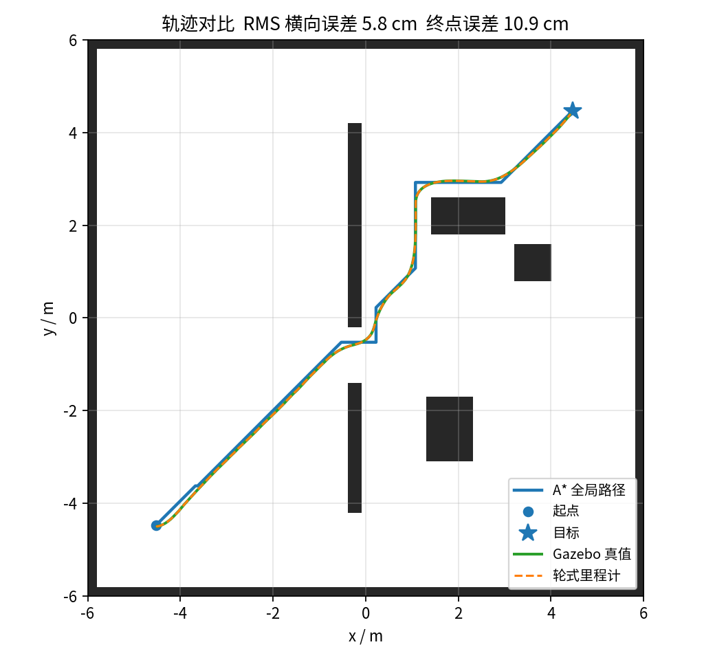
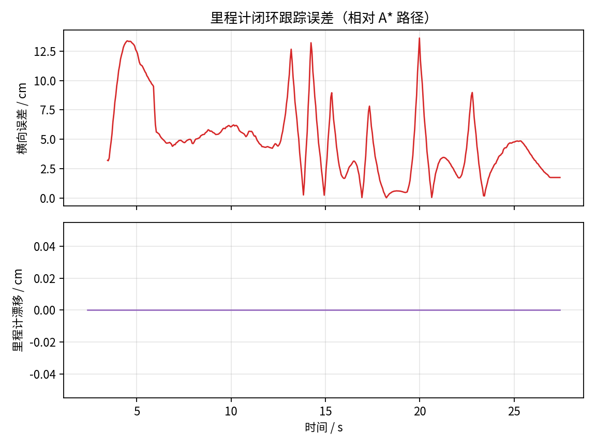
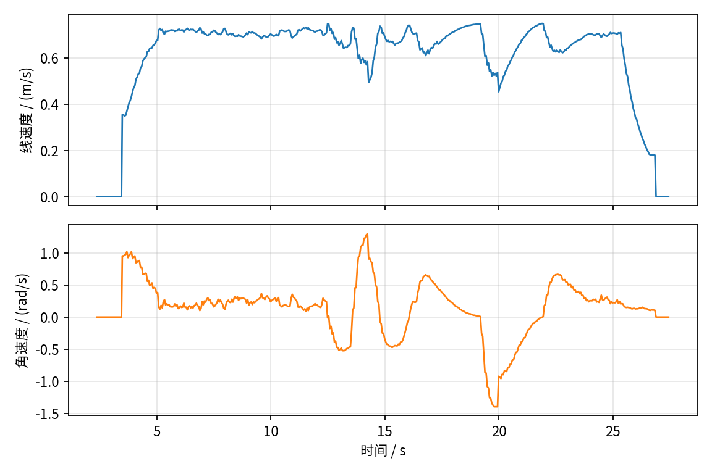

# 基于里程计反馈与 A* 算法的差速底盘静态全局路径规划

在 Gazebo 中搭建一个两轮差速底盘与静态障碍场景：先用 A* 在静态占用栅格上规划一条全局路径，再由纯追踪控制器仅依据轮式里程计（`/odom`）反馈跟踪路径，最终用 Gazebo 真值（`/ground_truth`）离线评估跟踪精度。实验数据、图表与 GIF 均由一次真实运行自动生成。

## 1. 与仓库已有模块的区别

仓库已有 [`ros2_pure_pursuit`](../ros2_pure_pursuit) 验证纯追踪路径跟踪与反应式避障，但参考路径由外部给定，没有全局规划，也不含 Gazebo 底盘模型。

本模块面向任务「基于里程计反馈与 A* 算法的差速底盘静态全局路径规划」，把静态栅格 A*、Gazebo 差速底盘与里程计闭环串成一条完整链路：

| 对比项 | `ros2_pure_pursuit` | 本模块 |
| --- | --- | --- |
| 全局规划 | 无（路径由外部给定） | 0.05 m 栅格 A* |
| 机器人模型 | 离线运动学 / 简化 ROS 2 节点 | Gazebo 物理差速底盘 |
| 规划起点 | — | `/odom` 轮式里程计实时位姿 |
| 路径执行 | 纯追踪闭环 | 纯追踪闭环（30 Hz） |
| 评价数据 | 跟踪误差 | 真值轨迹、横向误差、里程计漂移、速度指令 |

## 2. 运行环境

- Ubuntu 22.04 + ROS 2 Humble
- Gazebo Classic 11（`gazebo_ros`、`gazebo_plugins`）
- Python 3.10，依赖 `numpy`、`PyYAML`、`matplotlib`、`Pillow`
- 无显示器环境可直接运行（`gui:=false`，使用 `gzserver`）

## 3. 目录结构

```
diff_drive_astar_odom_nav/
├── diff_drive_astar_odom_nav/   # 节点与算法核心
│   ├── astar.py                 # 栅格 A*（纯 Python，可单测）
│   ├── control.py               # 纯追踪控制核心
│   ├── geometry.py              # 世界/地图的唯一几何来源
│   ├── map_utils.py             # PGM+YAML 地图读写、坐标转换
│   ├── map_publisher_node.py    # 发布静态 /map
│   ├── planner_node.py          # A* 规划节点
│   ├── tracker_node.py          # 里程计反馈跟踪节点
│   └── logger_node.py           # 真实运行数据记录
├── launch/main.launch.py        # 一键启动 Gazebo + 全部节点
├── urdf/diff_robot.urdf         # 差速底盘与编码器里程计
├── worlds/static_obstacles.world
├── maps/static_map.pgm|yaml     # 与 Gazebo 场景严格对齐的静态地图
├── tools/analyze.py             # 指标统计与图表生成
├── test/                        # pytest（不依赖 ROS/Gazebo）
├── results/                     # 真实运行数据与图表
└── main.py                      # 一键实验入口
```

## 4. 编译与运行

```bash
# 在仓库根目录
colcon build --packages-select diff_drive_astar_odom_nav
source install/setup.bash

# 一键运行：无界面启动 Gazebo，导航结束后自动生成真实数据图表
cd src/ground/diff_drive_astar_odom_nav
python3 main.py

# 有显示器的机器上可查看 Gazebo 画面
python3 main.py --gui
```

也可以使用标准 launch 方式（实验数据写入 `results/latest`）：

```bash
ros2 launch diff_drive_astar_odom_nav main.launch.py
ros2 launch diff_drive_astar_odom_nav main.launch.py gui:=true
```

重新生成静态地图与世界（修改 `geometry.py` 后必须执行，否则地图与场景会不一致）：

```bash
python3 -m diff_drive_astar_odom_nav.geometry .
```

## 5. 节点与话题

| 节点 | 订阅 | 发布 |
| --- | --- | --- |
| `static_map_publisher` | — | `/map`（`nav_msgs/OccupancyGrid`，transient local） |
| `astar_planner` | `/map`、`/odom`、`/goal_pose` | `/plan`（`nav_msgs/Path`）、`/plan_info`（JSON 字符串） |
| `odom_tracker` | `/plan`、`/odom` | `/cmd_vel`、`/nav_status` |
| `experiment_logger` | `/odom`、`/ground_truth`、`/plan`、`/cmd_vel`、`/nav_status` | `trajectory.csv`、`plan.csv`、`run_info.json` |

坐标变换：`odom -> base_link` 由 `gazebo_ros_diff_drive` 发布；`/ground_truth` 是 Gazebo 世界真值，仅用于评估，控制回路完全不使用它。

主要参数（`launch/main.launch.py`）：`robot_radius=0.22`、`inflation_extra=0.05`、`lookahead=0.55`、`v_max=0.75`、`goal_tolerance=0.12`，目标点默认 `(4.5, 4.5)`，起点 `(-4.5, -4.5)`。

## 6. 算法说明

### 6.1 静态地图

`geometry.py` 中的矩形列表同时生成 `worlds/static_obstacles.world` 与 `maps/static_map.pgm`（分辨率 0.05 m，240×240），保证规划地图与仿真障碍严格对齐。地图发布使用 transient local QoS，规划节点晚启动也不会漏掉地图。

### 6.2 A* 全局规划

- 8 邻接，直行代价 1、对角 √2，octile 启发式，`weight=1` 时最优；
- 严格穿角检查，避免路径擦过障碍角；
- 按机器人半径 0.22 m + 安全余量 0.05 m 对障碍做可分离膨胀；
- 起点取 `/odom` 当前位姿，目标附近若落在障碍内则用 BFS 修复到最近空闲格；
- 只规划一次（静态全局规划），不随位姿反复重规划。

### 6.3 里程计反馈与纯追踪

控制器只接收 `/odom`。在每个控制周期（30 Hz）：

1. 在全局路径上寻找距当前里程计位姿最近的点，并保证索引单调前进；
2. 沿路径前视 0.55 m 得到目标点，按 `w = v · 2y_local / L²` 计算角速度；
3. 依据前视方位角与距终点距离减速，速度限幅；到达 0.12 m 容差后停车。

### 6.4 指标定义

- 横向误差：真值位姿到 A* 折线的最短距离；
- 终点误差：末次真值位姿到路径终点距离；
- 里程计漂移：同一时间戳下 `/odom` 与 `/ground_truth` 的位姿差；
- 规划长度、实际行驶长度、耗时、最大速度指令。

## 7. 真实运行结果

一次完整运行（`results/run_01`）的关键指标：

| 指标 | 数值 |
| --- | --- |
| 运行状态 | SUCCEEDED |
| 规划路径长度 | 14.23 m |
| 实际行驶长度（Gazebo 真值） | 13.54 m |
| 总耗时 | 25.05 s |
| 终点位置误差 | 10.9 cm |
| 横向误差 RMS / 均值 / 最大 | 5.8 / 4.9 / 13.6 cm |
| 里程计漂移 最终 / RMS | 0.0 / 0.0 cm |
| 最大线速度指令 | 0.75 m/s |
| 路径点 / 采样行数 | 233 / 502 |

> 说明：Gazebo 的刚性轮地接触是理想模型，编码器里程计积分结果与真值几乎完全一致，因此漂移为 0；控制回路仍然只使用 `/odom`，真值仅用于事后评估。横向误差主要来自纯追踪在栅格折线拐角处的切角。









## 8. 测试

```bash
python3 -m pytest -q test
```

覆盖 A* 最优性/绕障/不可达/膨胀/穿角、纯追踪前视与转向方向、地图与场景几何一致性。

## 9. 复现实验数据

```bash
python3 main.py --out results/run_01
```

运行结束后 `tools/analyze.py` 会自动输出：

- `trajectory.csv`：20 Hz 的里程计、真值、指令、横向误差逐行记录；
- `plan.csv`：A* 全局路径点；
- `metrics.json` / `metrics.md`：指标；
- `trajectory.png`、`error.png`、`speed.png`、`trajectory.gif`。

`results/run_01` 中的数据来自本机 Gazebo Classic 11 的真实运行，没有手工修改或模拟生成。

## 10. 大模型使用声明

本模块的代码与文档在开发过程中使用了 AI 编程助手辅助生成。作者已逐行核对逻辑，并在 Gazebo 中实际运行验证；提交的实验数据与图表均由上述真实运行产生，未人工篡改。
