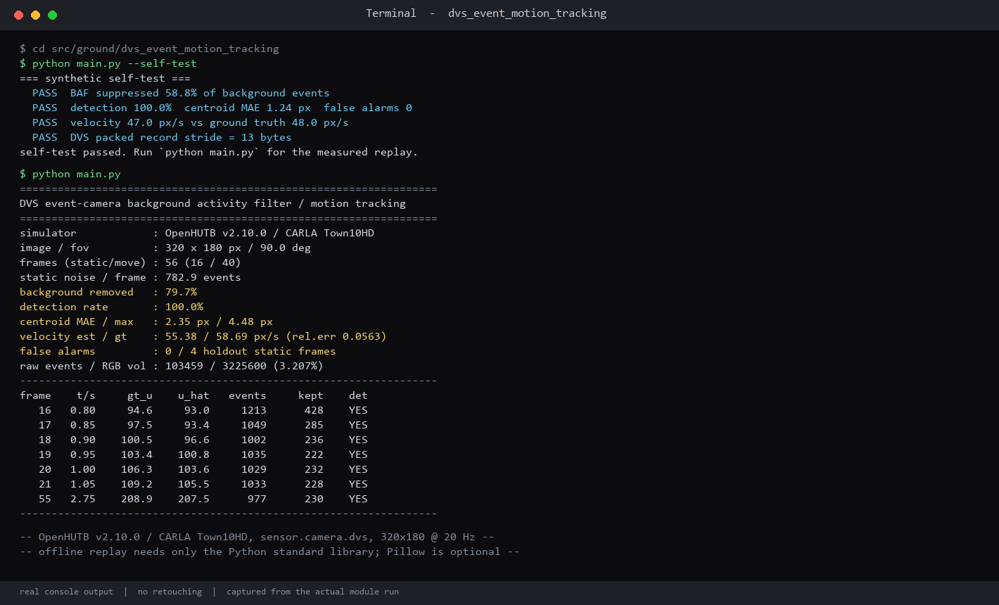
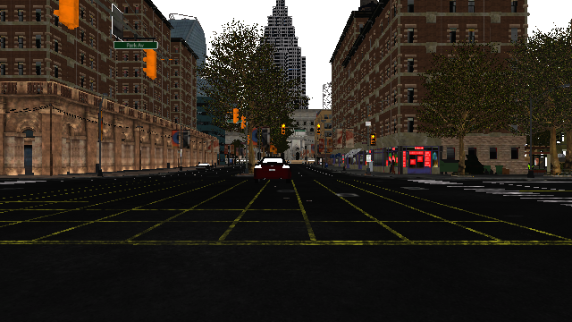
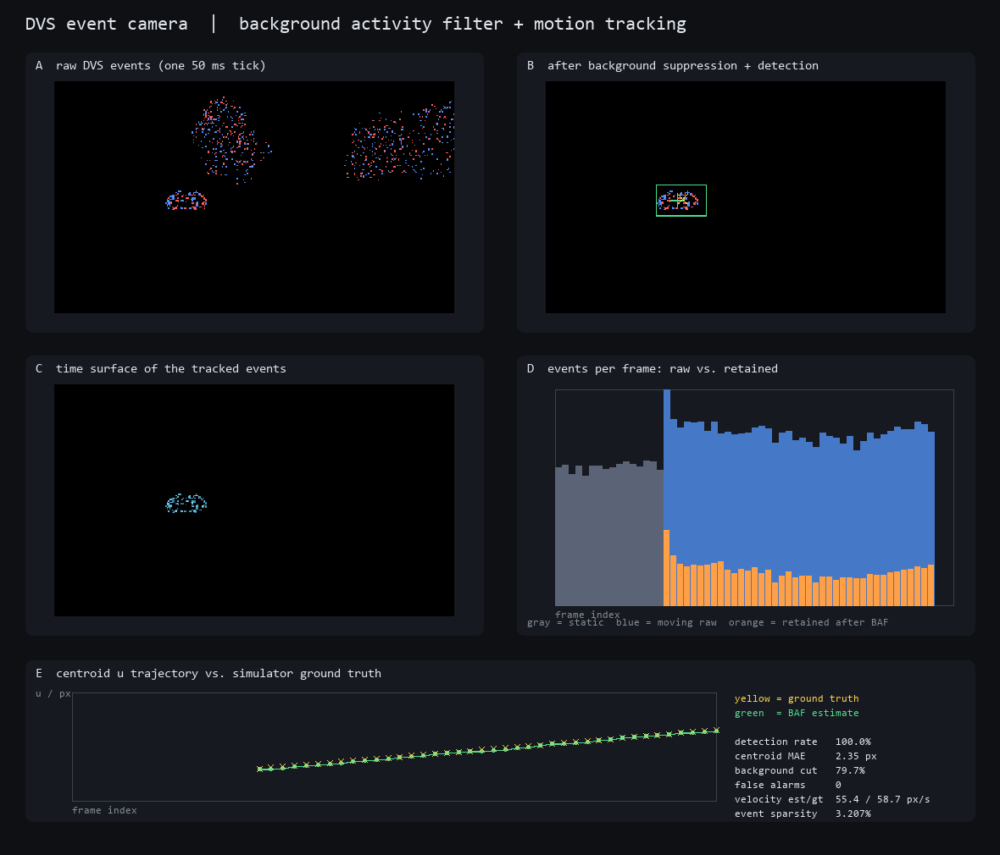

# DVS 事件相机背景活动抑制与运动目标跟踪

`dvs_event_motion_tracking`

## 为什么需要这个模块

仓库现有感知实验几乎都基于「固定帧率、整帧读出」的相机 / 激光雷达 / 毫米波雷达：静止背景被反复采样，真正有信息量的亮度变化反而淹没在整帧数据里。同时，上游 `master`（`2dd6fe9`）共约 288 个模块目录，`sensor.camera.dvs` 只出现在 3 个 ros-bridge 配置文件中，`DVSEvent` 只出现 1 次，「事件相机」出现 0 次——**没有任何一个独立模块真正使用过动态视觉传感器（DVS）**。

本模块因此补上一个此前空白的传感器维度：把 CARLA 的异步事件流直接拿来，先学习静态背景的事件活动（Background Activity Filter, BAF），再从残余事件中分割运动目标、重建时间面并估计像面速度。作业重点不是「再做一个避障」，而是回答事件相机的一个基础问题：**在相机静止但背景有大量纹理噪声时，怎样用很少的事件把运动目标分离出来，以及相对整帧 RGB 能省下多少数据**。

## 运行环境（已实际验证）

| 项目 | 版本 / 说明 |
| --- | --- |
| 操作系统 | Windows 11 |
| 仿真器 | OpenHUTB v2.10.0 / CARLA `Town10HD`，端口 2000 |
| 采集端 Python | 3.12.14，需可 `import carla`；用 `CARLA_PYTHON_PATH` 指向含 `carla` 包的目录 |
| 离线回放 Python | 3.13.12（也兼容 3.8+），**仅标准库** |
| 可选依赖 | Pillow（仅用于绘图；默认 `python main.py` 会出图，需 Pillow ≥ 9.1；系统自带 9.0.1 等旧版请加 `--no-plot` 跳过绘图，不影响指标计算） |
| 文档预览 | MkDocs 1.6.1 |

离线回放、自检、指标计算不依赖 `numpy`、`carla`、`matplotlib` 或 Pillow；只有 `--collect`（连真仿真）和绘图分别需要 `carla` 与 Pillow。

## 目录结构

```
src/ground/dvs_event_motion_tracking/
├── main.py            # 唯一入口：自检 / 离线回放 / 在线采集
├── dvs_core.py        # 纯标准库：BAF、连通域、质心、速度、时间面、合成自检
├── dvs_collect.py     # 可选：连接 CARLA 重新采集真实事件流与 RGB 截图
├── dvs_plot.py        # 可选：Pillow 生成五联运行效果图
├── dvs_events.json    # 实测数据集（56 帧，约 0.77 MB，同一固定抽样率）
├── README.md
└── data/              # 运行产生的 dvs_track.csv / dvs_metrics.json / event_analysis.png（被 .gitignore 忽略）
```

实验报告：[docs/ground/dvs_event_motion_tracking.md](../../../docs/ground/dvs_event_motion_tracking.md)

## 运行步骤

从仓库任意位置进入模块目录后执行：

```bash
cd src/ground/dvs_event_motion_tracking

# 1. 合成数据回归自检（不需要仿真器、不需要第三方库）
python main.py --self-test

# 2. 回放实测事件流，输出 CSV / JSON 指标并生成运行效果图
python main.py

# 3. 无 Pillow 环境下跳过绘图
python main.py --no-plot

# 4. 调整 BAF 参数做对照实验
python main.py --cell 8 --resid-k 2.0 --min-mass 40
```

`python main.py` 会打印完整指标表，并写出：

* `data/dvs_track.csv`：每帧真值 / 估计质心、事件数、保留事件数、是否检出；
* `data/dvs_metrics.json`：汇总指标与本次使用的参数；
* `data/event_analysis.png`：本次运行生成的五联效果图；`docs/img/dvs_event_motion_tracking/event_analysis.png` 是随仓库提交的静态示例图，运行不会覆盖它。

### 重新采集真实仿真数据（可选）

先启动 OpenHUTB / CARLA 服务端（Town10HD，端口 2000），再执行：

```bash
set CARLA_PYTHON_PATH=<包含 carla 包的目录>
python main.py --collect
```

采集脚本会清空遗留车辆与传感器，生成静止 ego + 前向 DVS 相机，预热 25 帧后采集 16 帧静态背景，再让目标车以 6 m/s 横向穿越视野并采集 40 帧；同时把一帧真实 RGB 画面保存为 `docs/img/dvs_event_motion_tracking/scene_rgb.png`。`--host` / `--port` 可改连接地址。

### 检查网页效果（提交 PR 前必做）

```bash
mkdocs serve
# 或旧版 MkDocs：mkdocs serve --livereload
```

MkDocs 1.6 的 `serve` 默认已启用 livereload，因此新版不需要显式加 `--livereload`（旧版才需要）。浏览器打开本模块页面，确认三张配图、公式与导航链接都能正常显示。

## 数据格式

CARLA `DVSEventArray.raw_data` 是紧凑排列的 13 字节事件记录：

```
x : uint16   y : uint16   t : int64   pol : bool     # struct "<HHq?"
```

`pol` 表示亮度变化方向（正 / 负）。为控制仓库体积，`dvs_events.json` 中每个事件存为 `[x, y, pol, dt8]`：`dt8` 是把帧内时间戳线性量化到 `0..255` 的结果，用来重建时间面；**每一帧统一使用固定步长 2 抽样**（`keep` 字段记录），这样各帧的网格事件数才可直接比较。原始事件总数记录在每帧的 `n` 字段中，用于数据量对比。

## 算法摘要

1. **背景建模**：把图像划成 8×8 像素网格，用前 12 帧静态数据求每个网格事件数的均值 `mu` 与标准差 `sigma`；后 4 帧静态数据留作留出集，专门用来统计误报。
2. **背景抑制**：对每帧计算残差 `cur - (mu + k*sigma)`，只保留超过 `max(3, mu + 2*sigma)` 的网格。
3. **目标分割**：8 邻域连通域合并，要求簇至少 3 个网格、残差质量至少 40，取质量最大的簇；按残差加权求质心并给出包围框。
4. **时间面**：对簇内事件按 `exp(-(t_end - t)/tau)` 计算指数衰减新近度，得到运动轨迹的时序表征。
5. **速度估计**：对最近 9 帧质心做最小二乘直线拟合，与仿真器投影得到的像面真值速度比较。
6. **真值**：采集时用相机外参把目标车包围盒中心投影到像面，写入每帧 `gt_u / gt_v`，全程不依赖人工标注。

## 实测结果（OpenHUTB / CARLA Town10HD）

| 指标 | 数值 |
| --- | --- |
| 帧数（静态 / 运动） | 56（16 / 40） |
| 静态背景噪声 | 782.9 事件 / 帧 |
| 背景事件抑制率 | 79.7% |
| 运动帧检出率 | 100.0% |
| 质心误差 MAE / 最大 | 2.35 px / 4.48 px |
| 像面速度估计 / 真值 | 55.38 / 58.69 px/s（相对误差 5.6%） |
| 留出静态帧误报 | 0 / 4 |
| 事件总量 / 等价 RGB 像素量 | 103,459 / 3,225,600（3.21%） |

合成自检（无需仿真器）另给出：检出率 100%、质心 MAE 1.24 px、误报 0、背景抑制 58.8%。

## 运行效果截图







## 局限与说明

* ego 车静止、目标仅横向匀速运动；未覆盖相机自身运动、纵向接近、遮挡与多目标交叉。相机运动时需要先做自运动补偿，否则静态背景会整体产生事件。
* 背景模型与相机视点绑定，换场景 / 换天气需要重新采集静态帧学习 `mu / sigma`。
* CARLA 的 DVS 是仿真传感器，不等价于真实神经形态芯片的噪声特性与微秒级时间分辨率。
* 事件稀疏度 3.21% 是相对「每帧整幅 RGB 像素」的比较，不含 RGB 压缩、传输协议开销，仅用于说明量级。
* 合并前仍需至少一名其他人在另一台机器按本文档完整运行并确认，作者自测不能替代。

> 说明：代码编写与文档整理过程中使用了大模型辅助；场景设计、仿真运行、数据采集、结果核对由本人完成，文责自负。
