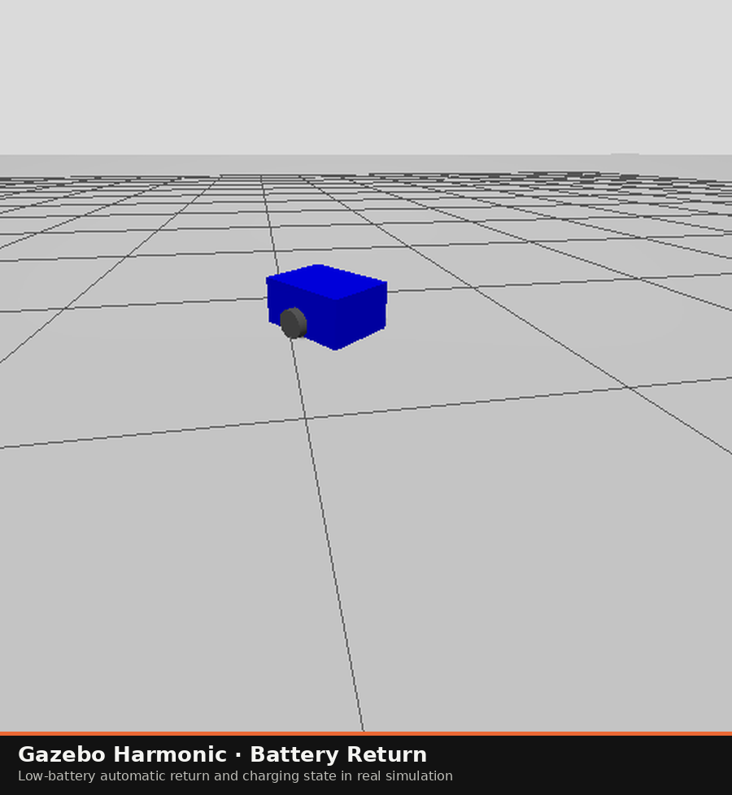
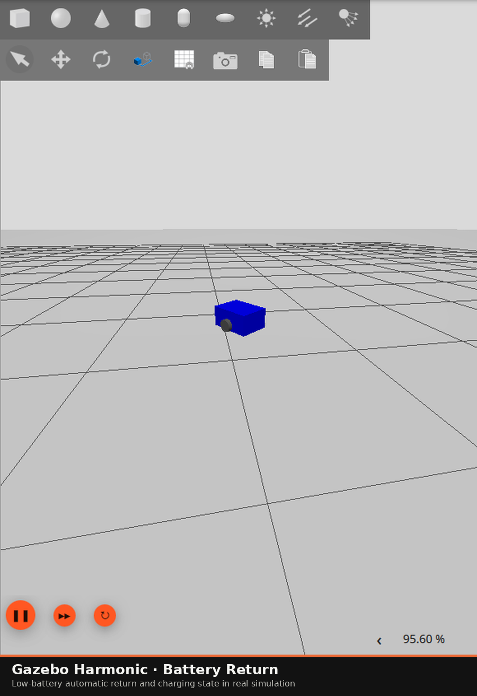

# Gazebo 差速小车键盘控制与电量管理/低电量返航

模拟电池消耗，电量低于阈值后自动返回充电点，到点进入充电状态，电量恢复后回到手动模式。

## 运行环境

- Ubuntu 24.04、ROS 2 Jazzy、Gazebo Harmonic
- 依赖：`ros_gz_sim`、`ros_gz_bridge`、`ros2_control`、`ros2_controllers`、`gz_ros2_control`、`robot_state_publisher`、`xacro`

```bash
sudo apt install ros-jazzy-ros-gz ros-jazzy-ros-gz-bridge \
  ros-jazzy-ros2-control ros-jazzy-ros2-controllers \
  ros-jazzy-gz-ros2-control ros-jazzy-robot-state-publisher ros-jazzy-xacro
```

## 快速运行

```bash
bash main.sh                 # 自动巡航
bash main.sh manual          # 仅启动仿真
bash main.sh battery # 本项目功能
```

无界面环境：

```bash
bash main.sh battery gz_args:='-r -s'
```

## 功能按键

| 按键 | 功能 |
| --- | --- |
| `s` / 空格 | 停止；返航中暂停返航 |
| `h` | 手动返回充电点 |
| `b` | 演示用，强制把电量降到阈值以下 |
| `+` / `-` | 调整线速度 |

## 实现要点

- `battery_teleop.py`：电量积分、低电量状态机、返航控制、充电和 `BatteryState` 发布。
- `controller_bridge.py`：把 `Twist /cmd_vel` 转成 `TwistStamped`，并转发 `/odom`。
- `main.sh battery`：后台启动仿真，前台运行键盘节点，退出时清理进程组。

## 实测结果

真实 Gazebo 运行：驶离充电点约 0.67 m 后强制低电量，自动返航并进入充电状态，电量从 6.3% 开始回升。

## 运行画面





## 参数与话题

完整参数表、话题/TF、算法公式、复现步骤和故障排查见 `docs/ground/gazebo_diff_drive_teleop.md`。

## 说明

代码与文档使用 AI 大模型辅助编写，已核对并确认，对提交内容负责。
