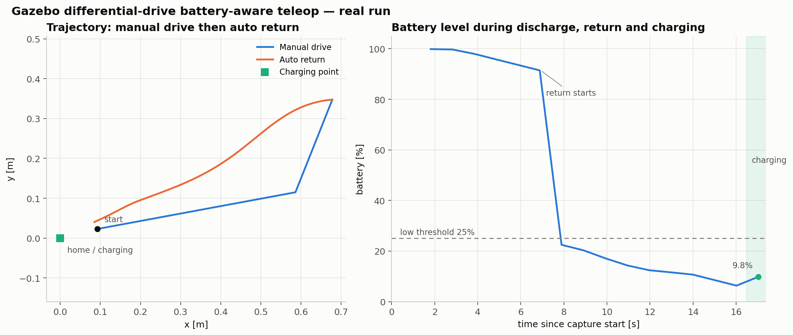
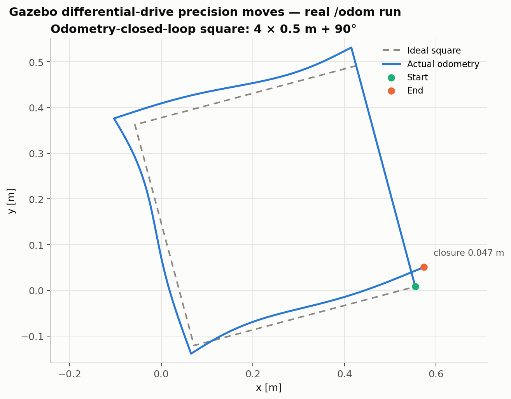
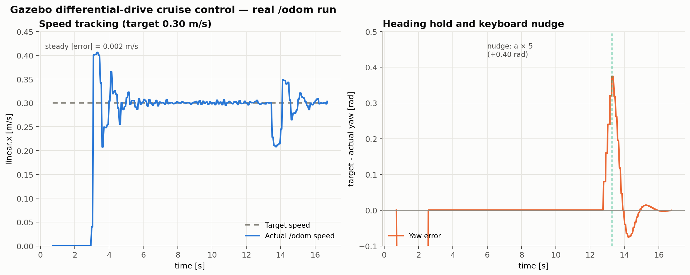

# Gazebo 差速小车键盘控制与示教录制/路径回放

记录键盘驾驶产生的 `/odom` 轨迹，再使用纯追踪控制器沿记录路径自动返回，支持循环往返和手动接管。

## 运行环境

- Ubuntu 24.04、ROS 2 Jazzy、Gazebo Harmonic
- 依赖：`ros_gz_sim`、`ros_gz_bridge`、`ros2_control`、`ros2_controllers`、`gz_ros2_control`、`robot_state_publisher`、`xacro`

```bash
sudo apt install ros-jazzy-ros-gz ros-jazzy-ros-gz-bridge \
  ros-jazzy-ros2-control ros-jazzy-ros2-controllers \
  ros-jazzy-gz-ros2-control ros-jazzy-robot-state-publisher ros-jazzy-xacro
```

## 快速运行

```bash
bash main.sh                 # 自动巡航
bash main.sh manual          # 仅启动仿真
bash main.sh teach # 本项目功能
```

无界面环境：

```bash
bash main.sh teach gz_args:='-r -s'
```

## 功能按键

| 按键 | 功能 |
| --- | --- |
| `r` | 开始 / 结束录制（重新开始会清空旧轨迹） |
| `p` | 开始 / 暂停回放 |
| `l` | 循环往返开关 |
| `c` | 清空轨迹 |
| `s` / 空格 | 停止；回放中暂停回放 |
| `+` / `-` | 调整线速度 |

## 实现要点

- `teach_replay.py`：键盘示教、按距离/角度采样 `/odom`、纯追踪闭环回放。
- `controller_bridge.py`：把 `Twist /cmd_vel` 转为控制器需要的 `TwistStamped`，并转发 `/odom`。
- `main.sh teach`：后台启动仿真，前台运行键盘节点，退出时清理进程组。

## 实测结果

真实 Gazebo 运行：39 个路径点，回放约 10.04 s，终点误差 0.110 m（阈值 0.12 m）；原模块回归测试 29 点、误差 0.118 m，均通过。

## 参数与话题

完整参数表、话题/TF、算法公式、复现步骤和故障排查见 `docs/ground/gazebo_diff_drive_teleop.md`。

## 说明

代码与文档使用 AI 大模型辅助编写，已核对并确认，对提交内容负责。

## 电量管理与低电量返航

`battery_teleop` 根据里程计实际速度模拟电量消耗，电量低于 25% 时自动返回充电点，到达后进入 `charging` 状态，电量恢复到 80% 后回到手动模式。支持 `h` 手动返航和 `b` 强制低电量演示。

```bash
bash main.sh battery
```



## 里程计闭环精确运动

`precision_moves` 用 `/odom` 闭环执行固定距离和固定角度动作：`1/2` 前进/后退 0.5 m，`3/4` 左右转 90°，`5` 转 180°，`6` 正方形演示。

```bash
bash main.sh precision
```



## 定速巡航与航向保持

`cruise_control` 用 `/odom` 闭环维持目标速度和目标航向。按 `c` 进入/退出巡航；巡航中 `a/d` 微调航向，`+/-` 调整目标速度。

```bash
bash main.sh cruise
```


