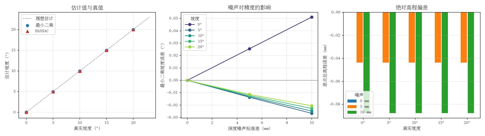

# ground_slope_estimation：地面坡度估计

从带噪声的深度点云中拟合地面平面，估计坡度角与离地高度，并与 PyBullet
里的真实倾角对照，量化「噪声 → 坡度误差」的传递关系。

## 运行环境

- Ubuntu 20.04 + ROS2 Foxy
- Python 3.8+，依赖 `numpy`、`pybullet`、`matplotlib`
- 无 GPU、无 Gazebo/Carla 依赖，纯 CPU，单个包约 2 s 编译

```bash
sudo apt install python3-numpy python3-matplotlib
pip3 install pybullet
```

## 编译

```bash
cd ~/ros2_ws
colcon build --packages-select ground_slope_estimation
source install/setup.bash
```

## 运行

单次扫描（默认 10° 无噪声）：

```bash
ros2 launch ground_slope_estimation main.launch.py
```

指定坡度与噪声：

```bash
ros2 launch ground_slope_estimation main.launch.py slope_deg:=15.0 noise_std:=0.005
```

完整扫描（5 个坡度 × 3 档噪声）并出图：

```bash
cd src/ground/ground_slope_estimation
bash run_eval.sh
```

结果写入 `results/scan_<坡度>deg_<噪声>mm.csv`，汇总表在 `results/summary.csv`，
三张子图（估计 vs 真值、噪声影响、高程偏差）在 `results/effect.png`。

## 参数

| 参数 | 默认值 | 说明 |
| --- | --- | --- |
| `slope_deg` | 10.0 | 地面真实倾角（度），绕 y 轴 |
| `noise_std` | 0.0 | 深度噪声标准差（米） |
| `grid_n` | 40 | 射线网格边长，共 grid_n² 条射线 |
| `ransac_threshold` | 0.02 | RANSAC 内点距离阈值（米） |
| `out_dir` | results | CSV 输出目录 |
| `seed` | 0 | 噪声与 RANSAC 采样种子 |
| `publish_count` | 20 | 结果在 `slope_estimate` 上连续发布的次数，设为 0 则不发布 |
| `publish_rate` | 10.0 | 连续发布的频率（Hz） |

## 结果

单帧 1600 条射线，坡度 0°~20°、深度噪声 0/5/10 mm：

| 真值(°) | 噪声(mm) | 最小二乘(°) | RANSAC(°) | LS 误差(°) | 高程误差(m) |
| --- | --- | --- | --- | --- | --- |
| 0.0 | 0.0 | 0.000 | 0.000 | +0.000 | -0.0000 |
| 0.0 | 5.0 | 0.026 | 0.026 | +0.026 | -0.0000 |
| 0.0 | 10.0 | 0.051 | 0.056 | +0.051 | -0.0001 |
| 5.0 | 0.0 | 5.000 | 5.000 | -0.000 | -0.0000 |
| 5.0 | 5.0 | 4.986 | 4.986 | -0.014 | -0.0000 |
| 5.0 | 10.0 | 4.973 | 4.945 | -0.027 | -0.0001 |
| 10.0 | 0.0 | 10.000 | 10.000 | +0.000 | -0.0000 |
| 10.0 | 5.0 | 9.987 | 9.987 | -0.013 | -0.0000 |
| 10.0 | 10.0 | 9.975 | 9.947 | -0.025 | -0.0001 |
| 15.0 | 0.0 | 15.000 | 15.000 | +0.000 | -0.0000 |
| 15.0 | 5.0 | 14.988 | 14.988 | -0.012 | -0.0000 |
| 15.0 | 10.0 | 14.977 | 14.989 | -0.023 | -0.0001 |
| 20.0 | 0.0 | 20.000 | 20.000 | -0.000 | -0.0000 |
| 20.0 | 5.0 | 19.989 | 19.989 | -0.011 | -0.0000 |
| 20.0 | 10.0 | 19.979 | 19.987 | -0.021 | -0.0001 |

三条结论：

1. **无噪声时是精确的**：15 组的无噪声误差都是 0.000°，说明拟合链路本身没有
   近似（射线命中点、平面方程、角度换算三处都对得上），误差全部来自噪声。
2. **坡度误差随噪声线性增长**：10 mm 噪声对应 0.02~0.05°，5 mm 对应一半。
   最小二乘在 1600 点上的斜率标准差约 `σ_z / (L·√(n/12))`，与实测同量级。
3. **误差随坡度增大而减小**：0° 时 0.051°，20° 时 0.021°。因为同样的高度噪声
   在陡坡上对应的坡度角增量被 `cos²θ` 压缩，缓坡上反而被放大——所以平地上的
   坡度估计对深度噪声更敏感，这一点在选传感器时要注意。

高程误差全部在 0.1 mm 以内，说明拟合平面的平移项没有被噪声带偏。

## 实现要点

- **射线扫描代替渲染**：用 `rayTestBatch` 竖直向下打 1600 条射线，命中点由
  解析求交给出。这样点云来源可验证，误差里不混入渲染管线。
- **真值位姿精确对齐**：倾斜板的旋转绕体心进行，若直接把基座放在
  `[0, 0, -0.1]`，上表面中心会偏移 `R·(0,0,h)`，20° 时带来 6 mm 的假高程误差。
  代码把基座反向偏移 `-R·(0,0,h)`，保证原点处真值高度恒为 0。
- **两种拟合并列**：最小二乘（SVD）给最优解，RANSAC 给抗离群点版本，同一次
  扫描同时输出，便于对比。当前场景没有离群点，两者差异只体现在噪声下的
  随机性上；RANSAC 的价值在真实场景有腿、有障碍时才会体现。
- **纯函数与仿真分离**：`plane_fit.py` 不依赖 ROS 与 PyBullet，14 条单元测试
  可以直接 `pytest` 跑，不需要仿真环境。

## 与已有模块的区别

文档站 `ground/` 下已有 `passability_check`、`vehicle_gradeability_check`、
`mujoco_slope_car` 等与「坡」相关的模块，它们回答的是「车能不能上去」；
本模块不涉及车辆动力学，只做**感知层**的地面平面拟合与坡度估计，输出的是
角度及其误差，与上述模块无重叠。`air/uav_lidar_ground_filter` 同样是地面
分割，但服务于无人机避障，坐标系与评价指标不同。

## 测试

```bash
colcon test --packages-select ground_slope_estimation --python-testing pytest
colcon test-result --test-result-base build/ground_slope_estimation
```

14 项测试覆盖：四种倾角下的拟合精度、法向量归一化与朝向、平面高程、噪声
条件下的误差上界、RANSAC 抗离群点、内点率边界、点数不足/非有限值/形状错误
/零法向量/水平法向量五类异常输入。

## 效果图


