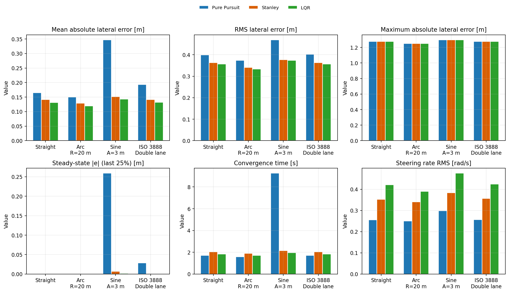
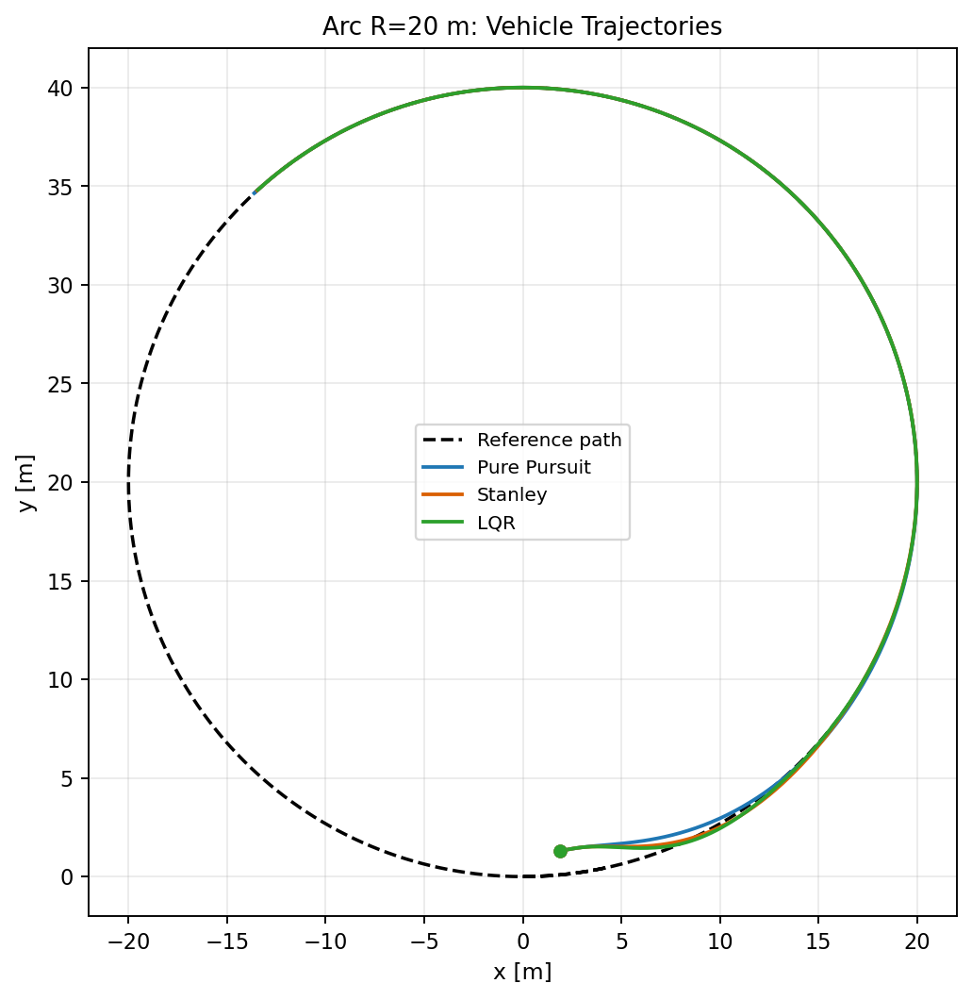
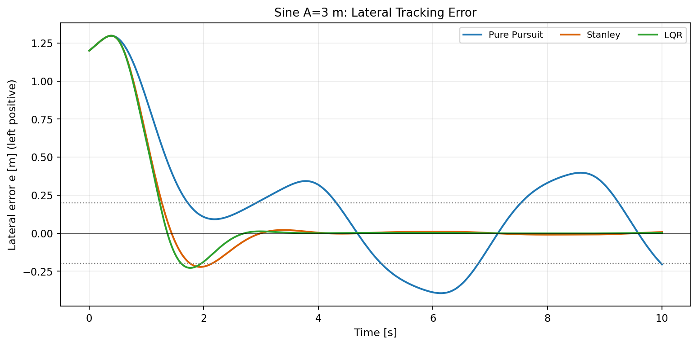

# 实验 5｜地面载具横向控制算法对比（纯跟踪 / Stanley / LQR）

在**统一车辆模型、统一参考轨迹、统一指标**下，对三种横向控制算法做定量对比。
不依赖 CARLA / Gazebo，只用 NumPy，没有 GPU、没有仿真器也能完整复现。

对应课程页面：
<https://openhutb.github.io/ros2/ground/lateral_control_benchmark/>

## 1. 三种算法

### 1.1 共用车辆模型（后轴参考点运动学自行车，RK4，dt = 0.02 s）

```
ẋ = v·cos ψ,   ẏ = v·sin ψ,   ψ̇ = v·tan δ / L
```

轴距 L = 2.7 m，转角上限 35°，转角速率上限 0.8 rad/s。曲率大的路段按
`v_max = sqrt(a_lat_max / |κ|)` 自动限速（a_lat_max = 4 m/s²）。

### 1.2 纯跟踪

```
Ld = Ld0 + k·v,   δ = atan2(2 L sin α, Ld)
```

几何法、无曲率先验；前视点自带阻尼，收敛快，但连续变曲率轨迹上残差大。

### 1.3 Stanley

```
δ = ψ_e + atan2(k·(-e), v) + atan(L·κ)
```

横向偏差 + 航向偏差 + 曲率前馈。控制点取**后轴**（与车辆模型参考点一致）；
切到前轴可复现经典写法（会留下可观的稳态偏差）。

### 1.4 运动学 LQRI（带横向偏差积分）

线性化对象是**实际被控的运动学模型**：

```
ė = v·ψ_e,   ψ̇_e = (v/L)·δ − v·κ,   ė_I = e
A = [[0, v, 0], [0, 0, v/L], [1, 0, 0]],   B = [[0], [v/L], [0]]
```

Riccati 方程用纯 NumPy 的 Hamiltonian 特征分解求解（`lqr_solver.py`），
反馈 `δ_fb = −K·[e, ψ_e, e_I]`，前馈 `atan(L·κ)`。

三个工程细节：

1. **增益随速度重算**——A、B 都含 v，定速增益换速会明显变差；
2. **误差进入反馈前限幅**（±0.5 m）——1.2 m 的初始偏差如果直接乘增益，
   转角会瞬间顶到 ±35° 饱和，把车“拐”出路面；
3. **积分抗饱和**——只在 0.01 m < |e| < 0.75 m 且未饱和时累积，大偏差阶段
   让已有积分缓慢泄放。

> 早期版本用**动力学误差模型**（含轮胎侧偏刚度）设计增益，却在**运动学模型**
> 上闭环，直道残差 5 m、最大偏差 10 m。换成与被控对象一致的模型后，直道
> 稳态误差直接降到 0.0000 m。

## 2. 评测方法（公平性设计）

| 维度 | 做法 |
| --- | --- |
| 车辆模型 | 三者共用同一模型与积分器 |
| 纵向速度 | 共用同一速度策略（巡航 + 曲率限速 + 一阶响应） |
| 初始条件 | 前方 2 m、横偏 1.2 m、航向偏 0.10 rad、初速 3 m/s |
| 指标 | 同一 `evaluate()` 计算 7 项指标 |
| 参数 | 三者都用各自较优参数 |

- **平均绝对横向偏差**：全时段平均；
- **RMS**：对大偏差更敏感；
- **稳态偏差**：末段 25% 的平均绝对偏差；
- **收敛时间**：首次进入 0.2 m 且此后一直保持的时刻；
- **离道占比**：|e| > 0.8 m 的采样占比；
- **转角变化率 RMS**：转向平顺性；
- **综合排名**：场景内各指标排名后跨场景平均。

## 3. 结果（巡航 8 m/s，运动学模型）

| 控制器 | 场景 | 平均\|e\| | RMS | 最大\|e\| | 稳态\|e\| | 收敛/s | 离道 | 转角变化率 RMS |
| --- | --- | --- | --- | --- | --- | --- | --- | --- |
| Pure Pursuit | 直线 | 0.1651 | 0.3996 | 1.2772 | 0.0000 | 1.72 | 0.106 | 0.2555 |
| Stanley | 直线 | 0.1411 | 0.3628 | 1.2770 | 0.0000 | 2.04 | 0.086 | 0.3528 |
| **LQR** | 直线 | **0.1316** | **0.3570** | 1.2770 | 0.0000 | 1.84 | 0.084 | 0.4213 |
| Pure Pursuit | 圆弧 R=20 | 0.1504 | 0.3737 | 1.2498 | 0.0000 | 1.58 | 0.094 | 0.2507 |
| Stanley | 圆弧 R=20 | 0.1290 | 0.3407 | 1.2497 | 0.0000 | 1.90 | 0.078 | 0.3407 |
| **LQR** | 圆弧 R=20 | **0.1193** | **0.3336** | 1.2497 | 0.0000 | 1.72 | 0.076 | 0.3904 |
| Pure Pursuit | 正弦 A=3 | 0.3470 | 0.4694 | 1.2981 | 0.2591 | 9.26 | 0.108 | 0.2990 |
| Stanley | 正弦 A=3 | 0.1516 | 0.3767 | 1.2980 | 0.0071 | 2.16 | 0.090 | 0.3833 |
| **LQR** | 正弦 A=3 | **0.1427** | **0.3735** | 1.2980 | **0.0015** | **1.96** | 0.090 | 0.4760 |
| Pure Pursuit | 双移线 | 0.1928 | 0.4020 | 1.2772 | 0.0286 | 1.72 | 0.106 | 0.2573 |
| Stanley | 双移线 | 0.1416 | 0.3628 | 1.2770 | 0.0008 | 2.04 | 0.086 | 0.3567 |
| **LQR** | 双移线 | **0.1317** | **0.3570** | 1.2770 | **0.0001** | 1.84 | 0.084 | 0.4243 |

综合排名（场景内 7 项指标平均名次）：

| 控制器 | 平均名次 |
| --- | --- |
| **LQR** | **1.482** |
| Stanley | 2.018 |
| Pure Pursuit | 2.500 |







## 4. 结论

1. **稳态精度**：LQR 在四个场景的稳态误差都在毫米级（0.0000 / 0.0000 /
   0.0015 / 0.0001 m）；Stanley 次之；纯跟踪在正弦连续变曲率上残差 0.259 m
   ——它没有曲率先验。
2. **收敛速度**：LQR 与纯跟踪相当（1.84 vs 1.72 s），Stanley 最慢（2.04 s）。
3. **平顺性**：纯跟踪最好（0.25 rad/s 量级），LQR 最“用力”（0.39–0.48 rad/s）
   ——这是状态反馈高增益的代价。
4. **最大偏差 1.27 m 由初始条件决定**：三种控制器都要先把 1.2 m 的横偏拉回来，
   这一项三者几乎一样，说明**初始瞬态不是区分算法的地方**，区分在稳态。
5. **实现细节 > 算法选择**：Stanley 从前轴换到后轴，圆弧稳态偏差从
   0.68 m 降到 0.0000 m；LQR 用错被控对象则直接发散。

## 5. 怎么跑

```bash
cd lateral_control_benchmark
python main.py --mode bench                  # 4 场景 × 3 控制器
python main.py --mode single --scenario sine # 单场景
python main.py --mode sweep                  # 5 档速度扫描
python main.py --mode bench --model dynamic  # 动力学模型对照
python -m pytest -q                          # 58 个单元测试
```

## 6. 文件结构

```
lateral_control_benchmark/
├── main.py                 # CLI：bench / single / sweep
├── src/
│   ├── vehicle.py          # 运动学 + 动力学自行车模型、转向执行器
│   ├── path.py             # 直线/圆弧/正弦/双移线 + 投影
│   ├── controllers.py      # 纯跟踪 / Stanley / 运动学 LQRI
│   ├── lqr_solver.py       # 纯 NumPy 的 CARE（Hamiltonian 特征分解）
│   ├── simulator.py        # 闭环仿真
│   ├── metrics.py          # 7 项指标 + 排名
│   └── plotting.py         # 图
├── results/                # bench.csv / ranking.csv / summary.txt / PNG
└── tests/test_controllers.py
```

## 7. 已知限制

- 主基准是**运动学**模型；`--model dynamic` 提供线性轮胎动力学对照，但没有做
  侧偏刚度辨识；
- 纵向速度由统一的曲率限速策略给出，不评测纵向控制；
- 初始条件固定为一组，没有做蒙特卡洛扰动统计；
- LQR 用线性化设计，大偏差时靠误差限幅与积分抗饱和兜底，不是全局最优。
