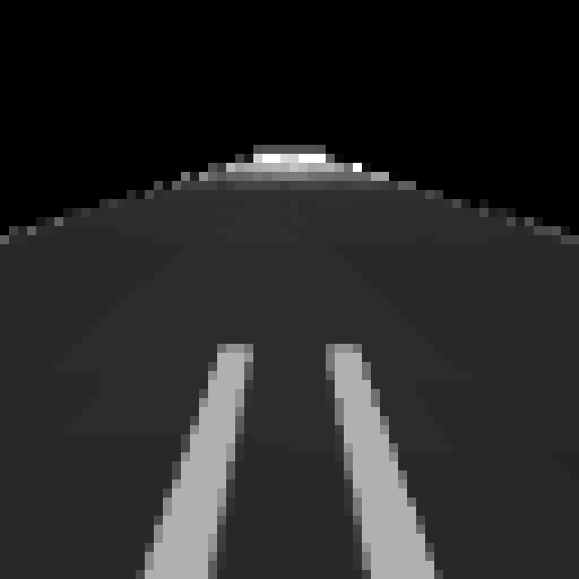

# MuJoCo 叉车相机引导的托盘接近与低速插入

本模块以 MuJoCo 3.12.0 仿真叉车沿直线接近托盘，车载前视相机采集托盘叉孔区域的灰度图，轻量神经网络输出驱动与制动指令，控制叉车低速插入。场景提供多个起始距离和固定随机种子评估。



## 环境

- Ubuntu 22.04
- ROS 2 Humble
- MuJoCo 3.12.0 或兼容版本
- Python 3、NumPy、Pillow

## 运行

从 ROS 2 工作空间构建并启动：

```bash
colcon build --packages-select mujoco_forklift_pallet_docking
source install/setup.bash
ros2 launch mujoco_forklift_pallet_docking main.launch.py
```

从仓库根目录直接运行：

```bash
python3 src/ground/mujoco_forklift_pallet_docking/main.py --mode evaluate
python3 src/ground/mujoco_forklift_pallet_docking/main.py --mode run --start-x -4 --speed 2
```

`evaluate` 模式默认载入随 ROS 包安装的网络权重，比较三个起始位置，输出叉齿插入深度、最终速度及是否过度插入，并可用 `--output /tmp/evaluation.json` 保存结果。`train` 模式报告留出集误差；指定 `--model-path` 时同时保存网络权重。

## Ubuntu 容器运行

在本目录构建包含 Ubuntu 22.04、ROS 2 Humble 和 MuJoCo 依赖的镜像：

```bash
docker build -t mujoco-forklift-pallet-docking .
docker run --rm mujoco-forklift-pallet-docking
```

容器启动后由 ROS 2 launch 执行三个起始距离的评估，并在终端输出 JSON 结果。

仓库页面提供[相机实况动图](../../../docs/img/ground/mujoco_forklift_pallet_docking.gif)和[多起点评估 JSON 记录](../../../docs/img/ground/mujoco_forklift_pallet_docking_results.json)。

## 算法

相机帧转换为 $16\times16$ 灰度像素向量 $\mathbf{x}$。多层感知机预测驱动和制动：

$$
\mathbf h=\tanh(W_1\mathbf{x}+\mathbf b_1),\qquad
\hat{\mathbf a}=\sigma(W_2\mathbf h+\mathbf b_2)
$$

监督目标按叉齿到托盘入口的距离和当前速度生成，距离小于制动距离时切换为制动。不同起点下的 MuJoCo 相机帧组成训练集，网络通过均方误差优化。

## 文件

- `model.xml`：叉车车体、叉齿、托盘、相机和驱动器。
- `mujoco_forklift_pallet_docking/policy.py`：图像策略网络和训练标签。
- `mujoco_forklift_pallet_docking/simulation.py`：MuJoCo 渲染、步进与场景评估。
- `main.py`：命令行入口。
- `launch/main.launch.py`：ROS 2 Humble 启动入口。
- `test/`：策略、相机帧与多起点停靠测试。
