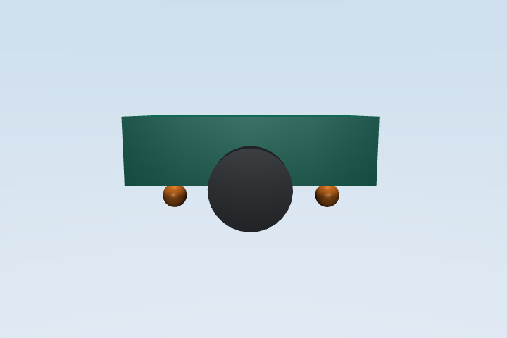

# MuJoCo 差速小车电机温升估计

本模块使用 MuJoCo 仿真差速小车左右轮驱动，以集总热模型估计左右电机的绕组温度，记录车体运动与电机温升。轮速目标限幅用于约束驱动指令；本模型不包含温度降额或速度相关散热。

## 运行环境

- Ubuntu 22.04
- ROS 2 Humble
- Python 3.10
- MuJoCo 3.2 或更高版本、NumPy、pytest

## Docker 构建与测试

从仓库根目录执行：

```bash
docker build -t mujoco-motor-thermal:humble -f src/ground/mujoco_motor_thermal_control/Dockerfile .
docker run --rm mujoco-motor-thermal:humble bash -lc "source /opt/ros/humble/setup.bash && source install/setup.bash && python3 -m pytest -q src/mujoco_motor_thermal_control/test && ros2 launch mujoco_motor_thermal_control main.launch.py steps:=12000 linear:=0.55 ambient:=25.0"
```

## 本地运行

```bash
python3 -m pip install "numpy<2" "mujoco>=3.2,<4" pytest
python3 -m pip install --no-deps ./src/ground/mujoco_motor_thermal_control
motor_thermal_main --steps 12000 --linear 0.55 --ambient 25.0
```

`--steps` 控制仿真步数，`--linear` 和 `--angular` 分别设置线速度与角速度指令，`--ambient` 设置环境温度。轮速目标限制在 ±24 rad/s（半径 0.07 m 对应轮缘速度 1.68 m/s）；比例响应系数 0.45 按 10 ms 步长用于跟随命令，驱动转矩限制为 ±2.5 Nm。运行结束后输出位姿、俯仰、速度及左右电机温度。

## ROS 2 启动

从仓库根目录执行：

```bash
source /opt/ros/humble/setup.bash
python3 -m pip install "numpy<2" "mujoco>=3.2,<4"
colcon build --merge-install --packages-select mujoco_motor_thermal_control
source install/setup.bash
ros2 launch mujoco_motor_thermal_control main.launch.py steps:=12000 linear:=0.55 angular:=0.0 ambient:=25.0
```

以上命令从仓库根目录执行。launch 从安装目录启动模块入口；默认仿真 120 秒，可通过 `steps`、`linear`、`angular`、`ambient` 参数配置运行。

固定 0.55 m/s 指令运行 120 秒时，仿真行驶约 53.72 m，左右绕组温度约 41.45 °C。温度来自本包一阶集总模型，不代表实车测量值。

## MuJoCo 模型初始帧

下图是 MuJoCo 可视化窗口的静态初始帧截图，叠加的状态为仿真起始时刻；运行命令本身输出数值，不生成截图。


