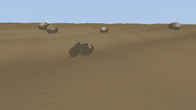
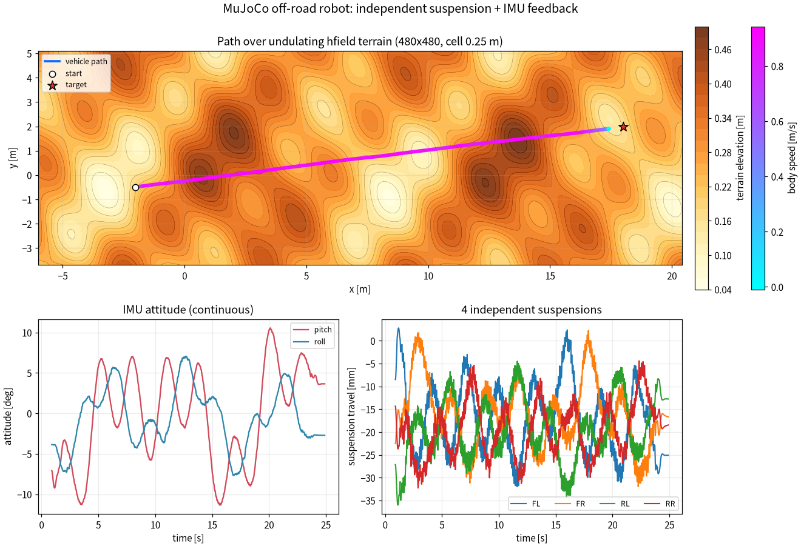

# mujoco_offroad_suspension_robot_noetic

四轮**独立悬架**越野小车 + **高度场起伏地形** + **IMU 姿态反馈**的 MuJoCo 仿真，
面向 Ubuntu 20.04 / ROS Noetic，一套物理与控制核心同时供 ROS 节点和离线无头渲染使用。




- 小车从 `(-2.0, -0.5)` 起步，滑移转向巡航 `19.58 m`，停进 `(18.0, 2.0)` 的旗标目标盘
- 四条滑柱悬架各自随地形伸缩，实测峰峰值 **27.8–34.7 mm**，画面里能看到摇臂与减振器在动
- 姿态由 IMU 姿态角（roll/pitch）实时反馈，崎岖段落自动降速，曲线**连续无台阶**




| 指标（24 s 全程，实测） | 数值 |
|---|---|
| 行驶路径长度 | **19.58 m** |
| 平均车体速度 | **0.816 m/s** |
| 距目标点最终距离 | **0.60 m**（min 0.597 m，停在目标盘内） |
| roll RMS / max | **3.66° / 7.67°** |
| pitch RMS / max | **5.88° / 11.34°** |
| 四悬架行程峰峰值 FL/FR/RL/RR | **34.7 / 34.2 / 31.5 / 27.8 mm** |
| 车轮最高转速 | **6.41 rad/s** |
| 最小离地间隙 | **0.071 m** |
| 地形高程范围 | **0.036 – 0.524 m**（480×480，单格 0.25 m，起伏约 ±0.25 m） |

表里每个数都取自 `scripts/main.py` 一次 24 s 运行（**1201 个采样点**，`sample_dt=0.02`）生成的
`docs/img/offline_metrics.json`。该文件是程序产物，**不入库**（见 `docs/img/.gitignore`），
按 §3 的命令重跑即可原地重新生成、与上表逐项对照。跑表的机器是
**Ubuntu 22.04.5 / Python 3.12.11 / MuJoCo 3.1.6 / numpy 1.26.4 / matplotlib 3.11.0**；
同机用 3.1.1 复跑，路径 19.5748 m、最终距离 0.60 m、roll/pitch RMS 3.66°/5.88°，
与本表四舍五入后一致，悬架峰峰值有 0.5 mm 级差异，因此表格统一取 3.1.6 的实测值。

入库的图只有三张：`docs/img/offroad_demo.gif`（1,047,642 B）、`docs/img/offline_curves.png`
（424,830 B）、`docs/img/offroad_noetic_viewer.png`（145,912 B），都是文档页配图。
其余运行产物（`offline_metrics.json`、`offline_log.csv`、关键帧 `offroad_demo_start/mid/end.png`、
逐帧日志 `offroad_demo_log.csv`、`offroad_demo.mp4`）由脚本运行时生成，已列在
`docs/img/.gitignore` 里，不入库。

---

## 1. 目录结构

```
mujoco_offroad_suspension_robot_noetic/
├── CMakeLists.txt              # catkin_install_python，不用依赖源码目录权限位
├── package.xml                 # format 2（ROS 1 catkin）
├── requirements.txt            # mujoco / numpy / matplotlib / pillow
├── LICENSE                     # MIT（与 package.xml <license> 一致）
├── launch/
│   └── offroad_sim.launch      # gui:=true|false，目标点可传参
├── models/
│   ├── suspension_robot.xml    # 由 gen_model.py 生成（含 hfield、整车、sensor）
│   ├── soil.png / rock.png     # 由 gen_model.py 生成的程序贴图（.gitignore 忽略，运行时自动重建）
├── scripts/
│   ├── main.py                 # 模块入口（规范要求）：默认纯物理仿真，--headless 走无头渲染
│   ├── terrain.py              # 解析式高程函数 + hfield 填充
│   ├── gen_model.py            # 生成 XML 与贴图
│   ├── attitude_controller.py  # 控制律 OffroadController + wrap_angle
│   ├── offroad_sim_core.py     # 仿真核心（reset/state/step/run/quat_to_euler）+ 输出目录解析
│   ├── plot_curves.py          # 三联图（纯物理与无头渲染共用，保证图注与图一致）
│   ├── mujoco_offroad_node.py  # ROS 节点（/cmd_vel → /odom /imu /suspension）
│   ├── physics_only_demo.py    # 纯物理仿真：出曲线图与指标（main.py 默认模式即转调它）
│   └── headless_demo.py        # 无头全流程：渲染→MP4/GIF/关键帧→曲线→指标
```

编译后的布局：入口脚本与库模块都装在 `devel/lib/<pkg>/`（`install` 空间是 `install/lib/<pkg>/`），
`models/`、`launch/` 在 `devel/share/<pkg>/`。四个入口脚本开头都有 `sys.path.insert(0, dirname(__file__))`，
所以同目录的库模块不依赖 `PYTHONPATH`；`offroad_sim_core` 找不到 `models/` 时会自动回退到
`../share/<pkg>/models`（也可用环境变量 `OFFROAD_MODEL_DIR` 指定），因此 `rosrun`/`roslaunch` 不要求先
`cd` 到源码目录。改了安装布局就要同步改这两处，CMakeLists 里也写了注释。

## 2. 环境准备（Ubuntu 20.04 + ROS Noetic）

```bash
# 1) ROS Noetic（若已装可跳过）
#    必须先导入 ros.asc 密钥，否则 apt update 会直接报 NO_PUBKEY
sudo apt install -y curl gnupg lsb-release
sudo curl -sSL https://raw.githubusercontent.com/ros/rosdistro/master/ros.asc \
     -o /usr/share/keyrings/ros-archive-keyring.gpg
echo "deb [signed-by=/usr/share/keyrings/ros-archive-keyring.gpg] http://packages.ros.org/ros/ubuntu focal main" \
  | sudo tee /etc/apt/sources.list.d/ros-latest.list
sudo apt update && sudo apt install -y ros-noetic-desktop-full python3-pip
source /opt/ros/noetic/setup.bash

# 2) MuJoCo（版本与实测一致，见 requirements.txt）
pip3 install -r requirements.txt

# 3) 编译工作空间
mkdir -p ~/catkin_ws/src && cd ~/catkin_ws/src
cp -r /path/to/mujoco_offroad_suspension_robot_noetic .
cd ~/catkin_ws && catkin_make && source devel/setup.bash

# 4) 校验模型能加载（不做渲染，先确认物理文件没坏）
python3 - <<'EOF'
import mujoco
m = mujoco.MjModel.from_xml_path("src/mujoco_offroad_suspension_robot_noetic/models/suspension_robot.xml")
print("nq=%d nu=%d nbody=%d" % (m.nq, m.nu, m.nbody))
EOF
```

> 云端/服务器无显示器时：`export MUJOCO_GL=egl`（无 GPU 用 `osmesa`，前提是装了 `libosmesa6`）。
> 虚拟机里 VMware 的 3D 加速建议打开，否则 `gui:=true` 会黑屏或极卡。

## 3. 运行

**方式 A：ROS + 实时 viewer（本机 20.04 用这个）**

```bash
roslaunch mujoco_offroad_suspension_robot_noetic offroad_sim.launch            # 默认：自动目标模式
roslaunch mujoco_offroad_suspension_robot_noetic offroad_sim.launch target_x:=10 target_y:=-2
```

> 默认就是自主行驶模式，小车会自己从起点开到旗标目标点。不需要键盘遥控。

**方式 B：生成物理曲线图（不需要 GPU，VMware 虚拟机里直接跑）**

只跑物理仿真，不渲染画面，直接出曲线图和数据。适合没有 EGL/GPU 的环境。

```bash
cd ~/catkin_ws/src/mujoco_offroad_suspension_robot_noetic

# 1) 首次运行必须先生成模型贴图：XML 里写的是 <texture file="soil.png"> / "rock.png"，
#    这两张图不入库，缺了会直接报 ValueError: resource not found: models/soil.png
python3 scripts/gen_model.py

# 2) 再跑纯物理仿真出曲线（main.py 是模块入口，默认就转调 physics_only_demo.py）
python3 scripts/main.py

# 也可以显式指定时长
python3 scripts/main.py --duration 12
```

> 需要动图/关键帧时走无头渲染（需 `export MUJOCO_GL=egl` 或 `osmesa`）：
>
> ```bash
> python3 scripts/main.py --headless --duration 24 --fps 16
> ```
>
> 仓库里那张 `docs/img/offroad_demo.gif` 就是这条命令的产物，完整参数为
> `--duration 24 --fps 16 --gif-width 320 --gif-fps 8 --gif-colors 32`：**320×180、195 帧、
> 120 ms/帧、总 24.0 s、1,047,642 B**（约 1.0 MB）。GIF 全片共用一套调色板，体积从 3.86 MB 降到 1.0 MB。
> GIF 是 MuJoCo 离屏画布（`mujoco.Renderer`）直出，底部叠 `t / v / roll / pitch` 状态条，
> 不含 viewer 的 File/Option 面板，也不是桌面录屏。

> `offroad_sim_core.py` 已内置兜底：检测到 `models/soil.png` / `rock.png` 缺失时会自动调用
> `gen_model.write_textures()` 补生成，所以漏跑第 1 步也能出结果；但改过地形、配色或车体参数后，
> 仍应显式执行 `gen_model.py` 重写 XML 与贴图（石头和旗标高度是按新地形重算的）。

输出到**仓库根** `docs/img/`（在源码树里跑时）：
- `offline_curves.png` — 三联图（轨迹叠等高线+速度着色 / 姿态 / 四悬架行程）
- `offline_log.csv` — 逐帧数据
- `offline_metrics.json` — 指标（路径长度、最终距离、roll/pitch RMS 等）

`offline_metrics.json` 与 `offline_log.csv` 是运行产物，已由 `docs/img/.gitignore` 忽略；
`offline_curves.png` 是文档配图，重跑会把仓库里那张原地更新。

`resolve_out_dir()` 从包目录向上最多 5 级，找同时存在 `docs/index.md` 与 `mkdocs.yml` 的仓库根，
命中就写它的 `docs/img`；装到工作空间后脚本在 `<ws>/lib/<pkg>/`，向上找不到仓库根，
按 **`--out` > `$OFFROAD_OUT_DIR` > 仓库根 `docs/img` > `~/.cache/<pkg>/output`** 逐个探测可写性，
默认退到 `~/.cache/<pkg>/output`；要固定位置就 `python3 scripts/main.py --out /tmp/run1`
（无头模式用 `--outdir`）。

**方式 C：重建模型与贴图**（改了地形或车体参数后必须先跑这条）

```bash
python3 scripts/gen_model.py     # 会覆盖 models/suspension_robot.xml、soil.png、rock.png
```

## 4. 话题接口

| 方向 | 话题 | 类型 | 说明 |
|---|---|---|---|
| 订阅 | `/cmd_vel` | `geometry_msgs/Twist` | `linear.x` m/s，`angular.z` rad/s（超过 0.3 s 没收到就交回自动目标） |
| 发布 | `/odom` | `nav_msgs/Odometry` | 世界系位姿 + 车体系线速度/偏航角速度 |
| 发布 | `/imu` | `sensor_msgs/Imu` | 姿态四元数 + 三轴角速度 + 三轴线加速度 |
| 发布 | `/suspension` | `sensor_msgs/JointState` | 四条滑柱行程（米），name 为 `susp_fl/susp_fr/susp_rl/susp_rr` |

| 参数 | 默认 | 说明 |
|---|---|---|
| `~gui` | true | false 时纯计算+发布，不建窗口（服务器用） |
| `~auto_target` | true | false 时完全听 `/cmd_vel` |
| `~target` / `~start` | `[18,2]` / `[-2,-0.5]` | 世界系目标/起点 |
| `~rate` | 50 | 发布频率 Hz，物理步数自动换算（`1/(rate*0.001)`） |

## 5. 模型与控制要点

**地形**（`terrain.py`）：不用随机种子，直接给解析高程，好处是能精确摆车、离线算石头/旗标高度：

```python
z = 0.28 + 0.130*sin(0.55x+0.30)*cos(0.42y) \
         + 0.075*sin(1.05x-0.80y+1.20) \
         + 0.040*sin(2.20x+1.60y+0.40)
```

- hfield `nrow=ncol=480`、`size="60 40 0.60 0.02"`，单格 0.25 m（**必须明显小于轴距，否则轮胎会"骑"在网格尖上抖**）
- MuJoCo 的 hfield 数据是**归一化**的：真实高程 = `base_z + data*size_z`，所以 `size` 第 4 个参数是基准高度，不能把米制高程直接塞进 `hfield_data`

**车体**：底盘 0.30×0.118×0.070 @ z=0.135（收窄抬高，避免和轮胎穿插），四角各一条 `slide` 滑柱
（`stiffness=380 damping=30 range=-0.11..0.09`）+ 摇臂 + 减振器外筒；轮胎半径 0.14/宽 0.062，
带 10 块胎纹 `lug`，`friction="1.45 0.02 0.18"`；四个轮子用 `velocity` 伺服（`kv=7, ctrlrange=-9..9`）。

**控制律**（`attitude_controller.py`）：

1. 航向误差 → 限幅偏航角速度（`kp=1.8`, `|w|≤0.85 rad/s`）→ 左右轮差速（滑移转向）
2. 崎岖路面按 `|roll|`/`|pitch|` 超软阈值降速（`roll_soft=0.10`, `pitch_soft=0.14`）
3. 纵向加速度限幅 `1.2 m/s²`，起步不打滑、到点不急刹点头
4. 距目标 `<0.72 m` 停车，近目标线速度按距离线性收敛

## 6. 云端跑通过程中修掉的坑（都是实测定位的）

| 现象 | 根因 | 修法 |
|---|---|---|
| 地形"设了起伏却看着是平的" | hfield 数据被归一化，米制值写进去等于失效 | 用 `base_z + data*size_z` 反算写入，`size` 第 4 参数给基准高度 |
| 画面下半部一大片"天空色空洞" | `<map znear="0.02">` 近裁剪面把近景地面切掉 | `znear=0.001 zfar=200` |
| 车体与轮胎互相穿透 | 底盘太宽太低 | 底盘收到 0.30 宽、抬到 0.135，接触对只剩轮胎-地形 |
| `<sensor>` 报 schema 错误 | 不能放在 body 内 | 提到 `worldbody` 之后的顶层 `<sensor>` |
| `<global skybox="sky">` 报错 | 非法属性 | 删掉，skybox 纹理自动作背景 |
| 地面像棋盘/织物还有摩尔纹 | 内置 checker 纹理 | 用 FFT 频域高斯模糊的周期噪声生成 512×512 无缝贴图，`texrepeat 34 34` |
| 二段 `run()` 不推进 | `t_end` 用了绝对时间 | 改成 `d.time + duration` |
| MP4 写不出来 | imageio 缺 ffmpeg 插件 | 直接把 RGB 帧喂系统 `ffmpeg`（libx264 / crf 23 / yuv420p），**尺寸必须偶数** |

## 7. 已知限制（如实写）

- **倾角差速补偿没有收益**：`tilt_assist_gain=0 / 0.35 / 0.70` 三组 A/B（同一台机器、24 s、同起点同目标，
  每档 1201 个采样点），roll RMS 3.66/3.67/3.66°、pitch RMS 5.88/5.85/5.87°、最终距离 0.60/0.60/0.60 m。
  所以默认 `0.0`，代码保留开关但**它不是姿态稳定器**，增益调大只会让轮速抖动、白白丢牵引力。
- ROS 节点与 `launch` 已在真实 Noetic 环境验证：ROS Noetic 1.17.0（`ros-noetic-ros-base` 1.5.0，
  RoboStack 的 Noetic 构建）+ Python 3.11，宿主 Ubuntu 22.04.5；`catkin_make` 通过，
  `roslaunch` 的 `gui:=false` / `gui:=true` 都跑过，节点 50 Hz 发布，约 40 s 后停在目标盘内
  （`/odom` 位置 17.432, 1.905，距目标约 0.58 m）。**尚未验证的是 Ubuntu 20.04 上 apt 安装的 Noetic**
  （本机为 22.04，无法直接加 focal 源）。
- `requirements.txt` 锁实测版本 `mujoco==3.1.6`；3.1.1 同机复跑最终距离与姿态 RMS 一致，
  悬架峰峰值有 0.5 mm 级差异，表格统一取 3.1.6 的实测值。
- 渲染分辨率受 XML 的 `offwidth/offheight` 限制（现在是 1280×720），超过会报错。

## 8. 大模型说明

使用豆包辅助编写代码与文档。

本作业的代码与文档在编写过程中使用了 AI 大模型辅助，本人已核对并确认提交内容，对提交内容负责。
