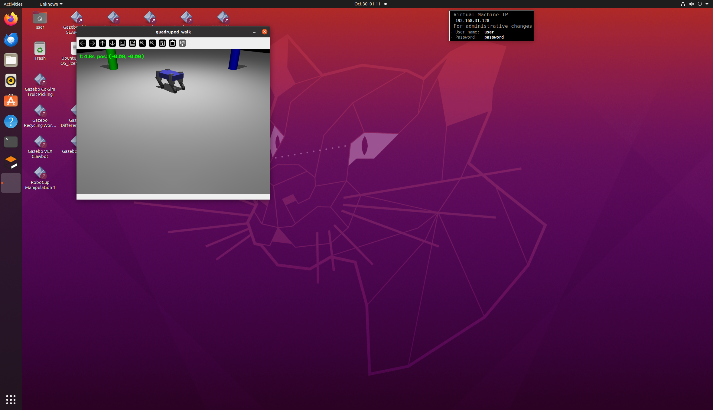

# MuJoCo 四足机器人 trot 步态仿真

基于 MuJoCo 的四足机器人对角步态（trot）开环仿真模块。

## 功能

- 简化四足机器人模型（躯干 + 4条腿，每腿2关节）
- 开环 trot 对角步态生成（FL+RR 一组，FR+RL 一组）
- 实时渲染显示，叠加位置信息
- 彩色参照物柱子，方便观察运动效果

## 运行环境

- Ubuntu 20.04
- Python 3.8
- MuJoCo 2.3.x
- OpenCV

## 运行步骤

```bash
cd src/ground/mujoco_quadruped_walk
pip3 install -r requirements.txt
python3 scripts/main.py
```

按 `Q` 退出。

## 效果图



## 文件结构

```
mujoco_quadruped_walk/
├── models/
│   └── quadruped.xml      # MuJoCo 机器人模型
├── scripts/
│   └── main.py             # 主程序：步态生成 + 渲染
├── README.md
├── requirements.txt
└── main.sh
```

## 步态说明

trot 是四足机器人最经典的对角步态：
- 前左腿（FL）和后右腿（RR）为同一相位
- 前右腿（FR）和后左腿（RL）为同一相位
- 两组相位差 180°，交替摆动

本模块使用正弦波生成髋部前后摆动和膝部弯曲的开环控制信号。
