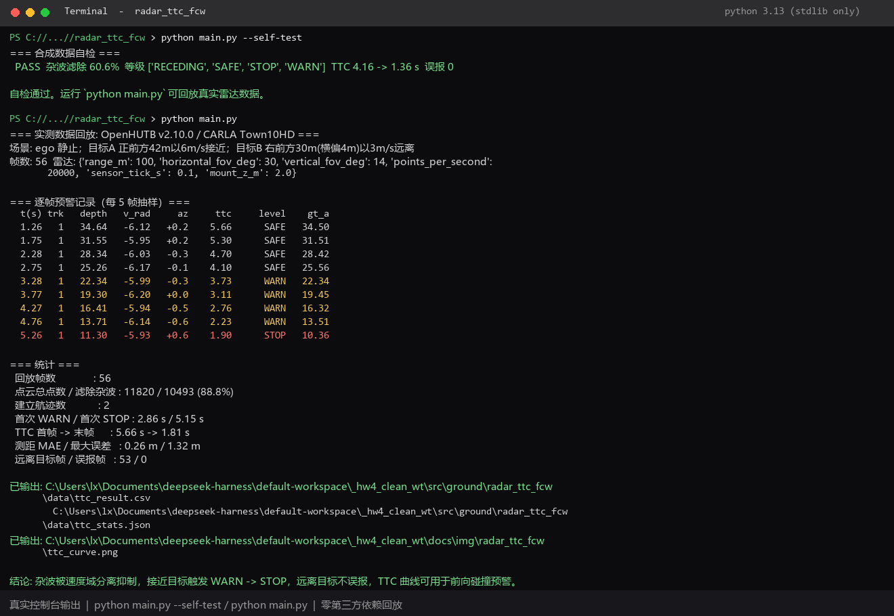

# radar_ttc_fcw — 毫米波雷达目标跟踪与前碰撞预警

基于 OpenHUTB / CARLA `sensor.other.radar`，用多普勒速度分离静止杂波，做多帧目标跟踪、TTC 估计与 `SAFE / WARN / STOP` 分级预警。

实验报告：[docs/ground/radar_ttc_fcw.md](../../../docs/ground/radar_ttc_fcw.md)
运行效果图：[docs/img/radar_ttc_fcw/ttc_curve.png](../../../docs/img/radar_ttc_fcw/ttc_curve.png)
终端运行截图：[docs/img/radar_ttc_fcw/run_screenshot.png](../../../docs/img/radar_ttc_fcw/run_screenshot.png)

## 运行环境

| 模式 | 依赖 |
|---|---|
| 离线回放（默认） | **Python 3.8+，仅标准库** |
| 合成自检 | **Python 3.8+，仅标准库** |
| 生成 PNG 曲线 | 可选 `Pillow`（缺失时自动跳过，不影响其余输出） |
| 在线演示 `--online` | 额外需要正在运行的 OpenHUTB v2.10.0 / CARLA，且 `carla` Python 模块可导入（`127.0.0.1:2000`） |

不需要 ROS2、不需要 numpy / matplotlib、不需要启动仿真，即可完整复现报告中的表格、统计与结论。

## 目录结构

```text
radar_ttc_fcw/
├── main.py                  # 入口：回放 / 自检 / 在线
├── radar_fcw.py             # 核心算法（纯标准库）
├── README.md
└── data/
    ├── radar_frames.json    # 实测数据集：56 帧 / 双目标 / 273 KB
    ├── ttc_result.csv       # 运行后生成：逐帧预警记录
    └── ttc_stats.json       # 运行后生成：统计摘要
```

## 运行步骤

```bash
cd src/ground/radar_ttc_fcw

# 1) 合成数据自检，验证算法链路（无需任何数据文件）
python main.py --self-test

# 2) 回放实测数据，输出表格 / CSV / PNG
python main.py

# 3) 可选：连接已启动的 OpenHUTB 仿真，实时打印 TTC 与预警等级
python main.py --online

# 4) 可选：环境没有 Pillow 时跳过绘图
python main.py --no-plot
```

其他参数：`--data PATH` 指定自定义数据集，`--out DIR` 指定 CSV/JSON 输出目录（PNG 固定输出到仓库 `docs/img/radar_ttc_fcw/`）。

提交 PR 前按仓库约定检查网页（MkDocs 1.6 的 `serve` 默认启用 livereload，旧版可显式加 `--livereload`）：

```bash
mkdocs serve
# 或旧版 MkDocs：mkdocs serve --livereload
```

## 输出说明

`python main.py` 会打印逐帧抽样表与统计摘要，并写出：

- `data/ttc_result.csv`：`t, track, depth, raw_depth, v_radial, az_deg, n_pts, closing_doppler, closing_slope, ttc, level, gt_a, gt_b`
- `data/ttc_stats.json`：杂波滤除率、首次 WARN/STOP 时刻、TTC 范围、测距误差、误报数
- `docs/img/radar_ttc_fcw/ttc_curve.png`：TTC 曲线与分级色带、测距 vs GT、双目标径向速度

## 运行截图



截图来自 `python main.py --self-test` 与 `python main.py` 的实际控制台输出，分别展示合成自检通过、56 帧实测回放的逐帧预警表以及统计摘要，可直接与下方结果和报告第 6 节核对。

实测结果（可直接核对报告第 6 节）：

```text
回放帧数 56 / 点云 11820 点 / 滤除杂波 10493 (88.8%)
首次 WARN 2.86 s，首次 STOP 5.15 s
TTC 5.66 -> 1.81 s，测距 MAE 0.26 m，远离目标 53 帧 / 误报 0
```

## 关键参数（`radar_fcw.py` 的 `DEFAULTS`）

| 参数 | 值 | 含义 |
|---|---|---|
| `v_dynamic` | 1.0 m/s | 速度域分离阈值，`|v| < 1` 视为静止杂波 |
| `az_limit` | 12.0° | 前向锥半角 |
| `cell` | 2.0 m | 聚类网格边长（8 邻域合并） |
| `gate` | 4.0 m | 多帧关联预测门限 |
| `max_tracks` | 8 | 同时保留的最大航迹数，抑制车辆启动抖动产生的假航迹 |
| `ttc_warn` / `ttc_stop` | 4.0 / 2.0 s | WARN / STOP 的 TTC 阈值 |
| `d_warn` / `d_stop` | 25.0 / 8.0 m | 距离兜底阈值 |
| `hysteresis` | 3 帧 | 降级迟滞，避免等级抖动 |
| `depth_bias` | 1.4 m | 车尾表面 → 车辆中心的标定偏差 |

## 数据集说明

`data/radar_frames.json` 采集自 OpenHUTB v2.10.0 / Town10HD，按 0.1 s 重采样共 56 帧，每帧含原始点云 `[v_radial(m/s), azimuth(deg), altitude(deg), depth(m)]` 与两个目标的 ground truth 距离。场景为 ego 静止、正前方目标以 6 m/s 接近、右前方目标以 3 m/s 远离，用于同时验证预警触发与不误报。

> 说明：代码编写与文档整理过程中使用了大模型辅助，仿真运行与数据采集由本人完成，文责自负。
