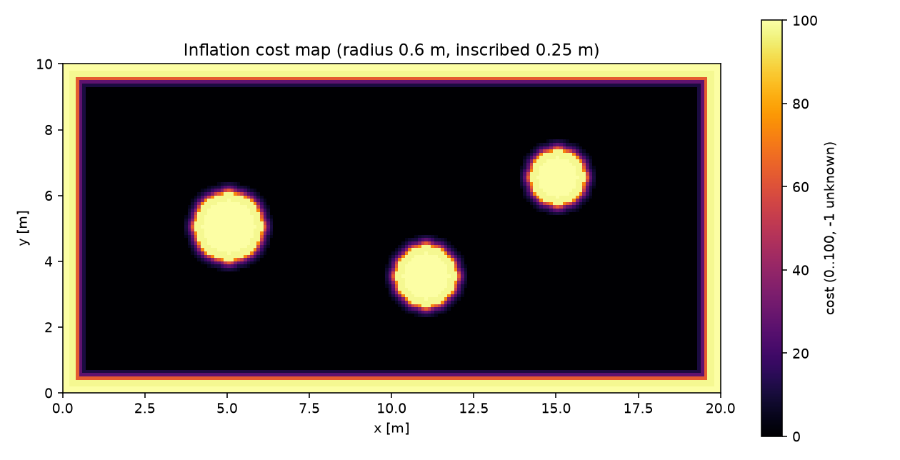

# ROS 2 代价地图障碍膨胀（精确欧氏距离）

把 `nav_msgs/OccupancyGrid` 转成 0–100 的代价值：障碍附近按精确欧氏距离衰减，
机器人体积内（inscribed radius）为 99，障碍本身为 100，未知保持 -1。
可作为 Nav2 costmap 的 0–100 输入；需在 Nav2 侧映射到 costmap_2d 语义（253/254）。

## 1. 方法

1. **精确距离变换**：对每行、每列做 Felzenszwalb–Huttenlocher 一维平方距离变换，
   得到每个格到最近障碍格的**精确欧氏距离**（不是 chamfer 近似）；
2. **代价值**：
   * 障碍格 `100`；
   * `dist <= inscribed_radius`：`99`；
   * `inscribed < dist <= inflation_radius`：
     `98 * exp(-cost_scaling * (dist - inscribed) / (inflation - inscribed))`；
   * 超出膨胀半径：`0`；
   * 未知格：`-1`。

## 2. 运行

```bash
cd ~/hutb_ws
colcon build --packages-select ros2_costmap_inflation
source install/setup.bash
ros2 launch ros2_costmap_inflation main_launch.py
```

| 方向 | 话题 | 类型 |
| --- | --- | --- |
| 订阅 | `/map` | `nav_msgs/OccupancyGrid` |
| 发布 | `/costmap` | `nav_msgs/OccupancyGrid`（0–100） |

参数在 `config/inflation_params.yaml`：`inflation_radius`、`inscribed_radius`、
`cost_scaling`。

## 3. 离线复现

```bash
cd src/ground/ros2_costmap_inflation
python3 -m unittest discover -s test -v   # 7 项
python3 -m ros2_costmap_inflation.sim
```

## 4. 结果

200 × 100 格、0.1 m 分辨率的房间 + 三个圆柱：

| 指标 | 数值 |
| --- | ---: |
| 障碍格（lethal） | 1643 |
| 膨胀格（1–99） | 3872 |
| 自由格（0） | 14485 |
| 距离最大误差 | **0.000 m** |



精确 EDT 的距离误差为 0，膨胀半径和代价值严格由几何距离决定；chamfer 近似在
斜向会有几厘米误差，本模块不用。

## 5. 局限

* 只做几何膨胀，不区分障碍类别/动力学；
* 未知格保持 -1，规划器需要决定是否当作障碍；
* 一次只处理一张静态地图，动态障碍需重发或分层；
* 200 × 100 的两次 1D EDT 在几十毫秒内；`summary()` 的暴力解析距离只用于离线校验，不用于在线。

## 6. 大模型声明

代码与文档在编写过程中使用了 AI 大模型辅助。作者已实际运行 7 项单元测试和
一张 200 × 100 离线地图，并对提交内容的正确性与完整性负全部责任。

