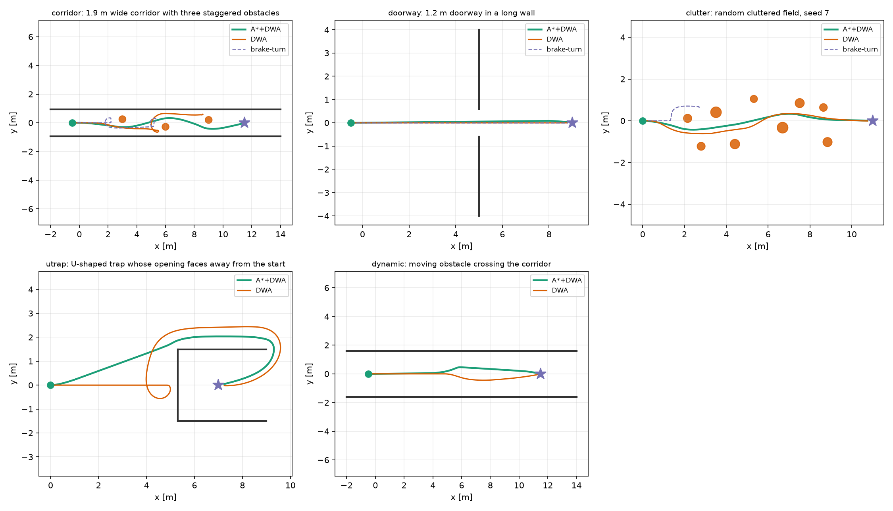

# ROS 2 差速机器人 A* 全局规划 + DWA 局部避障

`ros2_dwa_avoidance` 在 ROS 2 Humble 下实现两层导航：

* **A* 全局层**：用激光点构建世界坐标系下的局部占据栅格（未知区域视为可通行），
  在栅格上做 8 邻域 A* 搜索，并对路径做视线简化（string pulling）。
* **DWA 局部层**：在前视距离处取路径跟踪点，在动态窗口内采样 `(v, ω)`，
  对每条预测轨迹计算航向、贴近目标、障碍物间隙和速度四项代价，
  选代价最小的可行速度，输出 `/cmd_vel`。

纯 DWA 是局部方法：当目标正好在障碍物后面时，它无法判断该从哪一侧绕行，
容易在障碍物前来回摆动。A* 层给出绕行路线，DWA 层负责平滑、可执行地跟踪，
并对新出现的障碍物做反应式避让。

## 1. 运行环境

| 项目 | 版本 |
| --- | --- |
| 操作系统 | Ubuntu 20.04.6（实测）/ Ubuntu 22.04 |
| ROS | ROS 2 Foxy 0.9.2（实测）/ ROS 2 Humble（接口兼容） |
| Python | 3.8.10（实测）/ 3.10 |
| 依赖 | `rclpy`、`geometry_msgs`、`sensor_msgs`、`nav_msgs`、`numpy`、`matplotlib`（仅离线基准绘图） |

离线基准不依赖 ROS，可在任意安装了 Python 3.8+ 与 NumPy 的机器上运行。
本文档中的结果由 Windows 11 + Python 3.12.13 + NumPy 2.5.4 + Matplotlib 3.11.2 复现。

## 2. 编译

```bash
mkdir -p ~/hutb_ws/src
cp -r <本模块目录> ~/hutb_ws/src/ros2_dwa_avoidance
cd ~/hutb_ws
rosdep install --from-paths src --ignore-src -r -y
colcon build --packages-select ros2_dwa_avoidance
source install/setup.bash
```

## 3. 运行

### 3.1 启动节点

```bash
ros2 launch ros2_dwa_avoidance main_launch.py goal_x:=8.0 goal_y:=0.0 max_v:=0.8
```

或直接运行并覆盖参数：

```bash
ros2 run ros2_dwa_avoidance main_dwa --ros-args \
  -p goal_x:=8.0 -p goal_y:=0.0 -p max_v:=0.8
```

节点接口：

| 方向 | 话题 | 类型 |
| --- | --- | --- |
| 订阅 | `/scan` | `sensor_msgs/LaserScan` |
| 订阅 | `/odom` | `nav_msgs/Odometry` |
| 订阅 | `/goal_pose` | `geometry_msgs/PoseStamped`（可选，优先于参数目标） |
| 发布 | `/cmd_vel` | `geometry_msgs/Twist` |

若使用 `/goal_pose`，可在 RViz2 里用 “2D Goal Pose” 指定目标。
`/scan` 或 `/odom` 超过 `data_timeout`（默认 0.5 s）没有更新时，节点发布零速度并告警，
不会用过期数据做安全决策。

### 3.2 验证话题

```bash
ros2 topic hz /scan
ros2 topic hz /odom
ros2 topic echo /cmd_vel
ros2 topic echo /goal_pose
```

## 4. 离线基准（不需要 ROS）

```bash
cd src/ground/ros2_dwa_avoidance
python3 -m pip install -r requirements.txt
python3 -m ros2_dwa_avoidance.sim --no-figures   # 只写 results.json / sweep.json，不依赖 matplotlib
python3 -m ros2_dwa_avoidance.sim                # 完整运行，额外生成 figures/
python3 -m unittest discover -s test -v          # 18 项单元测试
```

`--no-figures` 会把 `results.json` 和 `sweep.json` 写完后跳过绘图，适合只装了 NumPy 的机器；
`test/ros_integration_manual.py` 文件名不匹配 `test*.py`，**不在 18 项单测内**，需要按第 6 节手动运行。

## 5. 参数

| 参数 | 默认值 | 说明 |
| --- | --- | --- |
| `max_v` / `max_w` | 0.8 / 1.8 | 线速度、角速度上限 |
| `max_acc_v` / `max_acc_w` | 1.2 / 3.0 | 加速度上限，决定动态窗口 |
| `predict_time` | 1.5 | 轨迹预测时长（s） |
| `robot_radius` | 0.22 | 机器人外接半径（m） |
| `safety_margin` | 0.08 | 规划额外保留的间隙（m） |
| `heading_weight` | 0.60 | 航向代价权重 |
| `velocity_weight` | 1.50 | 速度代价权重 |
| `clearance_weight` | 0.60 | 障碍物间隙代价权重 |
| `clearance_norm` | 0.70 | 间隙代价归一化距离（m） |
| `lookahead` | 1.20 | A* 路径跟踪前视距离（m） |
| `replan_period` | 1.00 | A* 重规划周期（s） |
| `map_half_size` | 10.00 | 滚动栅格半边长（m） |
| `control_rate` | 10.0 | 控制频率（Hz）；DWA 的 `dt = 1/control_rate` |
| `laser_x` / `laser_y` | 0.0 / 0.0 | 激光在 base 系下的安装偏移（m） |
| `publish_tf` | true | 是否发布 `odom→base_link`；底盘已发布时设为 false |

完整参数见 [`config/dwa_params.yaml`](config/dwa_params.yaml)。

## 6. 验证结果

5 个场景、三种控制器的闭环结果（成功 = 在超时前到达目标且无碰撞）：

| 场景 | A*+DWA | 纯 DWA | 反应式 brake-turn |
| --- | --- | --- | --- |
| 1.9 m 窄走廊 | **成功 21.2 s** | 超时 60 s | 超时 60 s |
| 1.2 m 门洞 | **成功 14.2 s** | 成功 13.4 s | 成功 17.1 s |
| 随机障碍场 | **成功 19.2 s** | 成功 15.6 s | 超时 60 s |
| U 形陷阱 | **成功 23.3 s** | 成功 29.3 s | — |
| 动态横穿障碍 | **成功 21.6 s** | 成功 16.6 s | — |

A*+DWA 5/5 成功，纯 DWA 4/5，反应式基线 1/3。纯 DWA 在窄走廊中仍会卡死；
在 U 形陷阱中它依靠“低速停滞时朝自由侧旋转”的恢复行为勉强脱困，
但比 A* 版本多花 6 s、多走 4.7 m。A* 层在门洞、障碍场和动态场景中比纯 DWA
慢 1–3 s（绕行与保守跟踪的代价），换来的是窄走廊中的通过能力和更短的绕行路径。
最小离障距离 0.30–1.14 m。注意 0.30 m 正是 `robot_radius(0.22)+safety_margin(0.08)`
的规划阈值；主基准中纯 DWA 有 3 个成功回合分别停在 0.300/0.301/0.302 m，
是“贴着阈值通过”而不是独立的安全裕度证据。#1079 的贴边比例（密度 13 时纯 DWA 100%）
进一步印证了这一点。



### ROS 2 节点实测（Ubuntu 20.04 + Foxy）

* `colcon build --packages-select ros2_dwa_avoidance`：通过；
* `python3 -m unittest discover -s test -v`：18 项通过（不含 ROS 闭环测试）；
* `test/ros_integration_manual.py` 发布 `/scan`（180 束）与 `/odom`，节点发布 `/cmd_vel`，
  2.5 m 走廊场景本机两次 20.3 s / 26.1 s 到达，最小间隙 0.30–0.34 m，无碰撞；
  另一位同学在 Humble 上复现为 18.7 s / 18.9 s（同场景、path 11.91 m）。
  **完成时间受机器调度影响可达 ±30%，不宜当作算法差异的验收基线。**

参数扫描（`predict_time` 5 档 × `max_v` 3 档 × 3 个场景，共 **45 次**；
下表的平均时间按三个场景取平均，成功率 3/3）：

| predict_time | 平均完成时间（v_max=0.8） | 成功率 |
| --- | --- | --- |
| 1.0 s | 15.1 s | 3/3 |
| 1.5 s | 18.2 s | 3/3 |
| 2.0 s | 25.1 s | 3/3 |
| 2.5 s | 31.7 s | 3/3 |
| 3.0 s | 39.0 s | 3/3 |

在已有 A* 路线的前提下，缩短预测时域能显著提高通行速度，成功率不降；
时域过长会让 DWA 过度保守。完整数据见 `sweep.json`。

## 7. 大模型声明

本模块的代码、实验脚本与文档在编写过程中使用了 AI 大模型辅助。
作者已在离线仿真中实际运行全部基准与单元测试，并在 Ubuntu 20.04 + ROS 2 Foxy
下完成 `colcon build`、单元测试与 `/scan`+`/odom`→`/cmd_vel` 闭环运行；
对提交内容的正确性与完整性负全部责任。

