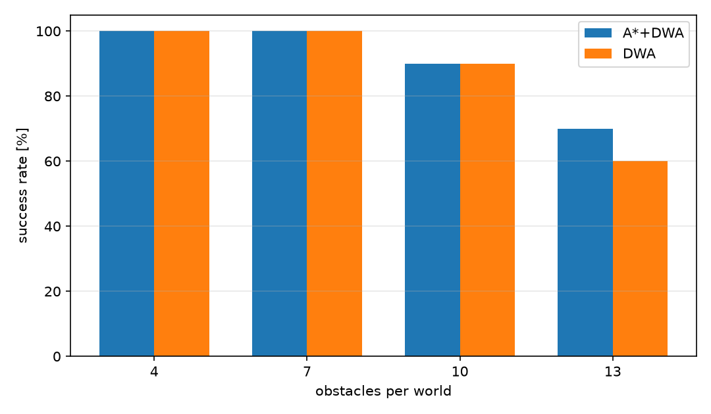
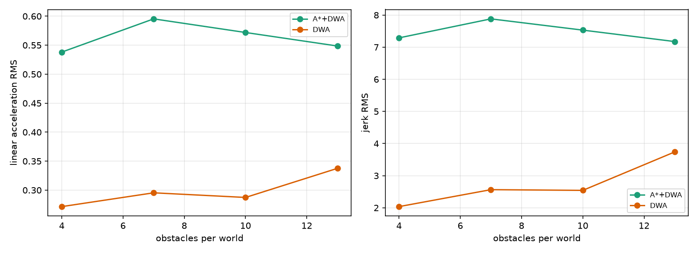

# ROS 2 DWA 局部规划器随机场景压力测试与舒适性评价

本模块不重复实现规划器，而是在 `ros2_dwa_avoidance`（A* 全局路线 + DWA 局部避障）
之上做**随机场景压力测试**：

* 生成 40 个随机障碍世界（4/7/10/13 个圆柱，每个密度 10 个世界），
  用真值 A* 保证每个世界都存在可行路径；
* 在同一批世界上对比 **A\*+DWA** 与 **纯 DWA**；
* 统计成功率、完成时间、路径长度、最小离障距离，以及**加速度 RMS / jerk RMS**
  两项舒适性指标；
* 输出 `results.json`、已提交的 `results/summary.json`（分组汇总）和三张图。

> 依赖关系：本模块通过 `exec_depend` 依赖 `ros2_dwa_avoidance`，
> 依赖 `ros2_dwa_avoidance`（#1077，已合并到 master）。

## 1. 运行环境

| 项目 | 版本 |
| --- | --- |
| 离线基准 | Ubuntu 20.04.6 + Python 3.8.10 + NumPy 1.24.4；Windows + NumPy 2.5.4 下密度 7 的 A\*+DWA 为 22.43 s（表中为 21.53 s） |
| ROS 2 | Ubuntu 20.04.6 + ROS 2 Foxy 0.9.2（`ros2 launch` 验证） |
| 依赖 | `ros2_dwa_avoidance`、NumPy、Matplotlib、launch/launch_ros |

## 2. 编译与运行

```bash
# 两个包一起编译
cd ~/hutb_ws
colcon build --packages-select ros2_dwa_avoidance ros2_dwa_benchmark
source install/setup.bash

# 方式一：launch
ros2 launch ros2_dwa_benchmark main_launch.py worlds:=10

# 方式二：命令行（推荐，参数完整）
python3 -m ros2_dwa_benchmark.main_benchmark \
  --out results.json --figdir figures --worlds 10 --densities 4,7,10,13
```

直接跑源码时，把 `src/ground/ros2_dwa_avoidance` 加入 `PYTHONPATH` 即可。

## 3. 指标

| 指标 | 定义 |
| --- | --- |
| 成功率 | 在 60 s 内到达目标 0.25 m 内且无碰撞 |
| 时间* / 路径* | 成功回合的完成时间、累计路程 |
| 最小间隙! | 回合内机器人中心到障碍表面的最小距离 |
| 线性加速度 RMS! | $\sqrt{\mathrm{mean}((\Delta v/\Delta t)^2)}$ |
| jerk RMS! | $\sqrt{\mathrm{mean}((\Delta a/\Delta t)^2)}$ |
| 贴边比例 | 成功回合中最小间隙 ≤0.31 m（贴近 0.30 m 硬约束）的比例 |

带 `*` 的指标只在成功回合上统计；带 `!` 的指标在**全部回合**上统计
（失败回合按 60 s 超时计入），避免只挑成功样本。速度序列取实际下发的
`/cmd_vel`（已经过加速度限幅），jerk 反映机器人真正会经历的冲击。

世界生成时，真值 A* 栅格同时标记随机圆柱和走廊墙（`scenario.segments`），
只有起终点确实连通的世界才会被采用；因此高密度下不会出现“从墙外绕过去”的假可行世界。

## 4. 结果（40 个世界，80 次运行）

| 密度 | 控制器 | 成功率 | 时间* | 时间! | 间隙! | 加速度! | jerk! | 贴边% |
| ---: | --- | ---: | ---: | ---: | ---: | ---: | ---: | ---: |
| 4 | A\*+DWA | 100% | 19.09 s | 19.09 s | 0.347 m | 0.538 | 7.29 | 10.0 |
| 4 | 纯 DWA | 100% | 16.85 s | 16.85 s | 0.418 m | 0.272 | 2.04 | 20.0 |
| 7 | A\*+DWA | 100% | 21.53 s | 21.53 s | 0.315 m | 0.602 | 7.94 | 30.0 |
| 7 | 纯 DWA | 100% | 17.80 s | 17.80 s | 0.312 m | 0.295 | 2.56 | 60.0 |
| 10 | A\*+DWA | 90% | 23.63 s | 27.27 s | 0.314 m | 0.572 | 7.53 | 44.4 |
| 10 | 纯 DWA | 90% | 18.19 s | 22.37 s | 0.306 m | 0.287 | 2.54 | 77.8 |
| 13 | A\*+DWA | 70% | 23.23 s | 34.26 s | 0.310 m | 0.549 | 7.18 | 57.1 |
| 13 | 纯 DWA | 60% | 25.63 s | 39.38 s | 0.301 m | 0.337 | 3.73 | 100.0 |





结论：

1. 中低密度（4/7 个障碍）两者都 100% 成功，纯 DWA 快 12%–21%，
   且 jerk 只有 A\*+DWA 的 1/3 左右；
2. 密度 10 时成功率相同（90%），纯 DWA 仍快 23%、更平滑；
3. 密度 13 时 A\*+DWA 成功率 70%、纯 DWA 60%，成功回合的平均时间也更短
   （23.2 s vs 25.6 s）；更关键的是**贴边比例**：纯 DWA 的成功回合 100% 都贴着
   0.30 m 硬约束，A\*+DWA 只有 57%，说明 A* 路线在密集场景里保留了真实的安全余量，
   而纯 DWA 是“擦着约束通过”；
4. A\*+DWA 的加速度/jerk 在所有密度下都更高（jerk 约 1.9–3.5 倍），原因是
   A* 路线每秒重规划、前视点在拐角处切换，导致角速度反复修正。
   **全局路线层不是无条件有益的：它用舒适性换高密度下的通过率与间隙余量。**
5. 这组结果也说明 A\*+DWA 模块适合作为“高密度/窄通道”模式，
   开阔场景可退回纯 DWA，或对 A* 路径做平滑/前视点滤波后再跟踪。

## 5. 复现与测试

```bash
cd src/ground/ros2_dwa_benchmark
python3 -m unittest discover -s test -v   # 5 项
```

世界生成、指标计算和一次 1 世界的冒烟基准都在测试中覆盖。随机种子由
`1000 + density*100 + index` 决定，在同一环境（Ubuntu 20.04 + Python 3.8.10 +
NumPy 1.24.4）下结果可逐位复现。缺少 `ros2_dwa_avoidance` 时测试会**显式报错**，
不再整体 skip 造成“假通过”；冒烟测试用 `figdir=""` / `--no-figures` 跳过绘图，
没有 matplotlib 也能跑。

另外，在 Ubuntu 20.04 + ROS 2 Foxy（Python 3.8）中用 `--no-figures` 跑通了
4 个密度 × 1 世界的冒烟基准（8 次运行，退出码 0）。

> 依赖顺序：先合并/安装 #1077（`ros2_dwa_avoidance`），再合并本模块。

## 6. 大模型声明

代码与文档在编写过程中使用了 AI 大模型辅助。作者已实际运行 40 个随机世界、
80 次闭环基准和 5 项单元测试，对提交内容的正确性与完整性负全部责任。


