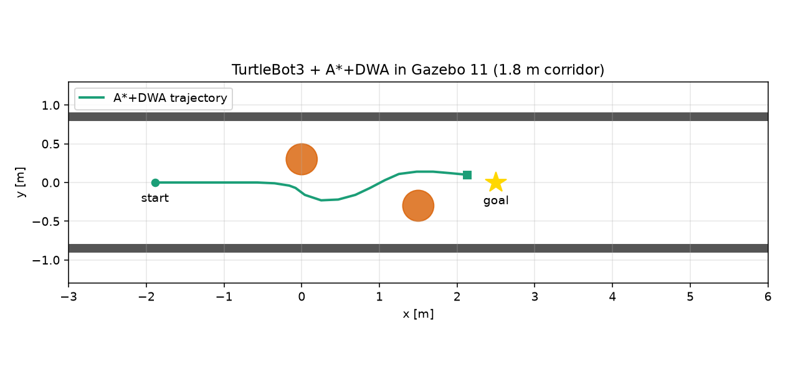

# ROS 2 DWA 的 Gazebo 11 + TurtleBot3 三维验证

本模块把 `ros2_dwa_avoidance`（#1077）的 A* 全局路线 + DWA 局部避障放进
**Gazebo 11 + TurtleBot3 burger** 的三维物理世界，验证真实的
`/scan` + `/odom` → `/cmd_vel` 闭环，而不是只在自写二维仿真里跑。

> 依赖：`ros2_dwa_avoidance`（#1077），需先合并/安装。
> 本模块只提供 launch、参数与验证脚本，不重复实现规划算法。

## 1. 环境

| 项目 | 版本 |
| --- | --- |
| 系统 | Ubuntu 20.04.6 |
| ROS | ROS 2 Foxy 0.9.2 |
| 仿真 | Gazebo 11.11 |
| 机器人 | TurtleBot3 burger（360° 激光，差速） |

安装：

```bash
sudo apt install gazebo11 ros-foxy-gazebo-ros-pkgs \
  ros-foxy-turtlebot3-gazebo ros-foxy-turtlebot3-description \
  ros-foxy-turtlebot3-msgs ros-foxy-xacro \
  ros-foxy-robot-state-publisher ros-foxy-joint-state-publisher
```

## 2. 编译与运行

```bash
cd ~/hutb_ws
colcon build --packages-select ros2_dwa_avoidance ros2_dwa_gazebo
source install/setup.bash

# 终端 1：启动 Gazebo 世界 + TurtleBot3 + DWA 节点
ros2 launch ros2_dwa_gazebo main_launch.py

# 终端 2：验证机器人是否真的动了、是否保持安全间隙
ros2 run ros2_dwa_gazebo verify_nav --ros-args \
  -p min_displacement:=3.0 -p timeout:=120.0
```

`verify_nav` 订阅 `/odom`、`/scan`、`/cmd_vel`，打印：

```text
RESULT {"success": true, "displacement_m": ..., "min_scan_m": ..., "max_cmd": ..., "elapsed_s": ...}
```

到达目标（默认 `(2.5, 0)`，容差 0.25 m）或位移 ≥ `min_displacement`（本次 3.0 m）、
收到过非零速度、激光最小距离 ≥ 0.12 m 时才退出码 0。`timeout` 与 `elapsed_s`
使用 `/odom` 的仿真时间，RTF < 1 时也不会误判超时；无 odom 时由节点初始化即开始
的墙钟兜底退出。

## 3. 参数

`launch/main_launch.py` 里给 TurtleBot3 的 DWA 参数：

| 参数 | 值 | 说明 |
| --- | --- | --- |
| `max_v` | 0.22 m/s | burger 的保守速度 |
| `max_w` | 1.0 rad/s | |
| `robot_radius` | 0.12 m | burger 外接半径约 0.105 m |
| `safety_margin` | 0.04 m | |
| `predict_time` | 1.5 s | |
| `goal_x/goal_y` | 2.5 / 0.0 | 起点 (-2.0, 0)，约 4.5 m |

## 4. 结果

Ubuntu 20.04 + ROS 2 Foxy + Gazebo 11（headless，`gzserver`）实跑：

```text
RESULT {"success": true, "displacement_m": 4.008, "min_scan_m": 0.132,
        "max_cmd": 0.858, "elapsed_s": 21.08, "goal_reached": true}
```

* 起点 `(-2.0, 0.0)`，目标 `(2.5, 0.0)`，1.8 m 走廊 + 两个圆柱；
* 机器人全程受 A*+DWA 控制，日志出现 `stop: goal reached`；
* 最小激光距离 **0.132 m**（burger 半径约 0.105 m），未碰撞；
* 多次运行的 min_scan 在 0.128–0.189 m，低于配置的 `robot_radius+safety_margin=0.16 m`，
  说明安全余量不能保证；`elapsed_s` 是 Gazebo 仿真时间，墙钟会受 RTF 影响。



## 5. 局限

* 只验证约 4.5 m（起点 -2.0 → 目标 2.5，位移 3.8 m）的直线到达，不是完整导航栈；
* 离线环境需保证 `GAZEBO_MODEL_PATH` 包含 `/usr/share/gazebo-11/models`，
  并设 `GAZEBO_MODEL_DATABASE_URI=`，否则 ground_plane 找不到或 gzserver 卡在在线模型库；
* TurtleBot3 burger 只有 2D 激光，没有相机/IMU 融合；
* 依赖 #1077，需先合并；
* 三维物理参数（摩擦、轮滑）未做辨识，速度取得较保守。

## 6. 大模型声明

代码与文档在编写过程中使用了 AI 大模型辅助。作者已在 Ubuntu 20.04 + ROS 2 Foxy +
Gazebo 11 中实际运行本模块，并对提交内容的正确性与完整性负全部责任。
