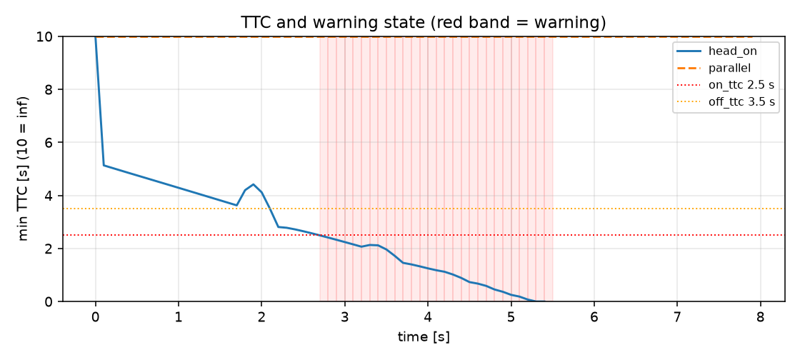
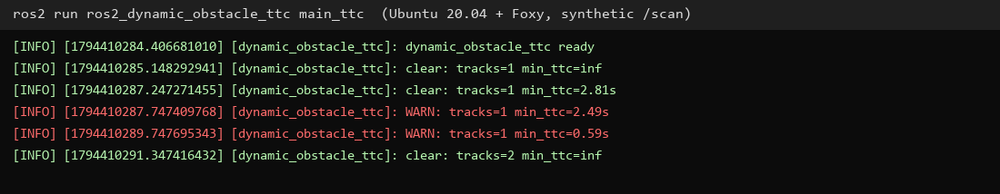

# ROS 2 动态障碍跟踪与 TTC 预警

从 2D 激光雷达中聚类动态障碍、估计速度并计算 **碰撞时间（TTC）**，
在真正碰撞前发出 `/collision_warning`。这是独立的**感知/安全层**，不依赖 `ros2_dwa_avoidance`，也不做路径规划。TTC 按**自车静止/低速**计算；移动底盘需要先把激光点变换到 odom 系并扣除自车速度。

## 1. 方法

1. **聚类**：相邻有效光束的角间隔 < 0.12 rad、距离跳变 < 0.65 m 时归为同一障碍；
   少于 3 束或外接半径 > 3.5 m 的簇丢弃；半径 >0.8 m 的长墙/车侧保留为 cluster，但不进入圆模型 TTC。
2. **跟踪**：贪心最近邻关联（门限 0.9 m），速度用最近 5 帧位置做最小二乘拟合（不足 3 帧退化为相邻帧差分）；
   连续 3 帧未关联则删除。
3. **TTC**：把障碍近似为圆，求 `|p + v t| = R` 的最小正根，
   `R = robot_radius + safety_margin + obstacle_radius`；远离的障碍返回 `inf`。
4. **迟滞**：`TTC < 2.5 s` 触发告警，`TTC > 3.5 s` 才解除，避免抖动。

## 2. 运行

```bash
cd ~/hutb_ws
colcon build --packages-select ros2_dynamic_obstacle_ttc
source install/setup.bash
ros2 launch ros2_dynamic_obstacle_ttc main_launch.py
```

话题：

| 方向 | 话题 | 类型 |
| --- | --- | --- |
| 订阅 | `/scan` | `sensor_msgs/LaserScan` |
| 发布 | `/collision_warning` | `std_msgs/Bool` |
| 发布 | `/moving_obstacles` | `visualization_msgs/MarkerArray` |

## 3. 离线复现

```bash
cd src/ground/ros2_dynamic_obstacle_ttc
python3 -m unittest discover -s test -v     # 11 项
python3 -m ros2_dynamic_obstacle_ttc.sim    # 5 个场景
```

## 4. 结果

| 场景 | 告警时刻 | 碰撞时刻 | 提前量 | 最大跟踪数 | 误报 |
| --- | ---: | ---: | ---: | ---: | --- |
| crossing（斜穿） | 3.3 s | 5.9 s | **2.6 s** | 1 | 否 |
| head_on（正面） | 2.7 s | 5.5 s | **2.8 s** | 1 | 否 |
| two（正面+平行） | 2.7 s | 5.5 s | **2.8 s** | 2 | 否 |
| parallel（横向 1.5 m） | — | — | — | 1 | **否** |
| receding（远离） | — | — | — | 1 | **否** |

5 个场景中 3 个真实威胁全部在碰撞前 2.6–2.8 s 告警，2 个无威胁场景
（平行通过、远离）均未误报。



节点实跑日志（合成 `/scan`，headless）：2.49 s 触发 WARN，障碍通过后恢复 clear。



## 5. 局限

* 机器人按静止处理；移动底盘需要把 `/odom` 速度叠加到相对速度，原地转向时还需要把激光点变换到 odom 系，否则静止墙面会被算成横向运动（当前未接）；
* 只做几何聚类，不区分人/车/墙；外接半径 > 0.8 m 的长墙/车侧会保留为 cluster，但不进入圆模型 TTC（没有线段模型），因此对墙面等于“看见但不告警”；
* 2D 单线激光，低矮或悬空障碍可能漏检；
* 稀疏点云会把一个障碍拆成多个簇，跟踪门限需要按雷达分辨率调；
* 只在合成数据上验证，尚未接真实雷达。

## 6. 大模型声明

代码与文档在编写过程中使用了 AI 大模型辅助。作者已实际运行 11 项单元测试、
5 个离线场景，并对提交内容的正确性与完整性负全部责任。
