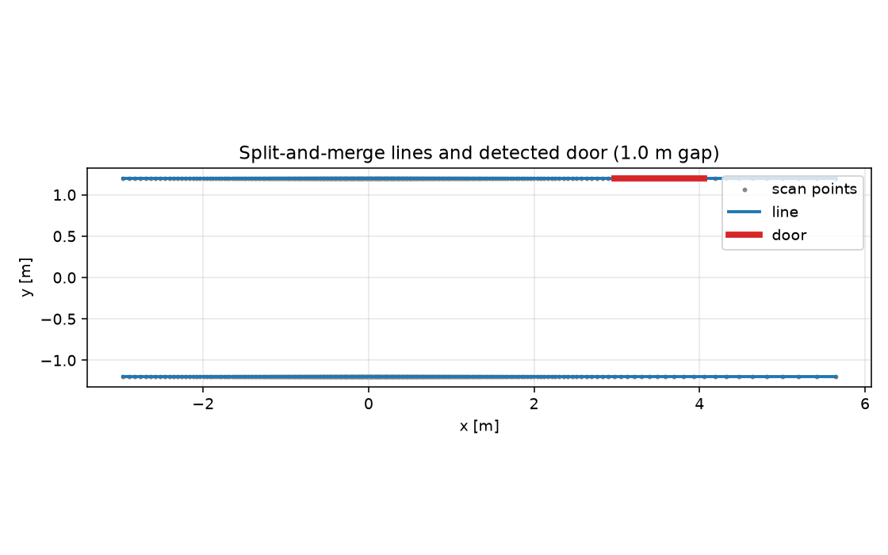

# ROS 2 激光线段提取与门洞检测

从 2D 激光扫描中提取线段（split-and-merge），再根据共线线段之间的间隙检测
门洞/通道，发布可视化 Marker。可作为语义地图、门通过或走廊定位的前置特征。

## 1. 方法

1. **扫描转点**：过滤无效/超量程光束；
2. **按间隙切分**：相邻点距离 > 0.5 m 断开（门洞、遮挡处）；
3. **split-and-merge**：递归找到离首尾连线最远的点，偏差 > 0.08 m 就切开；
4. **门洞检测**：两条线段夹角 < 0.12 rad、法向偏移 < 0.15 m，且沿墙方向的间隙
   在 0.6–1.4 m 之间，判为门洞。

## 2. 运行

```bash
cd ~/hutb_ws
colcon build --packages-select ros2_lidar_features
source install/setup.bash
ros2 launch ros2_lidar_features main_launch.py
```

| 方向 | 话题 | 类型 |
| --- | --- | --- |
| 订阅 | `/scan` | `sensor_msgs/LaserScan`（Best-Effort） |
| 发布 | `/lidar_features` | `visualization_msgs/MarkerArray` |

蓝色 `LINE_STRIP` 是线段，红色是门洞；参数在 `config/features_params.yaml`：`scan_topic`、`marker_topic`、`split_threshold`、`min_points`、`max_gap`。

## 3. 离线复现

```bash
cd src/ground/ros2_lidar_features
python3 -m unittest discover -s test -v   # 7 项
python3 -m ros2_lidar_features.sim
```

## 4. 结果

720 束合成扫描，1.0 m 门洞的走廊：

| 场景 | 线段数 | 平均残差 | 门洞数 | 门宽 | 误差 |
| --- | ---: | ---: | ---: | ---: | ---: |
| 带门洞走廊 | 3 | 0.000 m | 1 | 1.081 m | **0.081 m** |
| 封闭走廊 | 2 | 0.000 m | 0 | — | — |



## 5. 局限

* 只处理单帧 2D 扫描，没有多帧融合；
* 门洞判据假设门两侧墙面共线，斜门/弧形门会漏；
* 0.08 m 切分阈值对噪声敏感，真实雷达需调参；
* 扫描 ±π 接缝处同一面墙可能被切成两条线（当前未合并）；
* 7 项单测只覆盖合成场景，未在真实 TurtleBot3 上跑；
* 输出是可视化 Marker，不是语义地图消息。

## 6. 大模型声明

代码与文档在编写过程中使用了 AI 大模型辅助。作者已实际运行 7 项单元测试和
2 个合成场景，并对提交内容的正确性与完整性负全部责任。


