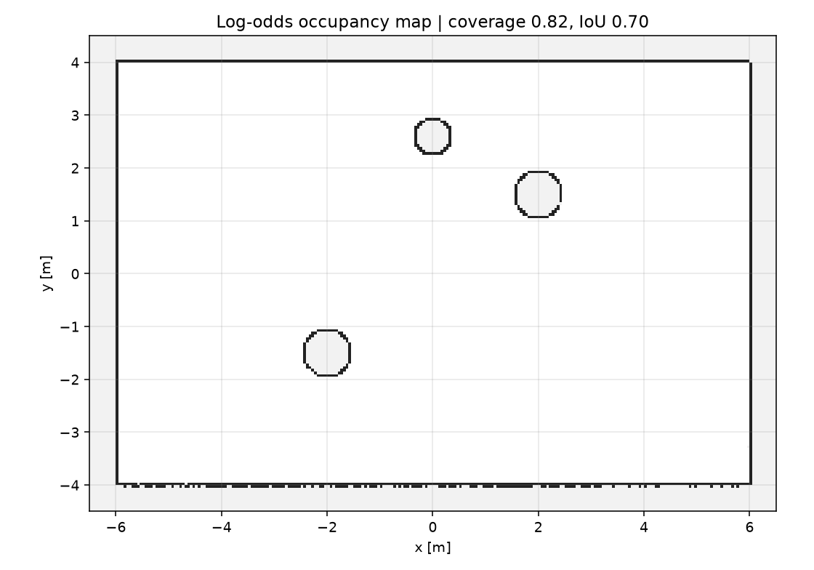

# ROS 2 2D 激光占据栅格建图

用 `/scan` + `/odom` 做 **log-odds 占据栅格建图**：每条激光束用 Bresenham
标记自由/命中格，发布 `nav_msgs/OccupancyGrid`。独立建图模块，不依赖规划器。

## 1. 方法

* 栅格分辨率 0.05 m，默认 20 m × 20 m（`x/y_min/max` 可配）；
* 每束激光从机器人格到端点做 Bresenham：中间格 `+= -0.40`（自由），
  命中格 `+= +0.85`（占据），log-odds 截断到 `[-5, 5]`；
* 输出：`log_odds > 0.2` 为占据（100），`< -0.2` 为自由（0），其余未知（-1）。

## 2. 运行

```bash
cd ~/hutb_ws
colcon build --packages-select ros2_occupancy_mapping
source install/setup.bash
ros2 launch ros2_occupancy_mapping main_launch.py
```

| 方向 | 话题 | 类型 |
| --- | --- | --- |
| 订阅 | `/scan` | `sensor_msgs/LaserScan` |
| 订阅 | `/odom` | `nav_msgs/Odometry` |
| 发布 | `/map` | `nav_msgs/OccupancyGrid`（transient local） |

## 3. 离线复现

```bash
cd src/ground/ros2_occupancy_mapping
python3 -m unittest discover -s test -v   # 5 项
python3 -m ros2_occupancy_mapping.sim     # 60 帧、180 束
```

## 4. 结果

12 m × 8 m 房间、**三个圆柱**，机器人绕半径 3 m 圆走 60 帧，与真值栅格对比：

| 指标 | 数值 |
| --- | ---: |
| 覆盖率（已知格比例） | 0.82 |
| 占据 IoU | **0.70** |
| 占据 precision | **0.953** |
| 占据 recall | 0.725 |
| 占据格数 | 1096 |

> 不同 NumPy/平台会有约 ±0.02 的 IoU 和 ±3% 的格数差异；在 Ubuntu 22.04 + NumPy 1.24 上复现为 0.722 / 0.959 / 0.745 / 1229，结论不变。



precision 高说明“标成占据的格子基本都是真障碍”；recall 0.725 主要因为部分墙面
只被斜视扫到、端点落在墙内，以及 0.05 m 栅格对圆边的离散化。

## 5. 局限

* 2D 单线激光，只有一层高度；
* 没有回环检测/位姿图优化，长距离里程计漂移会让地图重影；
* 世界按静态处理，动态障碍会留下拖影；
* 只输出占据/自由/未知，不做语义或可通行性分析；
* 20 m × 20 m 栅格固定内存，大场景需分块；
* 默认 `frame_id=odom`，不发布 `map→odom`；RViz 固定帧请选 odom，或补静态变换。

## 6. 大模型声明

代码与文档在编写过程中使用了 AI 大模型辅助。作者已实际运行 5 项单元测试和
60 帧离线建图，并对提交内容的正确性与完整性负全部责任。
