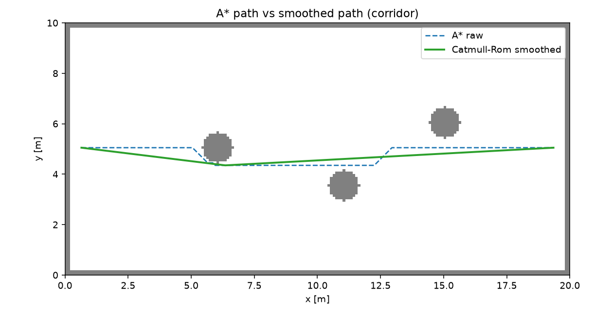

# ROS 2 A* 全局路径平滑（Catmull-Rom，带安全校验）

对 A* 栅格路径做后处理：视线法简化 + Catmull-Rom 平滑，在**逐段碰撞检查**和
**精确间隙**约束下降低最大曲率。节点订阅地图后才发布，校验不过则退回输入路径。

## 1. 方法

1. **A\***：8 邻域、禁止斜穿障碍角点；
2. **视线简化**：Bresenham/密集采样逐段检查，斜向穿角也判为不可见；
3. **Catmull-Rom**：控制点按 0.5 m 弧长重采样，端点保持不变；
4. **候选选择**：简化路径 + α=1/0.75/0.5/0.25 的平滑混合，全部做
   `path_free()` 检查；优先选满足 `min_clearance` 且最大曲率最小的候选；
5. **间隙**：点到**障碍格矩形**的精确距离（不是格心距离）；
6. **回退**：没有候选满足间隙时返回仍无碰撞的简化/原始路径，`safe=False`，
   节点不发布该结果。

## 2. 运行

```bash
cd ~/hutb_ws
colcon build --packages-select ros2_path_smoothing
source install/setup.bash
ros2 launch ros2_path_smoothing main_launch.py
```

| 方向 | 话题 | 类型 |
| --- | --- | --- |
| 订阅 | `/plan` | `nav_msgs/Path` |
| 订阅 | `/map` | `nav_msgs/OccupancyGrid`（transient local） |
| 发布 | `/plan_smoothed` | `nav_msgs/Path` |

节点先等 `/map`；没有地图时原样转发输入并告警。校验不通过时也原样转发输入。

## 3. 离线复现

```bash
cd src/ground/ros2_path_smoothing
python3 -m unittest discover -s test -v   # 7 项
python3 -m ros2_path_smoothing.sim
```

## 4. 结果

| 地图 | 原始长度 | 平滑长度 | 原始最大曲率 | 平滑最大曲率 | 原始间隙 | 平滑间隙 | 安全 |
| --- | ---: | ---: | ---: | ---: | ---: | ---: | --- |
| corridor | 19.28 m | 18.76 m | 5.685 1/m | **0.016 1/m** | 0.05 m | 0.15 m | 是 |
| doorway | 21.19 m | 19.64 m | 5.685 1/m | **0 1/m** | 0.07 m | 0.45 m | 是 |
| clutter | 22.01 m | 20.51 m | 5.685 1/m | **0.014 1/m** | 0.05 m | 0.45 m | 是 |

简化后的直线段在 corridor/clutter 上本身就是低曲率候选，所以最终选择的是
“简化 + 必要时样条”的最小曲率结果；doorway 起终点连线穿过门洞，曲率为 0。



## 5. 局限

* 只处理几何路径，不重新规划；
* 候选选择以降低曲率为目标，极端狭窄场景可能退回简化路径（曲率仍低于原始折线）；
* 节点依赖 `/map`；无地图时只转发输入，不做平滑；
* Catmull-Rom 在急弯处会切角，靠 `path_free` 和间隙检查兜底；
* 2D 路径，不处理高度/坡度。

## 6. 大模型声明

代码与文档在编写过程中使用了 AI 大模型辅助。作者已实际运行 7 项单元测试和
3 张离线地图，并在 Ubuntu 20.04 + Foxy 下完成 `colcon build`；对提交内容的
正确性与完整性负全部责任。
