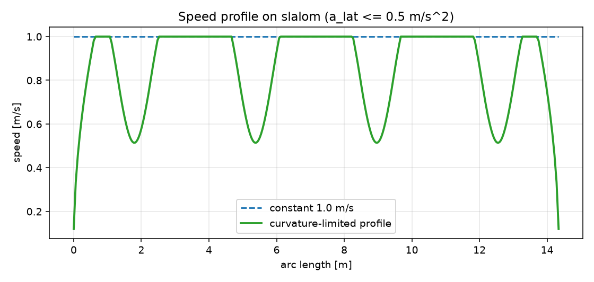

# ROS 2 路径速度规划（曲率/加速度约束）

给定一条 `nav_msgs/Path`，按曲率限制和加加速度限制生成速度剖面，输出每个路径点的
`(v, w)`。目标是让差速底盘在弯道自动减速、在直道恢复速度，同时不超横向加速度。

## 1. 方法

1. 由相邻三点计算离散曲率 $\kappa_i$；
2. 曲率限速 $v_{\kappa}=\sqrt{a_{lat,max}/\kappa}$，再与 `v_max` 取小；
3. 前向/后向各扫一遍：
   $v_i \le \sqrt{v_{i\pm1}^2 + 2a_{max}\Delta s}$；
4. 用 $\Delta t = \Delta s / \bar v$ 积分总时间，输出 `v` 与 `w = κ v`。

## 2. 运行

```bash
cd ~/hutb_ws
colcon build --packages-select ros2_velocity_profiling
source install/setup.bash
ros2 launch ros2_velocity_profiling main_launch.py
```

| 方向 | 话题 | 类型 |
| --- | --- | --- |
| 订阅 | `/plan` | `nav_msgs/Path` |
| 发布 | `/cmd_profile` | `std_msgs/Float64MultiArray`（`v0,w0,v1,w1,...`） |

参数在 `config/profile_params.yaml`：`v_max`、`a_max`、`a_lat_max`、`min_speed`。

## 3. 离线复现

```bash
cd src/ground/ros2_velocity_profiling
python3 -m unittest discover -s test -v   # 4 项
python3 -m ros2_velocity_profiling.sim
```

## 4. 结果

`v_max=1.0 m/s`、`a_max=0.8 m/s²`、`a_lat_max=0.5 m/s²`：

| 路径 | 长度 | 恒速时间 | 规划时间 | 恒速最大横向加速度 | 规划最大横向加速度 |
| --- | ---: | ---: | ---: | ---: | ---: |
| circle (r=1.2) | 7.54 m | 7.54 s | 10.43 s | 0.833 | **0.500** |
| slalom | 14.34 m | 14.34 s | 18.01 s | 1.892 | **0.500** |
| square | 20.00 m | 20.00 s | 23.63 s | 20.0 | **0.500** |

代价是时间增加 11%–38%，换来横向加速度严格不超 0.5 m/s²；恒速方案在弯道会
超出 1.7–40 倍。



## 5. 局限

* 只做速度剖面，不改变路径几何；曲率由离散三点估计，尖角处会偏大；
* 未考虑轮速/力矩饱和，真机需再限幅；
* `w = κ v` 假设纯滚动、无侧滑；
* 输出是逐点数组，不是标准 ROS 轨迹消息；
* 只支持 2D 路径。

## 6. 大模型声明

代码与文档在编写过程中使用了 AI 大模型辅助。作者已实际运行 4 项单元测试和
3 条离线路径，并对提交内容的正确性与完整性负全部责任。
