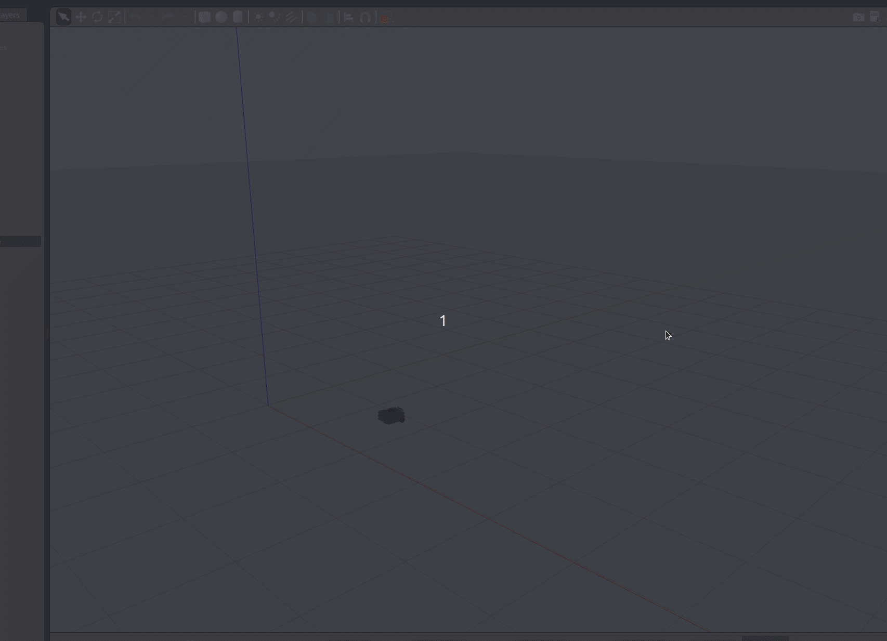

# turtlebot_multi_goal_nav 多目标点导航

一个小车多目标点导航的 ROS1 包。机器人在 TurtleBot3 的 Gazebo 仿真里按顺序走 5 个目标点，
到点就切下一个，全走完自动停车。正前方离障碍太近时会先停车、原地右转躲一下，然后接着走。

## 环境

* Ubuntu 20.04 / 22.04，ROS 1（Noetic）
* Python 3（3.8 以上都可以）
* 用到了 `rospy`、`sensor_msgs`、`nav_msgs`、`geometry_msgs`、`tf`
* 在 TurtleBot3 Gazebo 仿真里跑，需要 `/odom`、`/scan`、`/cmd_vel` 这些话题

## 编译运行

把包放进工作空间编译：

```bash
cd ~/catkin_ws/src
cp -r <仓库路径>/src/ground/turtlebot_multi_goal_nav ./
cd ~/catkin_ws && catkin_make
source ~/catkin_ws/devel/setup.bash
```

先启动 TurtleBot3 仿真（burger 模型）：

```bash
export TURTLEBOT3_MODEL=burger
roslaunch turtlebot3_gazebo turtlebot3_world.launch
```

再启动这个包：

```bash
roslaunch turtlebot_multi_goal_nav turtlebot_multi_goal_nav.launch
```

直接 `rosrun` 也可以：

```bash
rosrun turtlebot_multi_goal_nav main.py
```

## 目标点

依次走 (1.5,0) → (1.5,3) → (-2.5,3) → (-2.5,-1.5) → (0,0) 这 5 个点（单位米），
最后一个回到出发点，走完全部点自动停车。

## 运行效果

仿真里跑的录屏：



## 验证记录

在自己的机器上实际构建、启动、运行过，环境和结果如下：

* 系统：Ubuntu 20.04.6 LTS（focal）
* ROS：Noetic
* Python：3.8.10
* catkin：0.8.12
* 仿真：Gazebo 11.15.1，TurtleBot3 burger 模型

`catkin_make` 编译通过；`roslaunch turtlebot3_gazebo turtlebot3_world.launch` 正常启动仿真；
`roslaunch turtlebot_multi_goal_nav turtlebot_multi_goal_nav.launch` 启动节点后，
小车按顺序走完 5 个目标点并自动停车。节点终端输出：

```
开始多目标导航！
到达目标 1
到达目标 2
到达目标 3
到达目标 4
到达目标 5
全部目标点跑完，停车！
```

## 声明

`main.py` 是作业的原始代码，其余文件（`package.xml`、`CMakeLists.txt`、`launch`、`README.md`、文档页）在整理时用到了大模型辅助。我已逐项核对，对提交内容负责。
