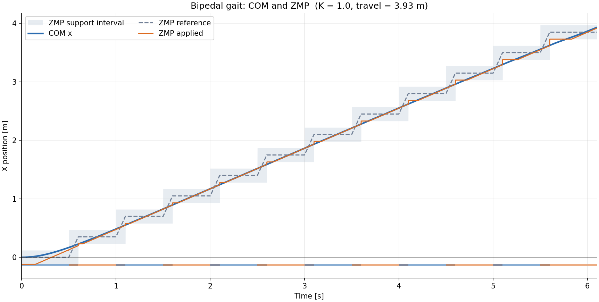
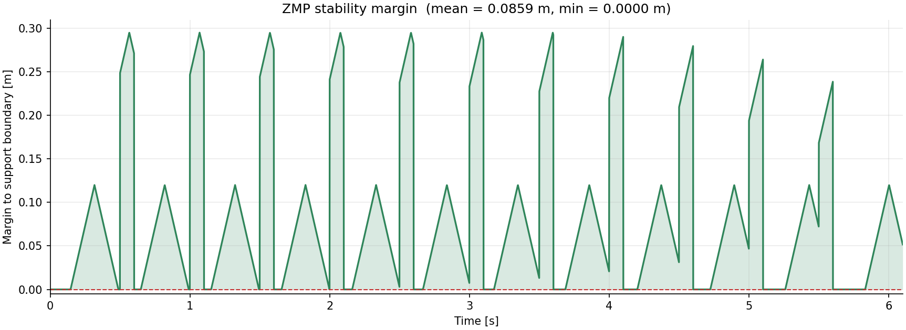
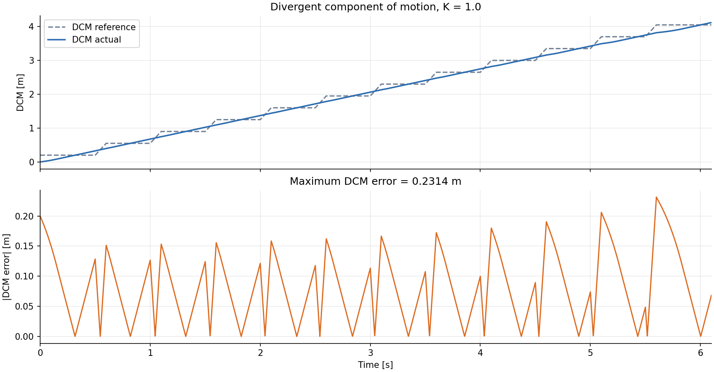
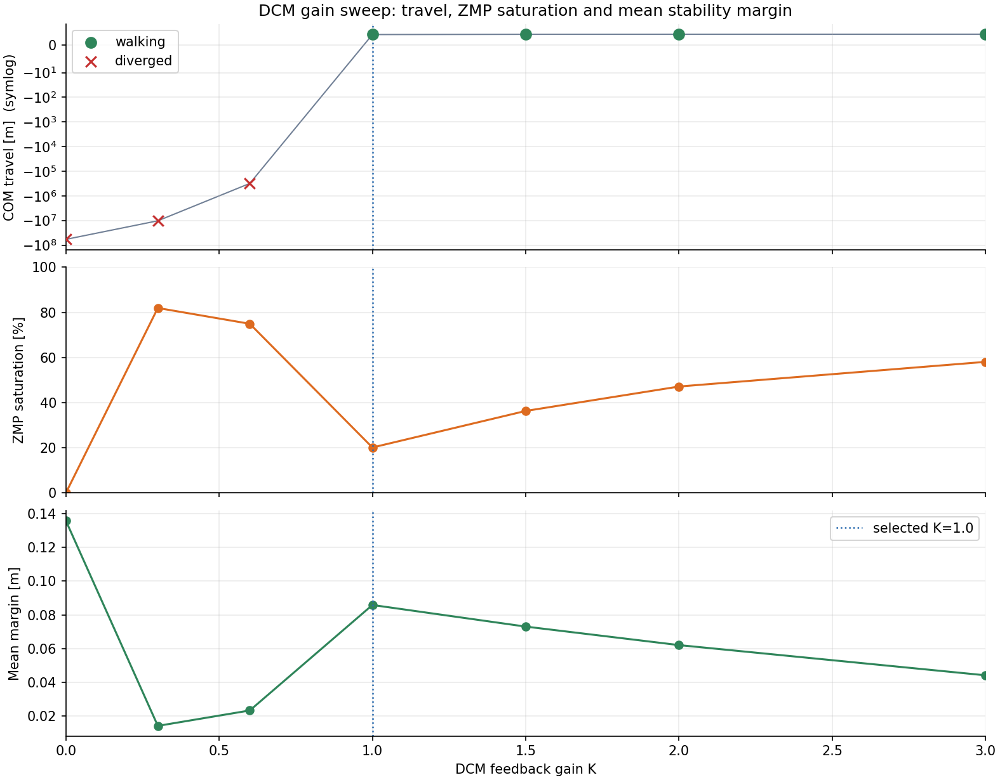
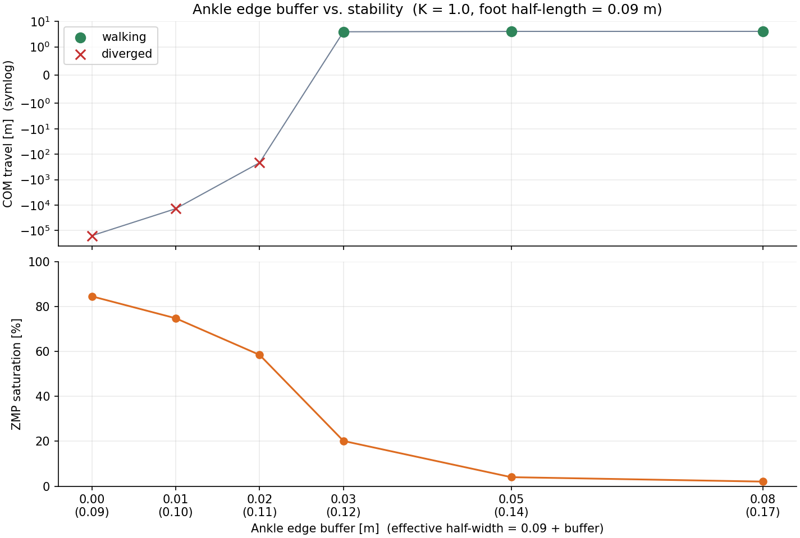

# 实验 1｜双足步态生成与 ZMP 稳定性

用**线性倒立摆模型（LIPM）**生成双足行走步态，并逐步检查 ZMP 是否始终落在
支撑多边形内。本实现为**离线 Python 版，不依赖 ROS、不联网、不安装额外包**；
全部计算只依赖 Python 标准库与 NumPy，出图用 matplotlib，动图用 Pillow。

对应课程页面：<https://openhutb.github.io/ros2/humanoid/bipedal_gait_zmp/>

## 1. 模型

质心高度恒定 $z_c$，水平方向只有前后一个自由度：

```
ẍ = ω² (x − p),    ω = sqrt(g / z_c)
p = x − ẍ / ω²                          （由质心轨迹反算 ZMP）
```

$z_c = 0.8$ m 时 $\omega = 3.5018\ \mathrm{s^{-1}}$，特征时间 $1/\omega \approx 0.29$ s。
给定恒定 ZMP 有解析解，`scripts/lipm.py` 里同时提供解析式与数值积分，测试中
两者差值的量级约 $10^{-14}$ m；用中心二阶差分核对 LIPM 方程时残差约 $1.7\times10^{-6}$。

> 倒立摆是**不稳定**的：质心偏到 ZMP 前方时加速度朝正方向，越跑越远。
> 这是后面"必须闭环"的根源。

## 2. 落脚点与支撑多边形

| 阶段 | 支撑区间 | ZMP 参考 |
| --- | --- | --- |
| 单脚支撑 | 支撑脚脚掌 | 脚掌中心 |
| 双脚支撑 | 两只脚脚掌的并集 | 沿前进方向从后脚中心线性过渡到前脚中心 |

足底几何半长 0.09 m；另外允许 ZMP 再向脚边外扩 0.03 m 作为踝关节调节余量，
因此有效半宽 0.12 m。**这个 0.03 m 是本模型最敏感的假设**（见第 5 节）。

## 3. 步态求解

LIPM 是线性系统，一个周期后的状态可写成仿射映射：

```
[x(T)]   [a11 a12] [x0]   [b1]
[v(T)] = [a21 a22] [v0] + [b2]
```

用三个初值 `(0,0)`、`(1,0)`、`(0,1)` 各积分一次即可定出 `A`、`b`。对称行走要求
一个周期后质心前进一个周期位移（0.7 m）、速度回到原值，解二元一次方程组即得
周期解：

```
x0 = 0.134442 m,  v0 = 0.779397 m/s,  映射残差 2.2e-16
```

周期起点取第二只脚落地时刻（t = 0.5 s），跳过"第一步落地时没有前一只脚"的
起步瞬态。

## 4. 闭环控制

取发散运动分量（DCM / capture point）：

```
ξ = x + ẋ/ω,   ξ̇ = ω (ξ − p)
```

稳定行走时质心平均速度恒定，取参考 `ξ_ref = p_ref + v_avg/ω`，控制律为

```
p = p_ref + K (ξ − ξ_ref),    p ← clip(p, 支撑区间)
```

限幅是必需的：ZMP 不可能跑到脚外面去。

## 5. 结果（默认参数）

步长 0.35 m，步时 0.5 s，支撑相占比 0.6（双支撑 0.1 s），12 步，仿真 6.1 s，
dt = 0.001 s，K = 1.0。

| 指标 | 数值 |
| --- | --- |
| 质心行程 | **+3.9311 m** |
| 平均速度 | **0.6444 m/s**（目标 0.70，起步阶段需要加速） |
| DCM 最大误差 | 0.2314 m |
| ZMP 饱和比例 | 20.14 % |
| 平均稳定裕度 | 0.0859 m |
| 最小稳定裕度 | 0.000 m（ZMP 限幅贴边；平均裕度仍为正） |








### 开环不稳定，微小扰动每周期放大 33 倍

从周期解出发给质心 +1e-4 m 扰动，各周期末速度偏差：

| 周期 | 1 | 2 | 3 | 4 | 5 |
| --- | --- | --- | --- | --- | --- |
| Δv (m/s) | 2.35e−2 | 7.95e−1 | 2.64e+1 | 8.75e+2 | 2.90e+4 |

相邻周期放大比实测 33.75 / 33.19 / 33.18 / 33.17，与理论值
$e^{\omega T} = 33.1746$ 一致（T = 1 s）。

### 增益扫描

| K | 行程 (m) | 平均速度 | ZMP 饱和 | 平均裕度 (m) | 稳定 |
| --- | --- | --- | --- | --- | --- |
| 0.0 | −5.86e+7 | — | 0.0 % | 0.1358 | 否 |
| 0.3 | −1.03e+7 | — | 81.9 % | 0.0143 | 否 |
| 0.6 | −3.14e+5 | — | 75.0 % | 0.0234 | 否 |
| **1.0** | **+3.931** | **0.644** | **20.1 %** | **0.0859** | **是** |
| 1.5 | +4.024 | 0.660 | 36.3 % | 0.0731 | 是 |
| 2.0 | +4.042 | 0.663 | 47.2 % | 0.0621 | 是 |
| 3.0 | +4.059 | 0.665 | 58.1 % | 0.0442 | 是 |



**结论：K = 0 必然发散，K ≥ 1 才能走；但增益越大 ZMP 越常贴边，平均裕度反而下降。**
默认 K = 1.0。

### 踝部边界缓冲的敏感性

足底半长固定 0.09 m，只改变允许 ZMP 外扩的余量：

| 缓冲 (m) | 有效半宽 (m) | 行程 (m) | 饱和 | 稳定 |
| --- | --- | --- | --- | --- |
| 0.00 | 0.09 | −1.61e+5 | 84.5 % | 否 |
| 0.01 | 0.10 | −1.39e+4 | 74.7 % | 否 |
| 0.02 | 0.11 | −215.8 | 58.4 % | 否 |
| **0.03** | **0.12** | **+3.931** | **20.1 %** | **是** |
| 0.05 | 0.14 | +4.068 | 4.0 % | 是 |
| 0.08 | 0.17 | +4.075 | 2.1 % | 是 |



缓冲为 0 时单脚支撑末段 ZMP 长期贴边，K = 1 走不到 4 s 就发散；加 0.03 m 后
才得到 3.93 m / 0.64 m/s / 20% 饱和这一组数。**同一算法下，支撑多边形的建模
口径比控制增益更能决定"能不能走"。**

## 6. 怎么跑

```bash
cd bipedal_gait_zmp
python main.py            # 完整：增益扫描 + 缓冲敏感性 + 5 张图 + GIF + CSV
python main.py --quick    # 只跑 --gain 指定的增益，跳过增益扫描
python main.py --gain 1.5 # 指定反馈增益
python -m pytest -q       # 78 个测试（27 个 pytest 函数 + 51 个 unittest 用例）
python -m unittest discover -s tests -q   # 仅跑 51 个 unittest 用例
```

输出在 `out/`：

| 文件 | 内容 |
| --- | --- |
| `metrics.csv` | 逐时刻质心、ZMP、支撑区间、裕度、DCM |
| `gain_sweep.csv` | 7 个增益的行程/速度/饱和/裕度 |
| `support_margin_sweep.csv` | 踝部缓冲敏感性 |
| `summary.txt` | 参数、周期解、指标、增益表、结论 |
| `gait_com_zmp.png` / `stability_margin.png` / `dcm_error.png` | 三条主曲线 |
| `gain_sweep.png` / `support_margin_sweep.png` | 两张扫描图 |
| `walking.gif` | 侧视行走动画，720×459、121 帧、1.65 MB（< 3 MB）；支撑腿深蓝、摆动腿浅蓝、红线 ZMP |

没有 Pillow 时只跳过 `walking.gif`，其余产物不受影响。

## 7. 文件结构

```
bipedal_gait_zmp/
├── main.py                # 入口：周期解 -> 开环不稳定 -> 增益/缓冲扫描 -> 出图
├── scripts/
│   ├── lipm.py            # LIPM 解析解与数值积分
│   ├── footstep.py        # 落脚点、支撑多边形、ZMP 参考
│   ├── gait.py            # 周期解、闭环仿真、开环发散、两种扫描
│   ├── dcm.py             # DCM、ZMP 指令、限幅、稳定裕度
│   ├── plotting.py        # 5 张 PNG
│   └── animate.py         # 侧视火柴人 GIF（matplotlib 逐帧 + Pillow 合成）
└── tests/test_gait.py     # 78 个测试：27 个 pytest 函数 + 51 个 unittest 用例
```

## 8. 已知限制

- 只做**矢状面（前后方向）**，侧向平衡不建模；
- 质心高度恒定，没有考虑抬脚高度对 ZMP 的影响；
- 摆动腿动力学被忽略（落脚点由离线计划给定，不随状态调整）；
- ZMP 限幅直接把指令截断，没有做预览控制（preview control）或 MPC 的
  未来落脚点优化；这两项正是 Kajita 2003 / Wieber 2006 要解决的问题。

## 参考

- S. Kajita et al., *Biped Walking Pattern Generation by using Preview Control of
  Zero-Moment Point*, 2003
- P.-B. Wieber, *Trajectory Free Linear Model Predictive Control for Stable
  Walking*, 2006
- J. Englsberger et al., *Three-Dimensional Bipedal Walking Control Based on
  Divergent Component of Motion*, 2015
