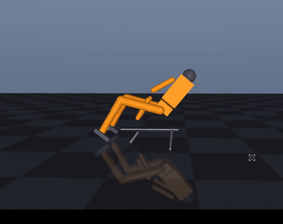
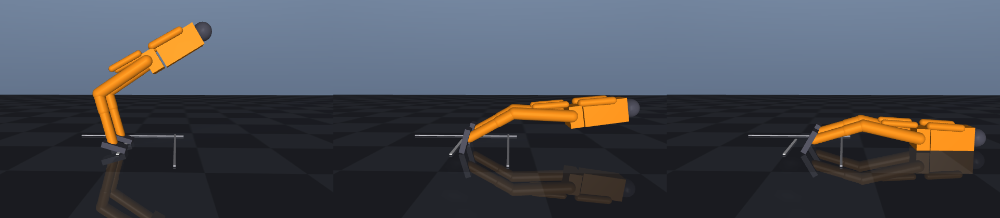
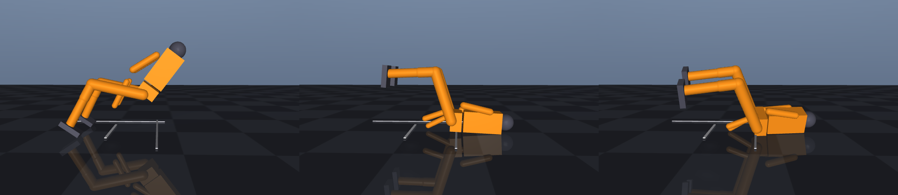

# humanoid_fall_protection —— 人形机器人跌倒预判与保护性倒地

MuJoCo 里让双足人形被推倒，对比三种「已经救不回来之后」的响应：**僵直**、**瘫软**、
**保护性倒地**。核心问题是：跌倒不可避免时，机器人应该怎么倒。

**这个模块不研究怎么不摔倒**——那是 `humanoid_push_recovery` 的题目（ZMP/捕获点判据 +
踝髋策略）。本模块从「判据已经判定救不回来」那一刻之后开始，关心落地瞬间各部件的
冲击怎么分配。

## 效果

**虚拟机窗口实录**（Ubuntu 22.04.5 + MuJoCo 3.15，`python3 main.py --demo`，
用 `ffmpeg -f x11grab` 直接录屏，未裁剪、未做后期处理）：



| 僵直倒地（头部压进地面） | 保护性倒地（屈膝蜷身） |
|---|---|
|  |  |

完整对比图（上排僵直、下排保护，三个时刻）与曲线、动图见
[`docs/humanoid/humanoid_fall_protection.md`](../../../docs/humanoid/humanoid_fall_protection.md)。

## 实测结果

Ubuntu 22.04.5 + Python 3.10.12 + MuJoCo 3.15.0，物理步长 2 ms（500 Hz），
推扰 300 N × 0.08 s（作用在躯干，+x 为向前推）。

| 策略 | 头最低 (m) | 头间隙 (m) | 头峰值 (N) | 躯干峰值 (N) | 膝峰值 (N) | 检测延迟 (s) | 倒地 (s) |
|---|---|---|---|---|---|---|---|
| 僵直 | 0.078 | −0.012 | 0.0 | 9198 | 3241 | 0.056 | 2.10 |
| 瘫软 | 0.049 | −0.041 | **5633.9** | 2032 | 3185 | 0.056 | 1.58 |
| 保护 | **0.111** | **+0.021** | **0.0** | **1426** | 5492 | 0.056 | 1.85 |

- 头部间隙 = 头部球心最低高度 − 球半径 0.09 m，负值表示球面压进了地面。
- 保护组头部全程没有接触地面（最小间隙 21 mm），躯干峰值冲击从 9198 N 降到 1426 N（−84%）。
- 代价是膝部峰值从 3241 N 升到 5492 N（+69%）——冲击被有意识地转移到了有护垫、有肌肉的膝关节。
- 瘫软组的头部冲击 5634 N 是三者中最高的：断电式倒地没有任何姿态准备，膝盖瞬间塌陷，头直接砸下去。

推力从 200 N 扫到 500 N（7 档 × 3 组）的完整表格见文档 §5.2。

## 跌倒判据

倾角 **30°** 取自 OpenHorizon Labs 的 **Asimov 1 safe-fall** 策略部署配置
（Apache-2.0，见 [asimov-v1-policies](https://github.com/openhorizon-labs/asimov-v1-policies)）：
一旦检测到跌倒（tilt or angular speed），策略立刻接管，让头、躯干、骨盆、膝承受的冲击最小。

角速度阈值用的是 **3.0 rad/s**，不是他们的 2.0。原因：那个值是在行走状态下整定的，
而本模块是站立场景——被推一下，躯干瞬时角速度就能到 2 rad/s，可机器人其实站得住
（150 N 实测如此）。取 3.0（仍在他们的训练范围 2~4 rad/s 内）之后，150 N 不触发、
200 N 触发，误触发与漏检的平衡点在 180 N 附近。

与 Asimov 的差别：他们用 PPO 训练一个 23 关节策略网络（ONNX），本模块是**手工控制律**
——判据相同、目标相同，实现方式是可解释的姿态 PD 伺服，不依赖训练权重，能在
ROS2 里逐帧看到每个关节的力矩。

## 安装与运行

```bash
# 1. 依赖
python3 -m pip install --user "mujoco>=3.3" numpy matplotlib pillow

# 2. 独立运行（在功能包根目录）
cd src/humanoid/humanoid_fall_protection
python3 main.py --test        # 自检，11 项
python3 main.py --headless    # 三种策略对比，出表格
python3 main.py --sweep       # 推力 200~500 N 扫描
python3 main.py --figures     # 生成曲线、关键帧、动图
python3 main.py --demo        # 打开 MuJoCo 窗口看保护动作

# 3. ROS2
cd ~/ros2_ws && colcon build --symlink-install --packages-select humanoid_fall_protection
source install/setup.bash
ros2 launch humanoid_fall_protection main.launch.py
```

无图形环境（SSH、容器）里跑 `--figures` 需要虚拟显示：

```bash
xvfb-run -a -s "-screen 0 1024x768x24" python3 main.py --figures
```

## 话题（ROS2）

| 话题 | 类型 | 说明 |
|---|---|---|
| `/fall_protection/joint_states` | `sensor_msgs/JointState` | 15 个关节角与角速度 |
| `/fall_protection/trigger` | `std_msgs/Bool` | 跌倒判据是否已触发 |
| `/fall_protection/status` | `std_msgs/String` | 当前模式、倾角、头高 |
| `/fall_protection/impact` | `std_msgs/Float32MultiArray` | 头/躯干/膝/手的峰值接触力 |
| `/fall_protection/push`（订阅） | `std_msgs/Float32` | 推扰力，正值为向前推 |
| `/fall_protection/strategy`（订阅） | `std_msgs/String` | 运行时切换 rigid/limp/protect |

## 文件结构

```
humanoid_fall_protection/
├── main.py                        # standalone 入口（--test/--headless/--sweep/--figures/--demo）
├── models/humanoid_fall.xml       # 15 关节双足，含手掌接触面与固定侧视相机
├── config/params.yaml             # ROS2 参数（按节点分节）
├── launch/main.launch.py
├── humanoid_fall_protection/
│   ├── config.py                  # 默认参数、站立/保护姿态、三种策略标签
│   ├── sim_core.py                # MuJoCo 封装：贴地初始化、倾角、接触力
│   ├── protection.py              # 跌倒判据 + 三策略状态机
│   ├── runner.py                  # 一次完整实验的执行器
│   ├── metrics.py                 # 指标采集、表格、CSV
│   ├── figures.py                 # 曲线、柱状图、关键帧、GIF
│   └── ros_node.py                # ROS2 节点
└── test/test_standalone.py        # 16 项单元测试
```

## 边界与已知问题

- **只做了前扑**。后仰场景下模型脚掌会向后滑动 1 m 以上，倒地过程不干净，数据不好看，
  所以没有纳入主实验；`PROTECT_BACKWARD` 姿态留在了代码里但没有实测。
- **手掌没有真正撑到地**。模型臂长 0.58 m、肩高 1.2 m，前扑过程中肩到地面的距离始终
  大于臂长，所以「手撑地」在这个几何下做不到。保护动作起作用的机制是**屈膝蜷身降低重心、
  改变落地顺序**，不是手臂支撑。文档里的说法按这个实际情况写，没有夸大。
- **膝部冲击升高**。这是主动选择的权衡（膝盖比躯干抗撞），但 5492 N 仍然不小，
  在真实机器人上需要护膝或更软的落地材料。
- **250 N 是临界点**。7 档推力里 6 档保护成功，250 N 这一档在 MuJoCo 3.15（虚拟机）下
  头部峰值 2263 N（保护失败），3.16（主机）下头部为 0、间隙只剩 2 mm（勉强成功）。
  接触仿真的分岔，不是控制律差异，文档里两个数都列了。

## AI 声明

本模块的代码、模型、文档由作者在 AI 编程助手（WorkBuddy / Claude）协助下完成，
判据参数引用自 OpenHorizon Labs 的 Asimov 1 safe-fall 配置（Apache-2.0），
所有数值均为本机与 Ubuntu 22.04 虚拟机上实际运行所得，未做手工修改。
