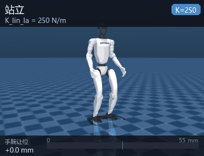

# humanoid_g1_compliance

Unitree **G1（23 自由度）** 的**全身柔顺控制**复现。LAC 策略把「刚度指令」当作观测输入，
在同样大小的外力下，指令刚度越低，手臂让位越大、关节力矩越低、恢复越慢——
这就是「柔顺」。整个链路纯 CPU、离线、无头运行，**不需要训练、不需要 GPU、不需要手柄**。



动图是一次连续运行：先站立 3 s，再以 `K_lin_la=30` 受 6 N 侧向力 2 s（让位 48.7 mm），
撤力后切到 `K_lin_la=250` 重复同样外力（让位 24.3 mm）。同一外力，低刚度让位接近 2 倍。

## 1. 代码与权重来源

| 内容 | 来源 | 许可 |
|---|---|---|
| 策略权重 `weights/lac_g1_23dof.pt` | [lac-code](https://github.com/lac-humanoid/lac-code) 的 `checkpoints/lac_g1_23dof.pt`，固定到 commit `a8e16291` | MIT |
| 推理链路 `humanoid_g1_compliance/lac/`（9 个模块） | 同上仓库 `ros2/lac_deploy/lac_deploy/`，原样 vendor，仅改相对导入 | MIT |
| G1 模型与网格 `assets/g1` | 同上仓库 `sim/unitree_robots/g1`（29 个 STL） | MIT |
| 动作库 `motions/lac_motion_library.npz` | 同上仓库 `motions/` | MIT |
| 纯 MuJoCo 闭环、柔顺实验、ROS 2 封装、测试与文档 | 原创 | BSD-3-Clause |

上游的部署链路依赖 DDS（`unitree_sdk2py`）、Xbox 手柄和 `mujoco_viewer` 交互窗口，
在评测机上跑不起来。本模块把它改造成**单进程纯 MuJoCo 无头闭环**：策略输出直接写
MuJoCo 的 `ctrl`，观测直接从 `sensordata` 读，不经过任何中间件。策略权重与网络结构
未做任何修改。

## 2. 环境要求

| 项 | 要求 |
|---|---|
| 系统 | Ubuntu 20.04 / 22.04（ROS 2 Humble），或 Windows 10/11（无 ROS 时可跑离线演示） |
| CPU | 任意 4 核；策略推理单帧约 2 ms，占 20 ms 周期的 10% |
| 内存 | 4 GB |
| GPU | 不需要（离屏渲染用 OpenGL，Linux 无显卡时设 `MUJOCO_GL=osmesa`） |
| Python | 3.10 / 3.11 / 3.12 |
| 依赖 | `mujoco >= 3.1`、`torch`（CPU 版即可）、`numpy`、`pyyaml` |
| 磁盘 | 约 70 MB（网格 19 MB + 权重 49 MB） |

## 3. 安装

```bash
# 1) 放入工作空间并安装 Python 依赖（torch 用 CPU 版即可）
cd ~/ros2_ws/src
# 拷贝本模块目录 humanoid_g1_compliance
pip install torch --index-url https://download.pytorch.org/whl/cpu
pip install mujoco pyyaml

# 2) 构建
cd ~/ros2_ws
colcon build --packages-select humanoid_g1_compliance
source install/setup.bash
```

权重、模型与网格已随仓库提供，**无需联网下载**：

| 文件 | 大小 | SHA-256 |
|---|---|---|
| `weights/lac_g1_23dof.pt` | 51,154,217 B | `a54a213637ebbc55ea20a11373b00a4ed7dbef06a4b7c20804009dd2819f4a9c` |

> **关于 48.8 MiB 的体积（体积换免联网）**：这是本仓库当前最大的单文件（次大是
> `docs/img/ground/rviz.gif` 的 16 MB），仍在 GitHub 50 MiB 提示线以内。入库的理由是
> 评测机断网也能直接 `colcon build` + 跑通，不用等下载。
>
> 与 #1167（语音模块）的处理不同：Whisper 权重可以由 `whisper.load_model()` 自动拉取，
> 而这份策略权重只能从上游 `lac-code` 仓库取，没有任何自动下载机制——不入库就得手写
> 下载脚本，且上游一旦改 commit 就复现不了。如果你更看重仓库体积，删掉
> `weights/lac_g1_23dof.pt` 后按 `THIRD_PARTY.md` 的 SHA-256 从上游取回即可，功能不受影响。

> 仓库根 `.gitignore` 有全局 `*.pt` 规则，本模块已在其中加入白名单
> `!src/humanoid/humanoid_g1_compliance/weights/*.pt`，否则权重会被静默忽略。

## 4. 运行

### 4.1 一键启动 ROS 2 链路

```bash
ros2 launch humanoid_g1_compliance main.launch.py
ros2 launch humanoid_g1_compliance main.launch.py stiffness:="[55,250,250,55,55]"
ros2 launch humanoid_g1_compliance main.launch.py teleop:=false     # 不启动调刚度终端
```

仿真节点每 20 ms 推进一步策略（50 Hz，`publish_rate` 可调），发布：

| 话题 | 类型 | 说明 |
|---|---|---|
| `/joint_states` | `sensor_msgs/JointState` | 23 个关节的位置/速度/力矩 |
| `/humanoid/joint_targets` | `std_msgs/Float64MultiArray` | 策略输出的关节目标角 |
| `/humanoid/stiffness_state` | `std_msgs/Float32MultiArray` | 当前刚度 5 通道 |
| `/humanoid/status` | `std_msgs/String` | JSON：时间、状态机阶段、骨盆位姿、`pg_z`、是否摔倒 |

订阅：

| 话题 | 类型 | 说明 |
|---|---|---|
| `/cmd_vel` | `geometry_msgs/Twist` | 线速度 / 偏航角速度指令 |
| `/humanoid/stiffness_cmd` | `std_msgs/Float32MultiArray` | 改刚度（5 个通道，越界自动截断） |
| `/humanoid/external_force` | `std_msgs/Float64MultiArray` | `[fx, fy, fz, duration_s]`，在左腕施加一次性外力 |

手动施力，观察柔顺让位：

```bash
ros2 topic pub --once /humanoid/stiffness_cmd std_msgs/Float32MultiArray \
  "{data: [30.0, 250.0, 250.0, 55.0, 55.0]}"
ros2 topic pub --once /humanoid/external_force std_msgs/Float64MultiArray \
  "{data: [0.0, 6.0, 0.0, 2.0]}"
ros2 topic echo /humanoid/status
```

### 4.2 离线演示（不需要 ROS）

```bash
python main.py --demo                 # 站立 + 一次手腕扰动，打印指标
python main.py --demo --k-la 30       # 低刚度，让位更大
python main.py --demo --k-la 250      # 高刚度，让位更小
python main.py --bench                # 刚度扫描，输出 7 档对比
python main.py --list                 # 列出 5 个刚度通道与取值范围
```

`K_lin_la=30` 的真实输出：

```text
[1/2] 站立 3 s（刚度 K_lin_la=30）
      骨盆高度 0.713 ~ 0.740 m  姿态 pg_z=-0.9998  稳定

[2/2] 手腕沿 y 轴受 +6.0 N 外力 2.0 s
      峰值让位     54.4 mm
      稳态让位     51.9 mm   -> 等效末端刚度 116 N/m
      撤销残留      2.7 mm
      恢复时间   1.02 s
      力矩峰值    24.13 N·m
      躯干偏移     26.7 mm
      结果       OK
```

### 4.3 无头自检

```bash
python scripts/smoke_compliance.py        # 6 项检查，ALL PASS 才算环境正常
python scripts/bench_compliance.py        # 刚度扫描，可 --json 存盘
python scripts/plot_compliance.py bench.json
```

## 5. 刚度通道

策略把 5 个刚度值当观测输入（取 `log` 后进入网络），因此**改刚度就是改策略的输入**，
不是改 PD 增益：

| 通道 | 含义 | 默认 | 范围 |
|---|---|---|---|
| `K_lin_la` | 左臂线刚度 N/m | 250 | 10 ~ 500 |
| `K_lin_ra` | 右臂线刚度 N/m | 250 | 10 ~ 500 |
| `K_lin_to` | 躯干线刚度 N/m | 250 | 10 ~ 500 |
| `K_ang_la` | 左臂角刚度 N·m/rad | 55 | 10 ~ 100 |
| `K_ang_ra` | 右臂角刚度 N·m/rad | 55 | 10 ~ 100 |

> 训练时躯干角刚度通道是 dead 的，模型里只有 5 维而不是 6 维。观测维度固定为
> 95 × 10 = 950（actor）与 95 × 64 = 6080（adapter 历史），权重里写死了，改维度会直接报错。

## 6. 实测数据

刚度扫描：6 N 侧向力作用在左腕 2 s，每档独立复位重跑（`scripts/bench_compliance.py`）。

| `K_lin_la` | 峰值让位 | 稳态让位 | 撤销残留 | 恢复时间 | 等效刚度 | 躯干偏移 |
|---|---|---|---|---|---|---|
| 30 | 54.4 mm | 51.9 mm | 2.7 mm | 1.02 s | 116 N/m | 26.7 mm |
| 55 | 42.0 mm | 40.2 mm | 5.9 mm | 0.90 s | 149 N/m | 23.4 mm |
| 80 | 35.2 mm | 34.0 mm | 8.1 mm | 0.78 s | 176 N/m | 20.1 mm |
| 110 | 30.9 mm | 29.2 mm | 9.3 mm | 0.66 s | 205 N/m | 18.0 mm |
| 150 | 25.0 mm | 23.4 mm | 11.0 mm | 0.34 s | 256 N/m | 12.7 mm |
| 250 | 22.6 mm | 20.2 mm | 11.2 mm | 0.24 s | 298 N/m | 11.6 mm |
| 500 | 23.1 mm | 20.1 mm | 10.4 mm | 0.68 s | 298 N/m | 12.8 mm |

三点结论：

1. **让位随刚度单调递减**，低刚度比高刚度多让位 2.58 倍，全程不摔倒。
2. **等效刚度在 150 以上饱和**（≈298 N/m）——再调高指令，末端实际刚度也不再变硬，
   说明这个策略的柔顺区间大致是 10 ~ 150 N/m。
3. **恢复时间不是单调的**：30→1.02 s，250→0.24 s，但 500 又回到 0.68 s。
   高刚度时撤销外力后的残余振荡更明显，这也是「硬」的代价。

站立稳定性：骨盆高度 0.713 ~ 0.740 m，姿态投影 `pg_z = -0.9998`（直立），
起步后 4 s 内指数收敛到平衡点（后移约 8.6 cm），6 s 后残余波动 < 5 mm。

上表在 Windows（MuJoCo 3.16.0）与 Ubuntu 22.04 + Humble 容器（MuJoCo 3.3.7）
两个平台各跑一遍，**7 档 7 个指标逐位相同**。此前记录的 150 / 500 两档
（24.5 / 22.5 mm 峰值、12.3 / 12.8 mm 残留）是早期版本的读数，与 MuJoCo 版本无关，
现已按实测更正为 25.0 / 23.1 mm 与 11.0 / 10.4 mm。相同权重 + 相同施力时序下这个闭环
是确定性的，连续跑两次七档数值逐位相同。

ROS 链路：`/joint_states` 50.007 Hz（std 0.6 ms），策略单帧 2.5 ms（占 20 ms 周期的 12%），
`/humanoid/status` 里 `pg_z = -0.9995`、骨盆 0.715 m，与离线仿真一致。

## 7. 与上游的差异

| 项 | 上游 lac-code | 本模块 |
|---|---|---|
| 通信 | DDS + `unitree_sdk2py` | 单进程，直接读写 MuJoCo |
| 输入 | Xbox 手柄摇杆 | 参数 / 话题 / 命令行 |
| 启动 | 弹性吊带托住，手柄按键逐级推进 | 直接满刚度进入 POLICY |
| 可视化 | `mujoco_viewer` 交互窗口 | 离屏渲染（可无头） |
| 观测 | 从 DDS 低层状态拼 | 从 `sensordata` 拼，字段一一对应 |

**为什么不需要吊带**：上游用弹性吊带是因为它从「零力矩瘫软」状态启动，`kp=35` 撑不住
34 kg 自重。本模块直接从训练时的 default pose 起步（本来就是策略训练分布内的站姿），
满刚度进入 POLICY 即可稳定站立 12 s。实测软启动（吊带 + 分级升 kp）反而更差：
弹簧式吊带会把机器人拉离地面（9 s 时骨盆 0.921 m），策略看到「悬空」状态后开始漂移。

## 8. 目录结构

```
humanoid_g1_compliance/
├── humanoid_g1_compliance/
│   ├── sim_core.py        纯 MuJoCo 闭环（椭圆摩擦锥、按名取 sensor、中文路径兜底）
│   ├── policy.py          LAC 推理封装 + 启动状态机 + Command
│   ├── compliance.py      Perturbation / ComplianceRunner / ComplianceMetrics
│   ├── sim_node.py        ROS 2 仿真节点（50 Hz）
│   ├── stiffness_node.py  终端调刚度
│   ├── demo.py            离线演示
│   └── lac/               vendored 推理模块（9 个，MIT）
├── assets/g1/             G1 23DOF 模型 + 29 个 STL
├── weights/               lac_g1_23dof.pt（49 MB）
├── motions/               动作库 npz
├── config/                compliance.yaml + lac_policy_cfg.yaml
├── scripts/               smoke / bench / plot / record_gif
├── launch/main.launch.py
└── test/test_offline.py   17 项离线测试
```

## 9. 常见问题

**`RuntimeError: Error opening file` 或权重读不出来**：模型和权重的路径含中文时，
MuJoCo 的 C++ 层和 `torch.load` 都会失败。本模块已做兜底（复制到 ASCII 临时目录），
如果仍然报错，检查 `TEMP` 是否可写。

**`RuntimeError: invalid value for env variable MUJOCO_GL`**：Windows 上没有
`osmesa` / `egl` 后端，**不要设 `MUJOCO_GL`**（非要设就用 `wgl`）。本模块的离线测试、
`smoke_compliance.py` 和 `bench_compliance.py` 都是纯物理计算，不需要离屏渲染；
只有 `record_gif.py` 在 Linux 容器里才需要 `MUJOCO_GL=osmesa`。

**机器人一启动就摔**：确认用的是 `direct_start:=true`（默认）。如果手动改成软启动，
`kp=35` 撑不住自重，必须配合外力支撑。

**让位数和文档对不上**：让位强烈依赖基线选取。本模块的基线取「施力前最后 10 帧手腕
位置均值」，如果你改施力时刻或时长，读数会变，趋势不变。

**策略推理很慢**：首次推理含预热（约 0.5 s），之后单帧约 2 ms（容器内 2.5 ms），
50 Hz 只占 10% 的周期。真慢的话多半是在用 GPU 版 torch 跑小 batch，改用 CPU 版更快。

## 10. 许可

本模块原创部分为 BSD-3-Clause。vendored 的推理代码、权重、模型与网格来自
[lac-code](https://github.com/lac-humanoid/lac-code)（MIT），详见 `THIRD_PARTY.md`。
