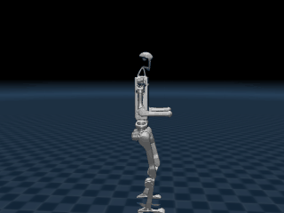
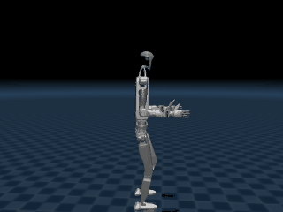

# humanoid_h1_walk

Unitree **H1** 与 **H1_2** 人形机器人在 MuJoCo 中行走、转向、后退，由 PPO 训练得到的
神经网络策略直接输出关节目标角，纯 CPU 实时推理，**不需要训练、不需要 GPU**。

| H1（10 自由度） | H1_2（12 自由度） |
|---|---|
|  |  |

两个机型都从站立开始，依次前进、边走边左转、前进、原地右转、后退、停止，
最低骨盆高度始终在 1.0 m 以上（不摔倒），全程走完约 10.8 m。

## 1. 代码与权重来源

| 内容 | 来源 | 许可 |
|---|---|---|
| 策略网络 `weights/*.pt` | [unitree_rl_gym](https://github.com/unitreerobotics/unitree_rl_gym) 的 `deploy/pre_train/{h1,h1_2}/motion.pt`，固定到 commit `276801e4` | BSD-3-Clause |
| H1 / H1_2 模型与网格 `assets/` | 同上仓库的 `resources/robots/{h1,h1_2}` | BSD-3-Clause |
| 推理流程（观测拼接、PD、相位） | 同上仓库 `deploy/deploy_mujoco/deploy_mujoco.py` 的单进程实现 | BSD-3-Clause |
| 本模块的 ROS 2 封装、测试与文档 | 原创 | BSD-3-Clause |

本模块把上游「Isaac Gym 训练 + MuJoCo 单进程部署」改写成 ROS 2 的两节点结构，
并把两个机型、固定动作序列、指标评价和无头自检补齐。策略与模型权重未做任何修改，
因此行为与上游 `deploy_mujoco.py` 完全一致（见第 7 节实测对比）。

## 2. 环境要求

| 项 | 要求 |
|---|---|
| 系统 | Ubuntu 20.04 / 22.04（ROS 2 Humble），或 Windows 10/11（无 ROS 时可跑离线演示） |
| CPU | 任意 4 核；策略推理单帧约 0.1 ms |
| 内存 | 4 GB |
| GPU | 不需要（离屏渲染用 OpenGL，Linux 无显卡时设 `MUJOCO_GL=osmesa`） |
| Python | 3.10 / 3.11 / 3.12 |
| 依赖 | `mujoco >= 3.1`、`torch`（CPU 版即可）、`numpy`、`pyyaml` |
| 磁盘 | 约 60 MB（其中网格 52 MB） |

## 3. 安装

```bash
# 1) 放入工作空间并安装 Python 依赖（torch 用 CPU 版即可，约 200 MB）
cd ~/ros2_ws/src
# 拷贝本模块目录 humanoid_h1_walk
pip install torch --index-url https://download.pytorch.org/whl/cpu
pip install mujoco pyyaml

# 2) 构建
cd ~/ros2_ws
colcon build --packages-select humanoid_h1_walk
source install/setup.bash
```

模型、网格与权重已随仓库提供，**无需联网下载**。两个策略文件与上游
`unitree_rl_gym@276801e4` 的 `deploy/pre_train/{h1,h1_2}/motion.pt` 字节一致，可直接校验：

| 文件 | 大小 | SHA-256 |
|---|---|---|
| `weights/h1_motion.pt` | 139,345 B | `44a0fbceb81f3877833ae9a398d039bea1759cb0d3c8188181013885f70589eb` |
| `weights/h1_2_motion.pt` | 145,745 B | `ea3003268d5d2e4b5004eb26d0969fbfdedced265ceeec7bf0b335309259cc80` |

> 仓库根 `.gitignore` 有全局 `*.pt` 规则，本模块已在其中加入白名单
> `!src/humanoid/humanoid_h1_walk/weights/*.pt`，否则权重会被静默忽略。

## 4. 运行

### 4.1 一键启动 ROS 2 链路（仿真 + 策略 + 键盘）

```bash
ros2 launch humanoid_h1_walk main.launch.py                 # 默认 H1
ros2 launch humanoid_h1_walk main.launch.py robot:=h1_2     # 换 H1_2
ros2 launch humanoid_h1_walk main.launch.py routine:=true    # 播放固定动作序列（无人操作）
ros2 launch humanoid_h1_walk main.launch.py teleop:=false    # 不启键盘节点，用话题发指令
```

键盘节点启动后：`↑ / ↓` 调整前进速度（连续按 ↓ 会后退），`← / →` 转向，空格停止，`q` 退出。
速度范围被限制在 vx ∈ [−0.5, 1.0] m/s、wz ∈ [−1, 1] rad/s，这是策略训练时见过的区间。

也可以直接用话题驱动：

```bash
ros2 topic pub -r 50 /cmd_vel geometry_msgs/msg/Twist "{linear: {x: 0.5}, angular: {z: 0.0}}"
ros2 topic echo /odom --field pose.pose.position
```

### 4.2 离线演示（不需要 ROS，Windows 也能跑）

```bash
python main.py --demo                 # 无头跑固定序列，打印各阶段平均速度
python main.py --demo --robot h1_2
python main.py --gui                  # 打开 MuJoCo 窗口，方向键调速
python main.py --gui --routine         # 窗口里自动播放固定序列
```

`--demo` 的输出（H1）：

```
机型 h1：Unitree H1：10 自由度双腿人形（髋 3 + 膝 1 + 踝 1，无踝侧摆）
控制周期 20 ms（50 Hz），观测 41 维，动作 10 维

  站立           平均 vx -0.06 m/s，最低骨盆 1.00 m
  前进           平均 vx +0.43 m/s，最低骨盆 1.02 m
  边走边左转        平均 vx +0.46 m/s，最低骨盆 1.03 m
  前进           平均 vx +0.46 m/s，最低骨盆 1.03 m
  原地右转         平均 vx -0.03 m/s，最低骨盆 1.03 m
  后退           平均 vx -0.33 m/s，最低骨盆 1.03 m
  停止           平均 vx -0.08 m/s，最低骨盆 1.03 m
```

### 4.3 自检 / 指标 / 动图

```bash
python main.py --test        # 两机型各跑 31 s，判定「不摔倒 + 真的走了」
python main.py --compare     # H1 / H1_2 步态指标对比（速度跟踪、能耗）
python main.py --gif         # 录制动图（离屏渲染，无需显示器）
```

`--test` 的判定标准与上游 `humanoid-walk` 的 `test_walk.py` 一致：骨盆最低点 > 0.5 m
且前进阶段位移 > 1.0 m。实测输出：

```
机型          最低骨盆      前进位移      末态高度      偏航角
---------------------------------------------
h1         1.00m     3.28m     1.04m   -0.34r
h1_2       1.00m     2.52m     1.01m    1.22r

[PASS] h1: 走完 3.28 m，未摔倒
[PASS] h1_2: 走完 2.52 m，未摔倒

ALL PASS
```

## 5. 控制原理

### 5.1 闭环结构

```
        ┌──────────── 20 ms ────────────┐
        │                               │
  q, q̇, 姿态 ──► 观测(41/47 维) ──► LSTM 策略 ──► 动作 a(10/12 维)
        ▲                                             │
        │                                             ▼
        └──── MuJoCo 物理 ◄── PD 力矩 ◄── q* = 0.25·a + q_default
                10 步 × 2 ms
```

一个控制周期（20 ms）内做 10 个物理步（每步 2 ms）。PD 控制律为

$$
\boldsymbol\tau = K_p \odot (\mathbf{q}^\star - \mathbf{q}) - K_d \odot \dot{\mathbf{q}},
\qquad \mathbf{q}^\star = \alpha\, \mathbf{a} + \mathbf{q}_{\text{default}}
$$

其中 $\alpha = 0.25$ 是动作缩放系数，$K_p, K_d$ 逐关节给出（H1 的膝关节 $K_p = 200$、
踝关节只有 40，因为踝部要柔一些才不会把机器人顶翻）。

### 5.2 观测（H1 41 维 / H1_2 47 维）

| 维度 | 内容 | 缩放 |
|---|---|---|
| 0–2 | 机身角速度（机体系） | × 0.25 |
| 3–5 | 机体系下的重力方向（姿态） | — |
| 6–8 | 速度指令 $[v_x, v_y, \omega_z]$ | × [2, 2, 0.25] |
| 9 – 9+n | 关节角相对默认姿态的偏差 | × 1.0 |
| 9+n – 9+2n | 关节角速度 | × 0.05 |
| 9+2n – 9+3n | 上一帧动作 | — |
| 9+3n – 9+3n+1 | 步态相位的 $\sin, \cos$ | — |

其中 $n$ 为关节数（H1 为 10，H1_2 为 12），相位按 0.8 s 周期推进：

$$
\phi(t) = \frac{t \bmod 0.8}{0.8}, \qquad
\text{obs}_{\sin} = \sin 2\pi\phi,\quad \text{obs}_{\cos} = \cos 2\pi\phi
$$

相位是策略的「节拍器」：网络据此知道当前处于支撑相还是摆动相，不需要自己从
关节角里推断步态节律，这也是这类策略能只用 41 维输入就稳定行走的原因。

### 5.3 策略网络结构

导出文件是 `legged_gym.utils.helpers.PolicyExporterLSTM`，含一层 LSTM 与一个两层 MLP：

| 层 | H1 | H1_2 |
|---|---|---|
| LSTM 输入 | 41 | 47 |
| LSTM 隐状态 | 64 | 64 |
| 全连接 1 | 64 → 32，ELU | 64 → 32，ELU |
| 全连接 2 | 32 → 10 | 32 → 12 |

$$
\begin{aligned}
\mathbf{h}_t &= \mathrm{LSTM}(\mathbf{o}_t, \mathbf{h}_{t-1})\\
\mathbf{a}_t &= W_2\,\mathrm{ELU}(W_1 \mathbf{h}_t + \mathbf{b}_1) + \mathbf{b}_2
\end{aligned}
$$

**LSTM 的隐状态跨帧保留**（$1\times1\times64$），相当于 0.8 s 步态周期内的短期记忆；
重新开始一段仿真时必须清零，`Walker.reset()` 已经处理。也因此策略节点不能在运行中
重启，否则步态会有一个短暂的重新收敛过程。

策略输出的是动作均值（确定性策略），部署时不做采样。

### 5.4 与训练环境的对应关系

上游用 Isaac Gym 训练、MuJoCo 部署，两者必须严格对齐的量有：仿真步长 2 ms、
控制抽减 10、PD 增益、默认关节角、各观测项的缩放系数、步态周期 0.8 s。
本模块把这些量集中放在 `config/robots.yaml`，任何一项改动都会让策略偏离训练分布。

## 6. ROS 2 接口

### 6.1 节点

| 节点 | 作用 | 可执行文件 |
|---|---|---|
| 仿真节点 | MuJoCo 物理 + 观测拼接 + 状态发布 | `sim_node` |
| 策略节点 | TorchScript 推理，观测 → 动作 | `policy_node` |
| 键盘节点 | 方向键 → `/cmd_vel` | `keyboard_teleop` |

### 6.2 话题

| 话题 | 类型 | 方向 | 说明 |
|---|---|---|---|
| `/joint_states` | `sensor_msgs/JointState` | 发布 | 腿部关节角与角速度 |
| `/odom` | `nav_msgs/Odometry` | 发布 | 骨盆位姿（`odom` 系）与机体系速度 |
| `/humanoid/obs` | `std_msgs/Float64MultiArray` | 发布 | 策略输入向量 |
| `/cmd_vel` | `geometry_msgs/Twist` | 订阅 | 速度指令 `[vx, vy, wz]` |
| `/humanoid/joint_targets` | `std_msgs/Float64MultiArray` | 订阅 | 策略输出的动作 |

另有 `odom → base_link` 的 TF（`publish_tf:=false` 可关）。

### 6.3 参数

| 参数 | 默认 | 说明 |
|---|---|---|
| `robot` | `h1` | 机型，`h1` 或 `h1_2` |
| `config` | 空 | 自定义 `robots.yaml` 路径，空则用包内配置 |
| `routine` | `false` | 忽略 `/cmd_vel`，播放固定动作序列 |
| `policy_in_sim` | `false` | 在仿真节点内直接推理（单进程，等价上游 `deploy_mujoco.py`） |
| `teleop` | `true` | 是否启动键盘节点 |
| `publish_tf` | `true` | 是否发布 `odom → base_link` |

`policy_in_sim:=true` 时策略节点不启动，仿真节点自己推理，省掉一次话题往返；
默认的两节点结构每帧多一个控制周期的延迟（20 ms），实测对步态几乎没有影响：

| 机型 | 零延迟位移 | 延迟一个周期 |
|---|---|---|
| H1 | 3.76 m | 3.75 m |
| H1_2 | 3.92 m | 4.18 m |

### 6.4 实测（Ubuntu 22.04 + ROS 2 Humble）

```
$ colcon build --symlink-install --base-paths src/humanoid/humanoid_h1_walk
Summary: 1 package finished

$ ros2 launch humanoid_h1_walk main.launch.py routine:=true teleop:=false
[sim_node]    h1 仿真节点已启动：10 个关节，控制频率 50 Hz（固定动作序列）
[policy_node] h1 策略节点已启动：观测 41 维 → 动作 10 维

$ ros2 topic hz /joint_states
average rate: 49.999

$ ros2 topic echo /odom --field pose.pose.position --once
x: 1.97  y: 2.08  z: 1.03        # 骨盆 1.03 m，正在走

[policy_node] 已推理 750 帧，平均单帧 0.50 ms
```

同样的流程在**从远端干净克隆**的工作空间复跑过（排除本地残留文件），
`colcon list` 识别为 `(ros.ament_python)`、`ros2 pkg prefix` 指向 `install/humanoid_h1_walk`、
`install/.../share/humanoid_h1_walk/weights/` 下有 2 个 `.pt`，
`robot:=h1_2` 也能正常起两节点（单帧 0.62 ms）。

> 若 `colcon list` 把本包识别成 `(python)` 而不是 `(ros.ament_python)`，
> 说明 `package.xml` 解析失败（例如注释里出现连续的 `--`），
> 此时不会生成 `ament_prefix_path` 钩子，`ros2 launch` 会报 `Package not found`。

## 7. 性能指标

固定动作序列（站立 3 s → 前进 6 s → 边走边左转 6 s → 前进 4 s → 原地右转 5 s →
后退 4 s → 停止 3 s，共 31 s）下的实测结果，`python main.py --compare` 可复现：

| 机型 | 质量 | 路径长 | 前进均速 | 最低骨盆 | vx RMSE | wz RMSE | CoT |
|---|---|---|---|---|---|---|---|
| H1 | 51.6 kg | 10.81 m | 0.44 m/s | 1.00 m | 0.101 | 0.083 | 0.34 |
| H1_2 | 67.4 kg | 10.55 m | 0.47 m/s | 1.00 m | 0.099 | 0.142 | 0.33 |

指标定义：

* **vx RMSE**：前进/后退阶段机体系 $v_x$ 与指令的均方根误差（m/s），越小越贴合指令；
* **wz RMSE**：转向阶段 $\omega_z$ 与指令的均方根误差（rad/s）；
* **最低骨盆高度**：全程最低点，衡量是否「蹲着走」；
* **CoT（单位距离能耗）**：$\dfrac{\int \sum_i |\tau_i \dot q_i|\,dt}{m g d}$，无量纲，越小越省力。

两个机型都在指令 0.5 m/s 下实际走出 0.44~0.47 m/s，误差主要来自起步/停止的
加减速段；H1_2 多两个踝侧摆关节，转向时 wz 跟踪略差（0.142 vs 0.083），但
CoT 更低（踝部主动发力减轻了髋膝负担）。

上表是 Windows + MuJoCo 3.16.0 的结果。在 Ubuntu 22.04 + MuJoCo 3.3.7（ROS 2 Humble
容器）里重跑，H1 为 0.41 m/s、H1_2 为 0.49 m/s，前进位移 2.93 / 3.15 m：两个 MuJoCo
版本的接触求解器实现不同，同一策略的步幅会有约 10% 差异，但「不摔倒 + 能走」的判定
两个平台都通过。

与上游单进程实现的一致性：同一段固定序列，上游 `humanoid-walk` 的 `test_walk.py`
报告 H1 走 3.3 m、H1_2 走 2.5 m，本模块为 3.28 m / 2.52 m，差异在数值积分误差量级。

## 8. 与仓库内已有模块的区别

| 模块 | 机型 | 控制方式 | 本模块的差异 |
|---|---|---|---|
| `humanoid_ppo_locomotion` | G1 | 解析平衡基元 + PPO 残差，只做站立 | 机型不同（H1/H1_2），端到端策略直接出行走动作 |
| `humanoid_keyboard_control` | G1 | 直接给关节角，无神经网络 | 本模块用神经网络跟踪速度指令 |
| `humanoid_push_recovery` | G1 | ZMP 刚性抗扰 | 本模块是速度指令跟踪，不含外力恢复 |

H1 与 H1_2 此前在仓库中**没有出现过**，机型、自由度、策略来源都与已合并模块不同。

## 9. 已知问题

1. **Windows 下路径不能含非 ASCII 字符**。MuJoCo 的 `mj_loadXML` 与
   `torch.jit.load` 都按窄字符读文件名，工作区放在 `D:\机器人操作系统\` 这类路径下
   会报 `Error opening file` / `errno 2`。本模块已做兜底：模型自动复制到临时 ASCII
   目录加载，权重改为读成字节流再交给 torch，因此**中文路径也能跑**（第一次运行会
   多花约 1 s 复制 52 MB 网格）。
2. **材质是近黑色**（`rgba="0.1 0.1 0.1"`，Unitree 原始设置），录屏时看不清。
   `scripts/record_gif.py` 默认把材质调亮 5 倍，**只改渲染颜色**，不影响质量与物理。
3. **手臂不参与控制**。策略只输出腿部关节，手臂保持默认角（H1_2 的手臂在
   默认姿态下略微抬起），这不影响行走，但看起来不够自然。
4. **没有外力恢复能力**。策略训练时没有加入推力扰动，受到侧向撞击会倒；
   需要抗扰请配合 `humanoid_push_recovery`。

## 10. 许可证

本模块代码遵循 BSD-3-Clause。模型、网格与策略权重来自
[unitree_rl_gym](https://github.com/unitreerobotics/unitree_rl_gym)（BSD-3-Clause），
版权归 Unitree Robotics 所有，来源对照与完整许可文本见 [THIRD_PARTY.md](THIRD_PARTY.md)。
