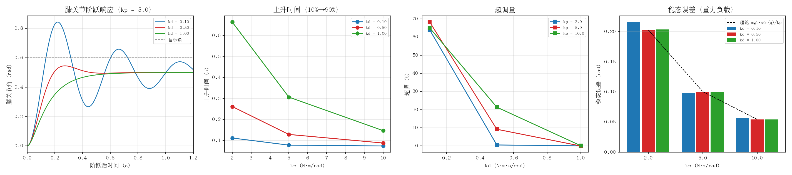

# humanoid_knee_impedance：膝关节阻抗参数整定

把简化双足人形机器人固定在台架上，只让膝关节由阻抗律
`τ = kp·(q_des − q) − kd·q̇` 驱动，对目标角施加一次阶跃，扫描刚度 `kp` 与阻尼
`kd`，量化它们对**上升时间、超调、调节时间、稳态误差、峰值力矩**的影响。

与「调参靠手感」不同，这里把每个指标都定义在明确的窗口里，并给出与等效二阶
系统 `ω_n = √(kp/J)`、`ζ = kd / (2√(kp·J))` 的对照，因此可以直接看出哪些量随
参数单调变化、哪些不是。



## 目录结构

```
humanoid_knee_impedance/
├── humanoid_knee_impedance/
│   ├── controller.py   # 阻抗控制律（纯函数，可单独测试）
│   ├── knee_sim.py     # 台架仿真节点：固定基座 + 双膝阶跃，写 CSV 并发话题
│   ├── metrics.py      # 阶跃响应指标 + 等效二阶系统理论值（纯函数）
│   └── report.py       # 汇总 CSV、打印指标表、生成四联图
├── launch/main.launch.py
├── urdf/simple_humanoid.urdf
├── test/               # 19 项单元测试（不依赖 ROS / PyBullet）
├── run_eval.sh         # kp × kd 网格扫描 + 出图
└── package.xml / setup.py
```

## 环境要求

- Ubuntu 20.04 + ROS 2 Foxy（`ros-foxy-desktop`）
- `ros-foxy-pybullet` 或 pip 版 `pybullet`
- `python3-matplotlib`（出图）、`python3-pytest`（测试）

```bash
sudo apt install ros-foxy-pybullet python3-matplotlib python3-pytest
```

若使用 conda 环境，请确保 `python3 -c "import pybullet"` 与 ROS 使用的是同一个
解释器，否则 `ros2 run` 会找不到模块。

## 编译

```bash
cd ~/ros2_ws
colcon build --packages-select humanoid_knee_impedance
source install/setup.bash
```

## 运行

单组参数（阶跃目标 0.6 rad，阶跃后仿真 2 s）：

```bash
ros2 launch humanoid_knee_impedance main.launch.py \
  knee_kp:=10.0 knee_kd:=0.50
# 想看到图形窗口：
ros2 launch humanoid_knee_impedance main.launch.py \
  knee_kp:=10.0 knee_kd:=0.50 use_gui:=true
```

运行结束后 CSV 落在 `results/samples_kp10.00_kd0.50.csv`（当前工作目录下）。

完整扫描 + 出图：

```bash
cd ~/ros2_ws/src/humanoid/humanoid_knee_impedance
./run_eval.sh          # 依次跑 kp∈{2,5,10} × kd∈{0.1,0.5,1.0}
```

脚本会先删除旧的 `samples_*.csv`，避免换参数后旧数据混进对比表。

单独汇总已有数据：

```bash
ros2 run humanoid_knee_impedance knee_report \
  --results results --figure results/effect.png
```

### 参数

| 参数 | 默认 | 说明 |
| --- | --- | --- |
| `knee_kp` | 10.0 | 阻抗刚度（N·m/rad），必须为正 |
| `knee_kd` | 0.5 | 阻抗阻尼（N·m·s/rad），必须非负 |
| `step_target` | 0.6 | 阶跃目标膝角（rad） |
| `hold_angle` | 0.0 | 阶跃前保持的膝角（rad） |
| `hold_time` | 0.3 | 阶跃前保持时长（s） |
| `duration` | 2.0 | 阶跃后仿真时长（s） |
| `torque_limit` | 8.0 | 膝关节力矩上限（N·m，与 URDF 一致） |
| `sim_time_step` | 0.001 | 仿真步长（s），即 1 kHz 采样 |
| `timer_period` | 0.005 | ROS 定时器周期（s），每拍补足若干仿真步 |
| `use_gui` | false | 是否打开 PyBullet 图形窗口 |
| `out_dir` | results | CSV 输出目录 |

### 话题

`/knee_sample`（`std_msgs/Float64MultiArray`）：
`[t, q, qd, τ, q_des]`，队列深度 1000。

话题只用于 `rqt_plot` 等工具实时观察；**指标用的全分辨率数据由仿真节点直接
写 CSV**。这样即使 CPU 争抢导致话题丢帧，落盘数据也始终完整——阶跃峰值是单点
极值，丢一条就会失真。

## 指标定义

样本序列以阶跃施加时刻为 `t = 0`，所有指标以**最终稳态值**为基准（纯 PD 在重力
负载下有稳态误差，用指令值作基准会把稳态误差混进超调）：

| 指标 | 定义 |
| --- | --- |
| 上升时间 | `q(0)→q(∞)` 幅值的 10% 到 90% 所用时间 |
| 超调量 | `(峰值 − 稳态值) / |稳态值 − 初值|`，单位 % |
| 调节时间 | 最后一次离开 ±2% 误差带的时刻；窗口内未收敛记 `—` |
| 稳态误差 | `q_des − q(∞)`，纯 PD 下约等于 `mgl·sin(q_ss)/kp` |
| 峰值力矩 | 指令力矩最大绝对值，用于判断是否触发限幅 |

按 URDF 质量分布算出的等效参数：膝下连杆（小腿 0.3 kg + 足 0.2 kg）绕膝轴
`J = 0.0296 kg·m²`，重力矩系数 `mgl = 1.05 N·m`。这两个数直接决定理论
`ω_n` 与 `ζ`，不是拟合出来的。

## 实测结果

kp ∈ {2, 5, 10} × kd ∈ {0.1, 0.5, 1.0}，阶跃 0.6 rad，1 kHz 采样，每组 2000 点：

| kp | kd | ζ | ω_n (rad/s) | 上升时间 (s) | 超调 (%) | 调节时间 (s) | 稳态误差 (rad) | 峰值力矩 (N·m) |
| --- | --- | --- | --- | --- | --- | --- | --- | --- |
| 2.0 | 0.10 | 0.21 | 8.2 | 0.112 | 64.0 | 1.770 | 0.216 | 1.20 |
| 2.0 | 0.50 | 1.03 | 8.2 | 0.262 | 0.6 | 0.412 | 0.203 | 1.20 |
| 2.0 | 1.00 | 2.05 | 8.2 | 0.665 | 0.1 | 1.189 | 0.204 | 1.20 |
| 5.0 | 0.10 | 0.13 | 13.0 | 0.078 | 68.3 | — | 0.099 | 3.00 |
| 5.0 | 0.50 | 0.65 | 13.0 | 0.129 | 9.2 | 0.412 | 0.101 | 3.00 |
| 5.0 | 1.00 | 1.30 | 13.0 | 0.307 | 0.0 | 0.557 | 0.101 | 3.00 |
| 10.0 | 0.10 | 0.09 | 18.4 | 0.074 | 65.0 | 1.986 | 0.057 | 6.00 |
| 10.0 | 0.50 | 0.46 | 18.4 | 0.088 | 21.4 | 0.430 | 0.054 | 6.00 |
| 10.0 | 1.00 | 0.92 | 18.4 | 0.147 | 0.2 | 0.236 | 0.054 | 6.00 |

读表要点：

1. **kp 决定响应速度**：`ω_n = √(kp/J)`，kp 从 2 提到 10，ω_n 翻一倍多，
   上升时间固定在 kd=0.1 时从 0.112 s 压到 0.074 s。
2. **kd 抑制超调，但过量阻尼反而更慢**：kp=2 时 kd 从 0.5（ζ=1.03）加到
   1.0（ζ=2.05），超调没了，调节时间却从 0.412 s 拉长到 1.189 s。
3. **稳态误差 ∝ 1/kp**：实测 0.203 / 0.101 / 0.054 rad，与
   `mgl·sin(q_ss)/kp` 的预测（0.203 / 0.099 / 0.054）吻合。纯 PD 无法消除，
   要消掉得加重力前馈。
4. **峰值力矩正好等于 `kp·Δq`**（1.2 / 3.0 / 6.0 N·m），三档都没碰到 8 N·m
   限幅，所以上表反映的是线性阻抗特性，不是限幅后的结果。
5. kp=5、kd=0.1（ζ=0.13）在 2 s 窗口内一直没进入 ±2% 误差带，表中记 `—`，
   而不是拿窗口末尾充数。

## 单元测试

```bash
cd ~/ros2_ws
colcon test --packages-select humanoid_knee_impedance --python-testing pytest
colcon test-result --test-result-base build/humanoid_knee_impedance
```

19 项（控制器 7 + 指标 12），不依赖 ROS 与 PyBullet，可直接
`pytest src/humanoid/humanoid_knee_impedance/test` 跑。

- `colcon test` 默认走已废弃的 `setup.py test`，必须显式加 `--python-testing pytest`；
- 若装了带 typeguard 的 pytest 插件导致收集失败，加
  `PYTEST_DISABLE_PLUGIN_AUTOLOAD=1`。

## 已知限制

- 纯 PD 阻抗没有重力前馈，稳态误差随 kp 减小而变大（见上表第 3 条）。模块刻意
  保留这一点，作为「误差从哪来」的教学点；消除方法是在力矩里加
  `mgl·sin(q)` 前馈。
- `ζ`、`ω_n` 由等效惯量算出，忽略了 ankle 伺服环与重力非线性，只用于看趋势。
  例如 kp=2、kd=0.1 按线性二阶预测超调约 52%，实测 64.0%：重力把稳态值拉低后，
  以稳态值为基准的百分比会被放大，而绝对峰值仍低于线性预测。
- 仿真按墙钟推进（`accumulator` 单拍封顶 0.05 s），极慢机器上仿真时间会落后
  墙钟；但结束判据用的是仿真时间，CSV 始终是完整的 `duration` 秒数据。
