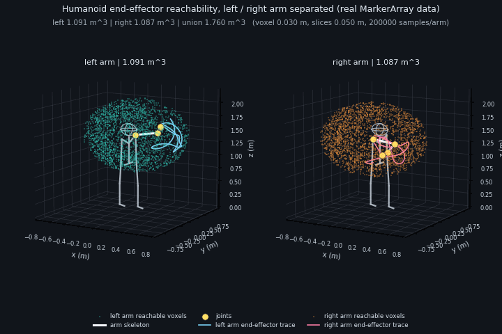

# 人形机器人双臂末端可达域分析可视化

本模块为简化 3D 人形机器人建立左右两条 7-DoF 手臂运动链（肩 3 + 肘 1 + 腕 3），在关节限位内做均匀随机采样，用正运动学计算末端参考点位置，再以体素栅格统计双臂可达域的体积、包围盒、最大伸展半径与分层切片，并通过 MarkerArray 显示体素外壳、切片、包围盒、示例骨架、静态参考骨架与在线末端轨迹。

模块不依赖 URDF 与 TF，仅依靠代码内置的连杆长度与关节限位，可独立运行验证。

## 运行环境

- Ubuntu 22.04
- ROS 2 Humble
- 依赖：`rclcpp std_msgs geometry_msgs visualization_msgs eigen`

## 简化模型

坐标约定：x 前、y 左、z 上，`world` 原点位于机器人双脚之间的地面。

| 项目 | 取值 |
| --- | --- |
| 肩点高度 | 1.42 m |
| 肩点横向偏移 | 0.20 m（左 +y，右 -y，几何镜像） |
| 上臂长度 | 0.30 m |
| 前臂长度 | 0.28 m |
| 腕点至末端参考点 | 0.10 m |

| 关节 | 轴 | 限位（°） |
| --- | --- | --- |
| shoulder_pitch | y | -120 ~ 120 |
| shoulder_roll | x | -20 ~ 170 |
| shoulder_yaw | z | -85 ~ 85 |
| elbow_flex | y | 0 ~ 145 |
| wrist_roll | x | -90 ~ 90 |
| wrist_pitch | y | -70 ~ 70 |
| wrist_yaw | z | -45 ~ 45 |

## 构建

```
mkdir -p ~/ros2_ws/src
cp -r ~/ros2/src/humanoid/humanoid_reachability ~/ros2_ws/src/
cd ~/ros2_ws
source /opt/ros/humble/setup.bash
rosdep install --from-paths src --ignore-src -r -y
colcon build --packages-select humanoid_reachability
source install/setup.bash
```

## 启动

```
ros2 launch humanoid_reachability main.launch.py
```

`main.launch.py` 同时启动两个节点：

- `humanoid_reachability`：可达域采样、统计与 MarkerArray 发布；
- `arm_demo_node`：按正弦轨迹发布双臂 14 个关节角（`/demo_joint_angles`），用于在线验证正运动学与末端轨迹。

## 话题

| 话题 | 类型 | 说明 |
| --- | --- | --- |
| `/demo_joint_angles` | `std_msgs/msg/Float64MultiArray` | 输入：左臂 7 + 右臂 7 个关节角（rad） |
| `/reachable_workspace` | `visualization_msgs/msg/MarkerArray` | 15 个标记：体素外壳、切片、包围盒、骨架、轨迹、静态参考骨架 |
| `/reachable_volume` | `std_msgs/msg/Float64MultiArray` | `[左臂体积, 右臂体积, 双臂并集体积]`（m³） |
| `/reachable_bounds` | `std_msgs/msg/Float64MultiArray` | 左臂、右臂包围盒，各 6 个值（xmin, xmax, ymin, ymax, zmin, zmax） |
| `/reachability_stats` | `std_msgs/msg/String` | 多行汇总：每臂采样数、体素、表面体素、体积、最大半径、包围盒，末行为并集体积与重叠体素 |
| `/demo_end_effector_left` | `geometry_msgs/msg/PointStamped` | 演示姿态下左臂末端参考点 |
| `/demo_end_effector_right` | `geometry_msgs/msg/PointStamped` | 演示姿态下右臂末端参考点 |

## 参数

参数位于 `config/params.yaml`，可用 `ros2 launch ... samples_per_arm:=...` 覆盖前两项。

| 参数 | 默认值 | 说明 |
| --- | --- | --- |
| `samples_per_arm` | 200000 | 每臂在 7 维关节空间的均匀随机采样次数 |
| `voxel_resolution` | 0.03 | 体素边长（m） |
| `slice_height` | 0.05 | 高度切片厚度（m） |
| `random_seed` | 2026 | 随机种子，保证结果可复现 |
| `max_display_voxels` | 2500 | 单臂表面体素最大显示数量（超出后等间隔抽稀；设为 0 表示不限制） |
| `publish_rate` | 2.0 | 统计与 MarkerArray 发布频率（Hz） |
| `publish_hz` | 20.0 | 演示节点关节角发布频率（Hz） |
| `period` | 8.0 | 演示轨迹周期（s） |
| `amplitude_scale` | 0.35 | 演示振幅相对关节限位范围一半的系数 |

## 统计口径

1. **体素体积**：把末端采样点落入边长为 `voxel_resolution` 的体素，体积等于占用体素数乘以单个体素体积。整格计数会让边缘略微外扩，采样不足又会漏掉部分区域，因此该值既非严格上界也非严格下界，只是离散估计，体素越小、采样越密越接近真实可达域。
2. **表面体素**：26 邻域内至少缺一个邻居的体素，用于绘制壳体，避免把上万个体素全部塞进 RViz。
3. **最大伸展半径**：所有采样末端点到对应肩点的最大距离。
4. **分层切片**：按 `slice_height` 沿 z 轴分带，输出层内占用体素数、x/y 范围与面积估计（体素数 × 体素面积）。
5. **并集体积**：左右臂体素取并集后统计，重叠区域只计一次。

## 可视化

```
ros2 run rviz2 rviz2 -d ~/ros2_ws/install/humanoid_reachability/share/humanoid_reachability/rviz/reachability.rviz
```

Fixed Frame 设为 `world`，MarkerArray 话题选择 `/reachable_workspace`。体素壳立方体按 `0.9 × voxel_resolution`（默认 0.027 m）绘制，留出缝隙避免相邻面重叠闪烁；左臂体素由青到绿、右臂由橙到红按高度渐变；切片为每层 x/y 范围的矩形线框，层内体素少于 5 个的切片不绘制；示例骨架与末端轨迹随演示节点实时更新；灰色 `body_skeleton` 为躯干/骨盆/下肢静态参考骨架，`body_head` 为半径 0.22 m 的半透明头部球（动图中按三向线框绘制），二者仅作空间参照，不参与可达域计算。

若虚拟机显卡性能不足，可先只开数据话题（`/reachable_volume`、`/reachability_stats`）检查数值，再开 RViz2。

> 本项目的验证虚拟机（VMware + llvmpipe）上 RViz2 启动即崩溃（`OGRE::UnimplementedException: pack to PF_UNKNOWN`、`AxisAlignedBox::setExtents` 断言），因此仓库动图由节点实际发布的 MarkerArray 数据在虚拟机内离线渲染，未做 RViz2 人工视觉确认。

## 运行效果

默认参数（每臂 200000 点、体素 0.03 m、切片 0.05 m、种子 2026）在该虚拟机上实测：

- 双臂采样耗时 20.78 s；
- 左臂：占用体素 40409（表面 25139），体积 1.091 m³，包围盒 x[-0.690, 0.690] y[-0.480, 0.900] z[0.720, 2.100]，最大伸展半径 0.680 m；
- 右臂：占用体素 40252（表面 25149），体积 1.087 m³，包围盒 x[-0.690, 0.690] y[-0.900, 0.480] z[0.720, 2.100]，最大伸展半径 0.680 m；
- 并集体积 1.760 m³，重叠体素 15480（约 0.418 m³，占单臂体素 38.3%）；
- MarkerArray 稳定为 15 个标记（首帧另带 1 个 `DELETEALL` 清理旧显示），左右体素壳各抽稀到 2286 / 2287 个立方体，切片各 28 层。

包围盒口径说明：`/reachable_bounds` 与 MarkerArray 使用占用体素的外沿（体素中心 ± 半个体素 = ±0.015 m），不是采样点原始极值。因此左臂 y 上限 0.900 m 会比“肩点 0.20 m + 最大伸展 0.680 m = 0.880 m”多出约半个体素，x 上限 0.690 m 同理；这是离散外扩，与最大伸展半径不矛盾。



左右臂分面板显示：青色为左臂体素壳、橙色为右臂，灰色为躯干/骨盆/下肢参考骨架，白色为演示姿态骨架，黄色为关节球，曲线为末端轨迹。动图由真实 MarkerArray 数据离线渲染（24 帧、720×480）。

## 已知限制

- 手臂为简化刚性链，未建模躯干、头部碰撞与自碰撞，也未加入肩部/肘部耦合约束；
- 均匀随机采样在高维关节空间下存在覆盖盲区，体素体积随采样数与分辨率变化，属于估计值而非解析解；
- 右臂由左臂几何镜像得到，未建模左右侧实际差异；
- 末端参考点固定为腕点沿局部 x 轴 0.10 m 处，未建模手指与工具；
- 静态参考骨架（躯干、骨盆、下肢、头部）仅用于空间参照，不参与可达域计算。

## 许可

Apache-2.0
