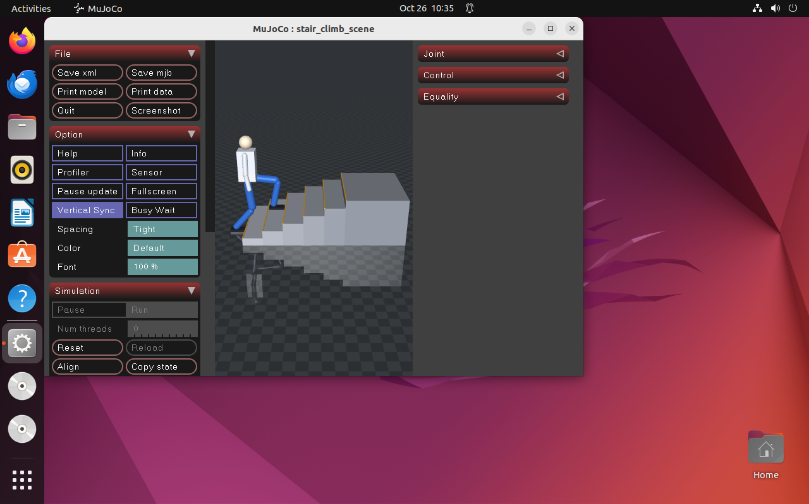
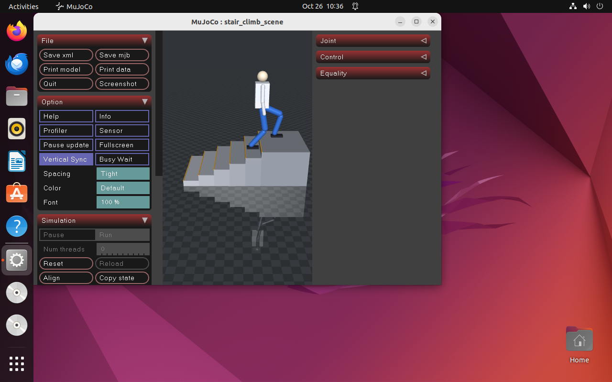

# humanoid_stair_climb —— 人形上下台阶步态仿真

MuJoCo 场景：平地 + **6 级台阶**（每级高 0.12 m、深 0.30 m）+ 平台，总爬升 0.72 m。
人形用**解析逆解 + 分段足端轨迹**交替迈步，逐级走上去，全程脚底不穿台阶、关节不越限。

**台阶是平地模块覆盖不到的一类**：足端必须抬到比落点更高的高度才能跨过立面，
重心要跟着支撑脚升降，腿长余量随时可能不够。

## 效果

| 起步 | 中段（第 4～5 级） |
|---|---|
|  |  |

完整动图与说明见 [`docs/humanoid/humanoid_stair_climb.md`](../../../docs/humanoid/humanoid_stair_climb.md)。

## 实测结果

Ubuntu 22.04 + Python 3.10.12 + MuJoCo 3.15.0，控制频率 50 Hz，步态周期 1.4 s。

| 指标 | 数值 |
|---|---|
| 到达平台 | 是 |
| 用时 | 11.84 s |
| 步数 | 17 |
| 爬升 | 0.720 m（= 6 × 0.12） |
| 最高基座 | 0.780 m |
| 脚与台阶最小间距 | −0.000 m（无穿透） |
| 落脚点误差 | 0.000 m |
| 关节越界 | 0（六个关节全查，限位见 `models/stair_scene.xml`）|

## 环境（已验证）

| 组件 | 版本 |
|---|---|
| 系统 | Ubuntu 22.04（VMware 虚拟机）/ Windows（standalone） |
| Python | 3.10（22.04）/ 3.13（Windows） |
| MuJoCo | 3.15.0（Ubuntu）/ 3.16.0（Windows） |
| 依赖 | `mujoco`、`numpy`（pip 安装）；录帧另需 `pillow` |
| ROS | Humble（仅 ROS 节点与 launch 需要） |
| 图形 | 无需独显；`--record` 需 OpenGL 上下文 |

## 安装与运行

```bash
sudo apt update && sudo apt install -y python3-pip patchelf libgl1 libglfw3
python3 -m pip install -r requirements.txt

cd src/humanoid/humanoid_stair_climb
python3 main.py --test                 # 自检 14 项，失败退出码 1
python3 main.py                        # 打开 MuJoCo 窗口实时演示
python3 main.py --headless             # 打印指标并写 CSV
python3 main.py --headless --record frames --record-every 0.4   # 逐帧导出
```

## 边界

- **不含平衡控制**：基座是 freejoint 运动学驱动，重心高度由步态给定，不是动力学算出来的。
  本模块评价「足端轨迹与逆解是否合理」，不评价「人形会不会摔倒」。
- **脚不参与接触**：脚 `contype=0`，与台阶的间距用 `mj_geomDistance` 量，不做接触力求解。
- **无感知与规划**：台阶尺寸是给定的，不做视觉识别或落脚点搜索。
- **单一场景**：6 级等高等深的直台阶，结论不外推到变高变深、带转角的楼梯。
- **速度较慢**：设计前进速度 0.214 m/s（步幅 0.30 / 周期 1.4），等价于「一步一级」的保守走法。
  实测起点 x = −0.35、终点 2.19，11.84 s 走 2.54 m，平均 0.215 m/s。
