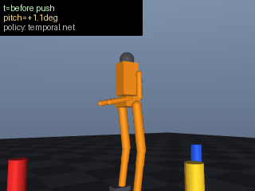

# 人形机器人多帧时序端到端视觉平衡控制

> 课程任务④：端到端模型 —— 连续 3 帧前视图像 → MLP → 15 维关节目标角

## 1. 功能概述

机器人头部前视相机连续取 3 帧 64×64 灰度图，每帧池化成 16×16（256 维），拼接成
768 维输入，经纯 NumPy 实现的 MLP（768→256→128→15）直接回归 15 维关节目标角，
由关节 PD 执行。网络不接触任何特权状态（root 高度、躯干欧拉角、接触力），
输入只有图像。

## 2. 环境

| 项 | 版本 |
|---|---|
| 系统 | Ubuntu 22.04.5 LTS |
| 仿真 | MuJoCo 4.0.0（`mujoco.Renderer`，Xvfb 下 headless 渲染） |
| Python | 3.12.11 |
| 依赖 | numpy 1.26.4 / imageio 2.31 / Pillow（见 `requirements.txt`） |

## 3. 网络

```
x ∈ R^768  =  concat( f(t-2·10步), f(t-10步), f(t) )     f ∈ R^256
h1 = ReLU(W1 x + b1)      W1 ∈ R^{768×256}
h2 = ReLU(W2 h1 + b2)     W2 ∈ R^{256×128}
y  = W3 h2 + b3           W3 ∈ R^{128×15}
```

训练口径：逐维 z-score 标准化（`STD_FLOOR = 0.01`，近似恒定的输入维不会被放大成
噪声），Adam（lr=1e-3，b1=0.9/b2=0.999/eps=1e-8），MSE 损失，batch=64，80 epoch。

## 4. 数据采集（行为克隆）

```
reset → 老师闭环站定 300 步 →
1~3 次随机推力（20~70 N，0~360°，起始散布 0~700 步，每次持续 40 步）→
每 10 步取一帧 → 每 30 步产一个样本（3 帧 × 256 维）→
标签 = 该时刻 sim.teacher_target() 的实际输出
```

- **推力区间 20~70 N 的依据**：本机型（15 个可动关节、无迈步能力）只靠踝策略时，
  20 N 不倒（倾角 15.5°）、50 N 不倒（40.4°）、**80 N 起必倒**。超出老师能力的
  样本学不会，故不采集。
- **防泄漏**：`FRAME_STRIDE=10`、`SAMPLE_STRIDE=30`，3×10=30，相邻样本的 3 帧窗口
  不重叠。
- **数据体检**：采集结束内置检查，`图像唯一行` 过低或 `标签逐维 std 中位数 < 1e-3`
  直接抛 `RuntimeError` —— 防止「标签恒为常量站姿」这种能训出漂亮 MSE 的假数据。

## 5. 实测数字

### 5.1 站姿与平衡层

| 场景 | 3 s 最大倾角 | root_z | 结论 |
|---|---|---|---|
| 原始代码站姿 `(0,0.08,-0.16,-0.08,0)` + 纯 PD | **89.78°** | 0.315 | 自倒（step 700 已判跌倒） |
| 本模块站姿 + 平衡层**关** | **59.81°** | 0.748 | 仍倒，说明站姿本身不够 |
| 本模块站姿 + 平衡层**开** | **1.73°** | 1.076 | 站住 |

这一对数字（1.73° vs 59.81°）证明踝策略真的在起作用，而不是模型恰好稳。

### 5.2 数据集

| 指标 | 值 |
|---|---|
| 样本 | 2012（68 episodes） |
| 图像唯一行 | 1469 / 2012（73%，非重复帧） |
| 标签逐维 std 中位 | 0.0349（max 0.1505） |
| 发生变化的维度 | **8 / 15**（髋 pitch、膝、踝 pitch、踝 roll 各双侧） |
| 恒定维度 | hip_roll、双肩、双肘、颈 —— 老师策略不驱动这些关节，属设计使然 |

### 5.3 开环精度（2012 样本，train 1610 / val 402）

| 指标 | 网络 | 常数基线（永远输出训练集均值） | 降幅 |
|---|---|---|---|
| val_mse (rad²) | **0.00001** | 0.00455 | **99.7%** |
| val_mae (rad) | **0.00185** | 0.03342 | 18 倍 |

逐维 MAE(rad)：`hipP_l=0.0024 knee_l=0.0047 ank_l=0.0023 ankR_l=0.0039`，右侧同量级，
双臂/颈 ≈0.0002。误差集中在真正在动的踝/膝，不是在复读站姿。

### 5.4 闭环（5 次随机推力 20~70 N，站定 300 步，评估 600 步）

| 策略 | 站住 | max_pitch | 平均倾角 | root_z |
|---|---|---|---|---|
| teacher（内置踝策略，上界参考） | 5/5 | 19.1° | 7.3° | 0.961 |
| const（永远输出均值姿态） | 5/5 | 27.1° | 10.0° | 0.964 |
| **net（本模块，3 帧）** | **5/5** | **19.6°** | **7.3°** | 0.957 |
| net1（消融：最近 1 帧重复 3 次） | 5/5 | 19.6° | 7.3° | 0.957 |

读法：网络闭环指标贴住 teacher 上界（19.6° vs 19.1°，平均倾角同为 7.3°），
明显优于复读均值的 const（27.1° / 10.0°）。**注意 const 也站住了** —— 说明在
20~70 N 区间「站住」不是有效的区分指标，真正区分网络与复读均值的是倾角幅度。

### 5.5 时序窗口的真实作用（开环消融）

| 输入 | val MAE | val MSE |
|---|---|---|
| 3 帧真实序列 | **0.00167** | 1.0e-5 |
| 最近 1 帧重复 3 次 | 0.00258 | 3.0e-5 |
| 中间帧重复 3 次 | 0.00190 | 1.4e-5 |

3 帧比单帧 MAE 低 35%，但**闭环上两者完全相同（19.6°/7.3°）**，原因是闭环误差
已被 PD 与物理过程主导，不由此量级的开环差异决定。

进一步实测：采样帧间隔 10 步（20 ms）时相邻帧特征平均差只有特征 std 的 **0.58%**
—— 机器人在 20 ms 内几乎不动。把间隔拉长到 20 步（40 ms）重采重训后，绝对误差反而
变差（MAE 0.00167 → 0.00216）、帧间差也只到 0.82%，因为标签是**当前状态的无记忆
函数**，更旧的帧携带的是过期信息。因此帧间隔保持 10 步，3 帧窗口的作用是「多帧
平均抑制 16×16 池化的单帧量化噪声 + 极短时速度线索」，不是真正的动态建模。
若要时序承载动力学信息，需要改用依赖历史的标签（如预测 k 步后的姿态）。

## 6. 复现

```bash
pip install -r requirements.txt
cd src/humanoid/humanoid_temporal_e2e

python3 main.py --check                      # 7 项自检
python3 main.py --collect --samples 2000     # 采集（约 4 min）
python3 main.py --train --epochs 80          # 训练 + 常数基线对照
python3 main.py --eval --eval-episodes 5     # 闭环评估（teacher/const/net/net1）
python3 main.py --demo --force 50 --steps 600 --gif demo.gif   # 真实渲染录 gif
python3 -m unittest discover -s test         # 10 条回归测试
```

headless 环境（无显示器）需要 `Xvfb :99 -screen 0 1280x1024x24 &` 并
`export DISPLAY=:99`，否则 `mujoco.Renderer` 初始化失败。

ROS2：

```bash
colcon build --packages-select humanoid_temporal_e2e
source install/setup.bash
ros2 launch humanoid_temporal_e2e main.launch.py
```

## 7. 演示



50 N 推力下的全程：网络每步只看到 3 帧 64×64 灰度图，输出 15 维关节目标角，
PD 执行，未跌倒。画面为 MuJoCo `overview` 机位逐帧真实渲染（302 帧），左上角为
当前 pitch 与膝/踝目标角。

## 8. 与单帧端到端（PR #424）的关系

| 维度 | 单帧 | 本模块 |
|---|---|---|
| 输入 | 256 维 | 768 维（3 帧） |
| 时序信息 | 无 | 有（窗口 20 ms，见 5.5 的局限说明） |
| 闭环 | 单帧策略 | teacher 上界附近，优于常数基线 |

单帧与 3 帧在本任务的闭环指标相同，差异只体现在开环精度（5.5 表）。本模块保留
3 帧结构的理由是任务要求时序输入，且为后续换成依赖历史的标签留好接口。
