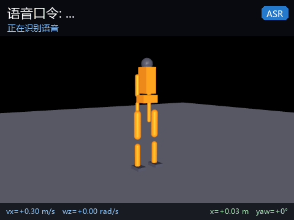

# humanoid_voice_command — 人形机器人离线语音指令控制

用 **Whisper tiny** 在 CPU 上离线识别口令，再由「规则匹配 + 字符 n-gram 意图网络」
两级判定出运动意图，最后转成 `/cmd_vel` 速度指令与上身动作请求。
全链路离线，不需要联网、不需要 GPU、不调用任何云端服务。



## 模块结构

```
humanoid_voice_command/
├── main.py                     离线入口（--wav / --demo / --text / --bench / --list）
├── config/intents.yaml         口令词表、基准速度、速度档位
├── humanoid_voice_command/
│   ├── asr.py                  Whisper 封装（16 kHz 重采样、重复片段折叠、权重定位）
│   ├── intent.py               规则匹配 + 意图网络（TorchScript）
│   ├── voice_node.py           ROS 2 感知节点：音频 → /voice_text、/voice_intent
│   └── command_node.py         ROS 2 决策节点：意图 → /cmd_vel、/humanoid/gesture
├── launch/main.launch.py       一键启动（语音 + 指令 + MuJoCo 仿真）
├── scripts/
│   ├── train_intent.py         训练意图网络（模板自动增广，CPU 约 1 s）
│   ├── eval_pipeline.py        端到端评估（识别准确率、耗时、速度指令）
│   ├── plot_eval.py            画指标图
│   ├── prepare_audio.py        把口令音频统一成 16 kHz / 16 bit / 单声道
│   ├── download_weights.py     预取并校验 Whisper 权重（仓库不携带 72 MB）
│   └── record_gif.py           录制演示动图
├── audio/                      18 条预录口令（约 1 MB）
├── weights/intent_mlp.pt       意图网络（304 KB，TorchScript）
└── test/test_offline.py        46 条离线单元测试
```

## 安装

```bash
# 1) PyTorch CPU 版（不要装默认的 CUDA 版，会多下载 2 GB）
pip install torch --index-url https://download.pytorch.org/whl/cpu
# 2) 语音识别
pip install openai-whisper soundfile pyyaml
# 3) 预取 Whisper tiny 权重到 ~/.cache/whisper（72 MB，只需一次，会校验 sha256）
python scripts/download_weights.py
# 4) 构建
cd ~/ros2_ws && colcon build --packages-select humanoid_voice_command humanoid_keyboard_control
source install/setup.bash
```

**关于权重**：仓库不携带 72 MB 的 Whisper 权重。首次运行时
`whisper.load_model('tiny')` 会自动下载到 `~/.cache/whisper`，之后全程离线；
上面第 3 步只是把这一步提前，并核对官方 sha256。完全断网的机器可以在一台能联网的
机器上跑 `python scripts/download_weights.py --copy-to <包内 weights/whisper 目录>`，
把文件拷进包内，`asr.py` 会优先使用它（也可用 `--model-path` 或环境变量
`HUMANOID_VOICE_WHISPER` 指向任意副本）。

## 离线试跑（不需要 ROS）

```bash
python main.py --list                       # 列出 18 条口令音频
python main.py --wav audio/forward_1.wav    # 识别单条：文本 → 意图 → 速度指令
python main.py --demo                       # 顺序播放全部口令
python main.py --text "往前走"              # 跳过语音，直接测意图解析
python main.py --bench                      # 测平均推理耗时
```

典型输出：

```
音频               识别文本         意图          来源     耗时     速度指令
forward_1.wav    前进           forward     rule   154   ms vx=+0.30 m/s  wz=+0.00 rad/s
wave_1.wav       轰手           wave        net    162   ms vx=+0.00 m/s  wz=+0.00 rad/s
```

第二行的 `轰手` 是 Whisper tiny 的真实识别错误（「挥」→「轰」），规则匹配不到，
由意图网络兜底判成 `wave`。

## ROS 2 使用

```bash
# 语音 + 指令 + MuJoCo 仿真（默认播放 audio/ 目录下全部口令）
ros2 launch humanoid_voice_command main.launch.py

# 只跑单条口令
ros2 launch humanoid_voice_command main.launch.py wav:=<share>/audio/forward_1.wav

# 无图形界面（服务器 / 容器）
ros2 launch humanoid_voice_command main.launch.py visualize:=false

# 不用仿真，只发指令（配合已有的行走模块）
ros2 launch humanoid_voice_command main.launch.py start_sim:=false
```

### 话题

| 话题 | 类型 | 方向 | 说明 |
|---|---|---|---|
| `/voice_text` | `std_msgs/String` | 发布 | 识别出的文本 |
| `/voice_intent` | `std_msgs/String` | 发布 | 意图名（8 类 + `unknown`） |
| `/voice_command` | `std_msgs/String` | 发布 | JSON：文本、意图、置信度、判定来源、耗时 |
| `/cmd_vel` | `geometry_msgs/Twist` | 发布 | 速度指令（仿真节点消费） |
| `/humanoid/gesture` | `std_msgs/String` | 发布 | 上身动作请求（`wave`） |
| `/joint_states`、`/humanoid/odom` | — | 订阅 | 由 `humanoid_keyboard_control` 的仿真节点发布 |

### 参数

| 参数 | 默认 | 说明 |
|---|---|---|
| `wav` | `''` | 单条口令音频路径 |
| `audio_dir` | 包内 `audio/` | 目录轮询，按文件名顺序播放 |
| `interval` | `3.0` | 两条口令之间的间隔（s） |
| `loop` | `true` | 目录轮询是否循环 |
| `model` | `tiny` | Whisper 规格（`tiny`/`base`/`small`） |
| `model_path` | `''` | 本地 Whisper 权重路径，空则用缓存或自动下载 |
| `language` | `zh` | 识别语言，`auto` 为自动检测 |
| `hold_time` | `3.0` | 一条运动指令保持多久后自动停车（s） |

## 支持的口令

| 意图 | 口令示例 | 输出 |
|---|---|---|
| `forward` | 前进 / 往前走 / 向前走 | `vx = +0.30 m/s` |
| `backward` | 后退 / 往后退 | `vx = −0.20 m/s` |
| `turn_left` | 左转 / 向左转 | `wz = +0.60 rad/s` |
| `turn_right` | 右转 / 向右转 | `wz = −0.60 rad/s` |
| `stop` | 停止 / 停下 / 别动 | 立即清零 |
| `wave` | 挥手 / 打个招呼 | 发 `/humanoid/gesture` |
| `faster` | 快一点 / 加速 | 档位 ×1.5 |
| `slower` | 慢一点 / 减速 | 档位 ×0.6 |

速度与档位都在 `config/intents.yaml` 里改，不用动代码。

## 评测结果

18 条口令（8 类 × 2 种说法 + 2 条英文）：

| 指标 | 结果 |
|---|---|
| 意图准确率 | 18/18 = 100% |
| 识别文本命中率 | 18/18 = 100% |
| 平均识别耗时（CPU） | 0.15~0.23 s / 条（首条含预热约 0.45 s） |
| 无关语音拒识 | 32/32 判为 `unknown`（不会误触发动作） |
| 意图网络验证准确率 | 98.5%（1311 条模板增广样本） |

```bash
python scripts/eval_pipeline.py --json /tmp/eval.json   # 端到端评估
python scripts/plot_eval.py /tmp/eval.json              # 画指标图
pytest test/test_offline.py -q                          # 46 条单元测试
```

## 重新生成口令音频

仓库里的 18 条 wav 用 Windows 中文语音合成（SAPI，语速 130 wpm）生成，
体积约 1 MB。想换口令或换音色时：

```bash
python scripts/prepare_audio.py <源目录> audio   # 统一成 16 kHz / 16 bit / 单声道
```

Linux 下可用 `espeak-ng` 或 `edge-tts` 合成，再跑上面的脚本规整格式。

## 已知限制

* 用的是 `tiny` 模型（39 M 参数），中文同音字仍会出错（例如「挥」→「轰」），
  靠意图网络兜底；换成 `base` / `small` 可提升字面准确率，但推理耗时涨 3~5 倍。
* 拒识策略偏保守：**单字**（「右」「停」「快」）和**否定句**（「不要前进」「不用停止」）
  一律判 `unknown`。宁可不动，也不下发方向相反的指令；代价是「右」这类省略说法
  需要说完整（「右转」）。
* 同音字兜底不是万能的：`缩转`（`左转` 的误识）网络会判成 `stop`，规则层也没命中，
  最终由「网络意图与输入零字符重合 → 取 LCS 最接近候选」这条规则救回 `turn_left`。
  这只是兜底，不代表识别准确率提升。
* 口令音频是预录的 wav，不是麦克风实时采集。需要实时麦克风时用
  `voice_node --ros-args -p use_mic:=true`（要求安装 `sounddevice` 且有音频设备，
  容器里通常没有）。
* 仿真执行层复用 `humanoid_keyboard_control` 的 MuJoCo 节点，其运动是
  演示级运动学控制，不代表真实双足步态。

## 许可证

BSD-3-Clause。Whisper 模型与代码来自 [openai/whisper](https://github.com/openai/whisper)（MIT），
详见 `THIRD_PARTY.md`。
