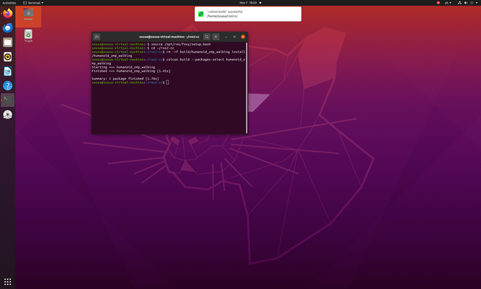
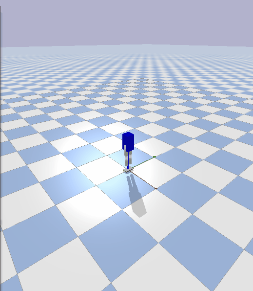

# 人形机器人轻量级 ZMP 步行控制基线

ROS 2 功能包 `humanoid_zmp_walking` 使用说明

## 修改概述 / Overview

- 中文：新增 `humanoid_zmp_walking` 模块，用线性倒立摆模型（LIPM）完成
  「落脚点序列 → 平滑质心轨迹 → ZMP 反算 → 支撑多边形判定」的离线规划，
  再由 ROS 2 话题把 6 个关节指令送入 PyBullet 仿真，观察 6 关节人形
  模型执行该步态序列时的摆动与平衡表现。
- English: A lightweight ZMP walking baseline built on the linear inverted
  pendulum model (LIPM). It plans a footstep sequence, a ZMP reference and a
  center-of-mass trajectory, verifies that the ZMP stays inside the support
  polygon, and streams joint commands to a 6-joint humanoid in PyBullet.

## 运行环境

- 操作系统：Ubuntu 20.04
- ROS 版本：ROS 2 Foxy
- 依赖库：Python 3.8，`rclpy`，`std_msgs`，`launch`，`launch_ros`，
  `ament_index_python`，`pybullet`

## 核心代码文件

```
src/humanoid/humanoid_zmp_walking/
├── launch/
│   └── main.launch.py          # 一键启动轨迹生成与仿真节点
├── resource/
│   └── humanoid_zmp_walking    # resource 资源标识文件
├── humanoid_zmp_walking/
│   ├── __init__.py
│   ├── lipm.py                 # LIPM 正逆运算（ZMP <-> 质心加速度）
│   ├── footstep.py             # 落脚点序列、支撑多边形判定
│   ├── gait.py                 # 质心轨迹、ZMP 反算、关节相位
│   ├── zmp_generator.py        # 轨迹生成节点
│   └── play.py                 # PyBullet 仿真节点
├── test/
│   └── test_gait.py            # 步态与 LIPM 单元测试
├── urdf/
│   └── simple_humanoid.urdf    # 6 关节人形模型（含脚掌与踝关节）
├── package.xml
├── setup.cfg
└── setup.py
```

## 核心代码内容

- [lipm.py](./humanoid_zmp_walking/lipm.py)
- [footstep.py](./humanoid_zmp_walking/footstep.py)
- [gait.py](./humanoid_zmp_walking/gait.py)
- [zmp_generator.py](./humanoid_zmp_walking/zmp_generator.py)
- [play.py](./humanoid_zmp_walking/play.py)
- [main.launch.py](./launch/main.launch.py)
- [simple_humanoid.urdf](./urdf/simple_humanoid.urdf)
- [test_gait.py](./test/test_gait.py)

## ZMP 计算说明

1. `lipm.py` 实现零力矩点与质心的互算关系：

   `p = c - (z_c / g) * a`，以及反向的 `a = (c - p) / (z_c / g)`

2. `footstep.py` 生成左右交替的落脚点序列。默认 `t_step = 1.0 s`，即每
   1.0 s 落一步；其中摆动期 0.4 s、双脚支撑期 0.6 s，摆动期间由另一只
   脚单独支撑。

3. `gait.py` 先构造平滑的质心轨迹：前进方向匀速（加速度为 0），侧向按
   步态周期做余弦摆动、幅度等于 `step_width`，摆动腿离地时质心位于支撑
   脚上方；随后用 LIPM 关系 `p = c - (z_c / g) * a` 由质心二阶差分反算
   ZMP。关节相位为左右髋反相、膝关节单向屈曲、踝关节抵消髋与膝的转角；
   相位在 2 个步长（2 s）内转一周，对应关节正弦驱动频率 0.5 Hz。

4. 支撑多边形取已落地脚掌矩形之并（脚掌 0.14 m × 0.12 m，中心间距
   0.12 m，两矩形相接），逐采样点判定 ZMP 是否位于其内。默认参数下
   （`com_height = 0.65 m`、`step_length = 0.10 m`、`step_width = 0.06 m`）
   601 个采样点全部位于支撑域内，ZMP 侧向幅值约 ±0.099 m。

## 环境说明：仿真不是实时的

`play.py` 显式调用 `p.setTimeStep(1/240)` 作为固定步长，并在每个 ROS
定时器回调里按实际经过时间累积、补足若干个固定步（单次上限 10 步），
用于抵消 executor 调度抖动与 GUI 渲染开销。仿真时间因此不保证与墙钟
严格同步，日志中的底盘高度反映的是仿真步内的状态。

## 已知限制：仿真中会失稳

本包的定位是**规划层基线**，只负责回答「ZMP 是否始终位于支撑多边形
内」，不包含平衡控制器：

- `zmp_generator` 输出的 ZMP 轨迹由质心轨迹反算得到，逐点判定已通过
  （默认参数下 601 个采样点全部在支撑域内），这部分与仿真是否摔倒无关。
- 模型只有绕 y 轴的俯仰关节（髋、膝、踝），没有侧向自由度，规划中的
  横向质心摆动在物理上无法执行；单侧膝屈曲后支撑腿变短，躯干只能向
  该侧倾斜。
- `play.py` 是开环关节回放，没有 IMU、没有踝力矩反馈、没有接触力闭环，
  因此机器人会在一段时间后失稳倒下。这是预期行为，不是规划失败。
- 若要实现动态步行，需要在此基线上增加侧向自由度与基于 ZMP 误差的
  平衡反馈，属于后续工作。

## 启动步骤

```bash
colcon build --packages-select humanoid_zmp_walking
source install/setup.bash
ros2 launch humanoid_zmp_walking main.launch.py
```

无图形界面的环境可用 `ros2 run humanoid_zmp_walking play --ros-args -p use_gui:=false`。

## 话题接口

| 话题 | 类型 | 元素含义 |
|------|------|----------|
| `/zmp_trajectory` | `Float64MultiArray` | `[t, zmp_x, zmp_y, com_x, com_y, in_support]` |
| `/joint_commands` | `Float64MultiArray` | `[左髋, 左膝, 左踝, 右髋, 右膝, 右踝]`（rad） |

## 运行效果





## 测试

```bash
colcon test --packages-select humanoid_zmp_walking
colcon test-result --verbose
```
