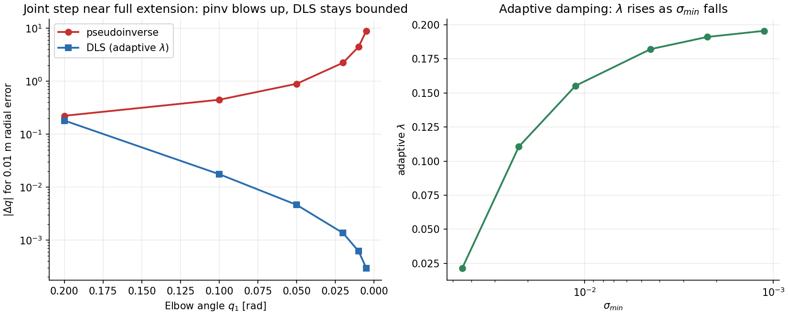
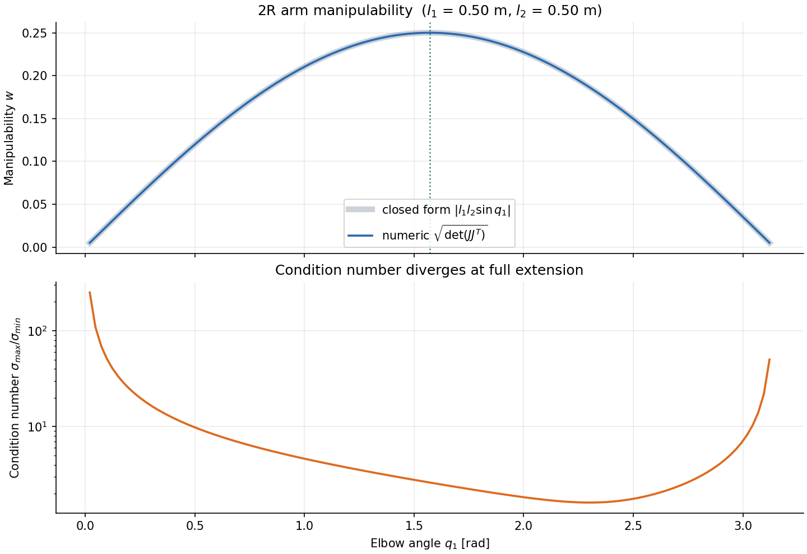
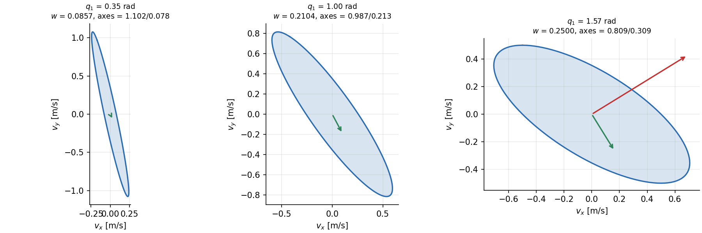
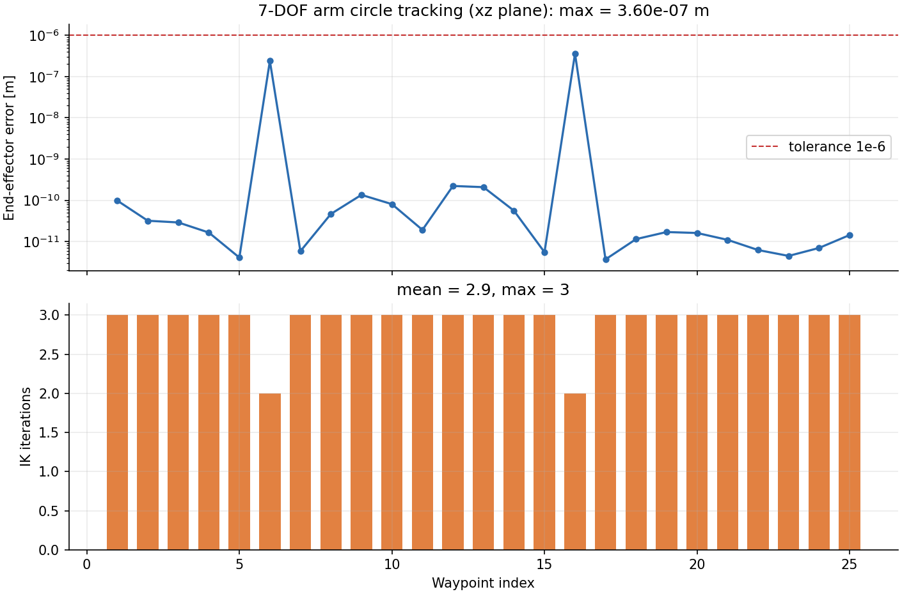

# 实验 2｜人形机器人全身逆运动学与可操作性

给定末端位姿反解关节角，用可操作性量化位形好坏，并在奇异位形附近保持数值稳定。
核心逻辑只依赖 NumPy。

对应课程页面：<https://openhutb.github.io/ros2/humanoid/whole_body_ik/>

## 1. 正运动学

关节约定为“先平移、再绕轴转动”：

```
T_i = Translate(origin_i) · Rot(axis_i, q_i)
T_ee = T_0 · T_1 · … · T_{n−1} · Translate(tool)
```

2R 平面臂展开后应精确等于

```
x = l1·cos(q0) + l2·cos(q0 + q1)
y = l1·sin(q0) + l2·sin(q0 + q1)
```

实测 2R 正解与解析式的最大偏差 **2.22e−16 m**（双精度舍入量级）。

## 2. 雅可比

用几何法而不是解析求导。对转动关节 i：

```
z_i  = R_{0..i−1} · axis_i
p_i  = 关节位置
Jv_i = z_i × (p_ee − p_i)
Jw_i = z_i
```

拼成 6×n。与中心差分 `(p(q+h) − p(q−h)) / 2h` 对照，最大偏差 **6.34e−10**。

## 3. 三种逆解与奇异点处的差别

```
Δq = Jᵀ (J Jᵀ + λ² I)⁻¹ e
```

λ = 0 退化为最小范数伪逆；λ 随 σ_min 自适应（σ_min ≥ 0.05 时不阻尼，
低于后线性升到 0.2）。让 2R 臂肘角从 0.2 趋近 0（完全伸直），给固定
0.01 m 径向误差：

| q1 (rad) | σ_min | 伪逆 \|Δq\| | DLS \|Δq\| | 自适应 λ |
| --- | --- | --- | --- | --- |
| 0.200 | 4.46e−2 | 0.2224 | 0.18070 | 0.0214 |
| 0.100 | 2.24e−2 | 0.4466 | 0.01753 | 0.1106 |
| 0.050 | 1.12e−2 | 0.8941 | 0.00462 | 0.1553 |
| 0.020 | 4.47e−3 | 2.2359 | 0.00135 | 0.1821 |
| 0.010 | 2.24e−3 | 4.4721 | 0.00061 | 0.1911 |
| 0.005 | 1.12e−3 | 8.9442 | 0.00029 | 0.1955 |



**伪逆步长按 1/σ_min 线性增长**（σ_min 减半就翻倍；实测最后一步比值
8.944/4.472 = 2.00），真实机器人上就是关节速度飙到失控、电机报警。
DLS 用阻尼把步长压到 1e−4 量级，代价是奇异方向收敛变慢。

## 4. 可操作性

Yoshikawa 指标 `w = sqrt(det(J Jᵀ))`，几何意义是末端速度椭球体积。2R 平面臂
取 x、y 两行时有闭式解 `w = |l1 l2 sin q1|`，与数值实现一致性到 **1.39e−16**。

| 肘角 q1 | 长半轴 | 短半轴 | w |
| --- | --- | --- | --- |
| 0.35 | 1.1016 | 0.0778 | 0.0857 |
| 1.00 | 0.9873 | 0.2131 | 0.2104 |
| π/2 | 0.8090 | 0.3090 | 0.2500 |





> **一个容易踩的坑**：平面 2R 臂的 3 维位置雅可比**恒奇异**——它本来就在
> 平面里运动，z 方向永远是 0。直接算 `det(J Jᵀ)` 会把所有位形都判成奇异；
> 必须只取机构真正能驱动的任务维度（这里取 x、y 两行）。另外 NumPy 的
> `svd` 对 m×n（m > n）只返回 n 个奇异值，剩下的 m−n 个恒为 0，需要显式
> 补零，否则会漏判奇异。

## 5. 7 自由度冗余

7 自由度手臂（肩 3 + 肘 1 + 腕 3）自由度 7 > 任务维度 6，有 1 维零空间：

```
|J · (I − J⁺J) z| = 4.59e−15      （零空间内关节被调整，末端不动）
```

本实现还进一步检查了**冗余在各关节上的分布**：在默认位形下，零空间主方向由
`shoulder_yaw / shoulder_roll / wrist_yaw / wrist_roll` 承担，**肘关节分量为 0**。
也就是说，“肘角”在这一位形下被末端位姿唯一决定，次级任务只能在其余关节
上做。这个结论是位形相关的，不能一概而论。

## 6. 圆轨迹跟踪

7 自由度手臂末端沿半径 0.12 m 的圆走一圈（25 点，每点以上一点为初值）：

| 平面 | 最大误差 | 平均迭代 | 最大迭代 | 全部收敛 |
| --- | --- | --- | --- | --- |
| 竖直圆 x-z | **3.60e−07 m** | 2.92 | 3 | 是 |
| 水平圆 x-y | **1.82e−09 m** | 3.00 | 3 | 是 |




竖直圆要经过接近伸直的位形（误差尖峰出现在第 6、16 点），所以最大误差比
水平圆大两个数量级，但仍在容差内。

## 7. 反例：2R 臂做不了 6 维位姿逆解

| 任务 | 收敛 | 误差 |
| --- | --- | --- |
| 末端绕 z 转 0.3 rad | 否 | 0.1329 |
| 伸到 0.85 m（臂展 1.0 m，但链路受限） | 否 | 0.1500 |
| 只求平面位置 (0.5, 0.5) | 是 | 1.22e−11 |

不是算法的问题，是任务提得超出了机构能力。**报告 IK 失败时先检查任务是否
可达，再怀疑求解器。**

## 8. 怎么跑

```bash
cd whole_body_ik
python main.py              # 完整实验 + 4 张图 + GIF + CSV + metrics.txt
python main.py --quick      # 跳过 GIF，圆轨迹用 12 点
python main.py --no-gif     # 只跳过 GIF
python -m pytest -q         # 34 个单元测试
```

输出在 `out/`：

| 文件 | 内容 |
| --- | --- |
| `metrics.txt` | 全部指标与结论 |
| `singularity_scan.csv` | 伪逆 / DLS 步长、σ_min、自适应 λ |
| `manipulability_vs_elbow.csv` | 数值 / 闭式可操作性、条件数 |
| `singularity_damping.png` | 奇异点步长与阻尼曲线 |
| `manipulability_vs_elbow.png` / `manipulability_ellipsoid.png` | 可操作性曲线与椭球 |
| `ik_tracking_xz.png` / `ik_tracking_xy.png` | 圆轨迹误差与迭代次数 |
| `ik_circle.gif` | 7 自由度手臂画圆线框动画 |

## 9. 文件结构

```
whole_body_ik/
├── main.py                  # 入口：数值校验 -> 奇异点 -> 可操作性 -> 画圆
├── scripts/
│   ├── linalg.py            # 旋转、SO(3) log、伪逆、DLS、阻尼、零空间
│   ├── kinematics.py        # 关节 / 链 / 正解 / 几何雅可比 / 2R / 7DoF
│   ├── ik_solver.py         # 位姿 IK、位置 IK、圆轨迹跟踪
│   ├── manipulability.py    # 可操作性、椭球、奇异扫描、零空间报告
│   ├── plots.py             # 4 张 PNG
│   └── animate.py           # 线框 GIF
└── tests/test_ik.py         # 34 个用例
```

## 10. 已知限制

- 逆解是**局部**方法，收敛依赖初值；目标远离当前位形时可能落到不同关节解；
- 只做位置/位姿逆解，不做轨迹的时间参数化与速度规划；
- 不考虑碰撞，关节限位只在关节空间夹取；
- 可操作性用标准 Yoshikawa 定义，未做尺度归一化（位置与姿态量纲不同，
  6 维指标需要谨慎解读）；
- 零空间次级任务（避限位）只在理论上验证了投影不移动末端，没有做成
  完整的“限位回避”策略——如第 5 节所述，哪些关节能参与是位形相关的。

## 参考

- J. Yoshikawa, *Manipulability of Robotic Mechanisms*, 1985
- B. Siciliano et al., *Robotics: Modelling, Planning and Control*, 2009
- S. Chiaverini et al., *Review of the Damped Least-Squares Inverse Kinematics
  with Experiments on an Industrial Robot Manipulator*, 1994
