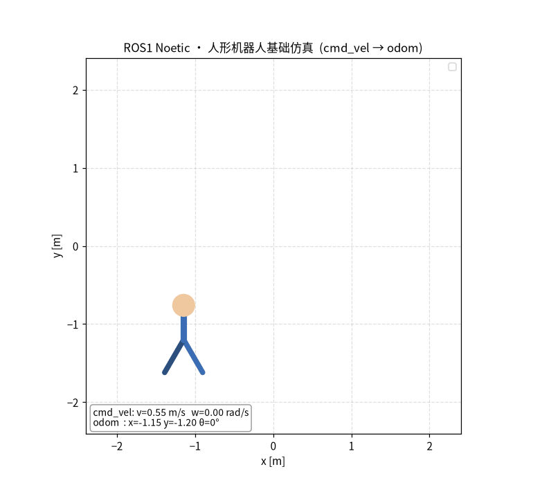

# humanoid_walk_sim

人形机器人行走仿真功能包(ROS1 Noetic)。演示 ROS 最基础的**发布/订阅**通信闭环:
一个"人形机器人"沿方形路径自动行走,由三个节点通过话题协作完成,无需真实机器人即可运行。

```
[控制器] --发布cmd_vel--> [里程计仿真] --发布odom--> [可视化]
  发 v,w                    积分出 x,y,theta          画出人形走路并存 GIF
```

## 功能

- **节点1 `cmd_vel_publisher`**:周期发布速度指令 `/cmd_vel`(Twist),直走+原地转弯,让机器人沿方形路径行走
- **节点2 `odom_sim`**:订阅 `/cmd_vel`,按差速机器人运动学积分出位姿,发布 `/odom` 里程计与 `odom -> base_link` TF
- **节点3 `robot_visualizer`**:订阅 `/odom`,用 matplotlib 画出会走路的人形机器人(头+躯干+摆动的双腿),并自动保存 GIF

运行效果:



## 运行环境

- Ubuntu 20.04 + ROS1 Noetic(Python 3)
- 依赖:rospy / std_msgs / geometry_msgs / nav_msgs / tf2_ros / matplotlib / pillow

```bash
sudo apt update
sudo apt install -y python3-tk python3-matplotlib python3-pil
```

## 1. 放入工作空间并构建

将整个 `humanoid_walk_sim` 文件夹放入 ROS 工作空间的 `src` 目录(例如 `~/catkin_ws/src`),然后编译:

```bash
cd ~/catkin_ws
catkin_make
```

## 2. 加载工作空间环境

```bash
source ~/catkin_ws/devel/setup.bash
```

## 3. 启动运行

```bash
roslaunch humanoid_walk_sim main.launch
```

启动后,人形机器人会自动沿方形路径行走,仿真约 20 秒后 GIF 自动保存到 `~/.ros/humanoid_demo.gif`。

## 4. 验证"它真的在动"

仿真运行时,另开终端:

```bash
source ~/catkin_ws/devel/setup.bash
rostopic echo /odom/pose/pose/position/x   # x/y 坐标不断变化 = 机器人在走
rqt_graph                                  # 查看节点与话题关系
```

## 话题接口

- 发布话题:`/cmd_vel`(`geometry_msgs/Twist`),10Hz
  - `linear.x`:线速度(m/s)
  - `angular.z`:角速度(rad/s)
- 发布话题:`/odom`(`nav_msgs/Odometry`)
- TF:`odom -> base_link`

## 目录结构

```
humanoid_walk_sim/
├── CMakeLists.txt
├── package.xml
├── README.md
├── launch/
│   └── main.launch          # 一键启动三个节点
└── scripts/
    ├── cmd_vel_publisher.py # 节点1: 控制器
    ├── odom_sim.py          # 节点2: 里程计仿真
    └── robot_visualizer.py  # 节点3: 可视化
```

## 修改试玩

编辑 `scripts/cmd_vel_publisher.py` 中的 `straight_v`(走路速度)、`straight_t`(直走时长)、`turn_w`(转弯角速度),
重新 `catkin_make` 后再 `roslaunch`,观察行走轨迹变化。

---

> **声明**:本模块代码与文档由大语言模型(AI)辅助生成,我已核对内容并对提交结果负责。
