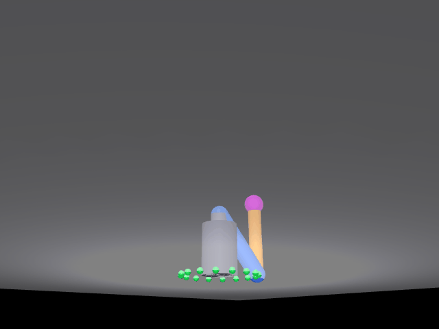

# mujoco_arm_3d：三自由度机械臂空间螺旋线仿真

基于 MuJoCo 的三自由度机械臂（肩方位 yaw + 肩俯仰 shoulder + 肘俯仰 elbow）仿真：
末端在 3D 空间中沿**圆柱螺旋线**运动（水平画圆 + 垂直匀速上升），
解析空间 IK 实时解算三个关节角，运动学驱动（IK 解直接写入 `qpos` 再 `mj_forward`）
保证末端严格落在轨迹上，逐帧渲染并合成 `demo_arm3d.gif` 效果图。

## 演示效果



## 算法

- **空间逆运动学（ik3）**：由末端位置 (x, y, z) 先求水平方位角 q0 = atan2(y, x)，
  再在臂平面（r-z）内用两连杆解析解求肩角 q1、肘角 q2；
  yaw 角做解缠处理保证多圈连续旋转（1.5 圈 / 540°）。
- **正运动学（fk3）**：q0、q1、q2 -> 末端世界坐标，用于与仿真器互查验证。
- **运动学驱动**：把 IK 解直接写入 `qpos`（`qvel` 清零）后 `mj_forward`，
  末端跟随误差实测 **0.0 mm**。同时保留 PD 位置控制路径（`ARM3D_PD=1`）作对照：
  2 ms 步长下 PD 带宽不足，实测各增益（KP/KD = 40/12、120/25、200/40、300/60、400/80）
  末端误差仍有 100~540 mm、肘关节来回震荡，因此演示默认走运动学驱动。
- **相机标定（DLT）**：手算 lookAt + 透视投影与 MuJoCo 实际相机的像素约定有偏差
  （黄线与末端明显错位），改用 DLT 标定：渲染多组标定姿态，按末端品红球的像素质心
  反解 3×4 投影矩阵（平均重投影误差 1.5 px），再把末端世界坐标投影成像素叠加黄色轨迹线。

## 文件

| 文件 | 说明 |
|---|---|
| `main.py` | 主程序（XML 内嵌，单文件可直接运行） |
| `verify_arm3d.py` | 验证脚本：`ik`（IK 精度）与 `gui`（glfw 实时渲染） |
| `docs/mujoco_arm_3d_demo.gif` | 演示效果图（当前代码直接输出：216 帧 / 640×480） |
| `docs/mujoco_arm_3d.md` | 模型、算法与验证详细说明 |

## 运行

```bash
pip install mujoco pillow numpy
python3 main.py                        # 生成 demo_arm3d.gif
python3 verify_arm3d.py ik             # IK 数值精度验证
python3 verify_arm3d.py gui            # glfw 实时渲染验证（弹出窗口）
```

无图形界面环境（虚拟机）用 osmesa：

```bash
MUJOCO_GL=osmesa python3 main.py
```

PD 控制对照路径（可选）：

```bash
ARM3D_PD=1 ARM3D_KP=40 ARM3D_KD=12 python3 main.py
```

## 验证结果（本机实测，MuJoCo 3.17.0）

| 项 | 结果 |
|---|---|
| IK 数值精度 | 螺旋线 8 个空间点 逆解→正解互查，最大误差 **0.0000 mm** |
| 末端跟随误差 | 运动学驱动下 216 帧逐帧对比，首帧 / 末帧 / 最大 **0.0 mm** |
| 相机标定 | 10 个标定点，平均重投影误差 **1.54 px**；末帧投影与末端球实测偏差 **4.04 px** |
| 效果图 | `docs/mujoco_arm_3d_demo.gif`：216 帧 / 9.0 秒 / 640×480 / 1.72 MB（脚本直接输出，非录屏） |

参数：半径 0.20 m，螺旋高度 0.32 → 0.56 m，1.5 圈，每帧 21 个 2 ms 物理子步
（物理时间与轨迹推进同步：1/24 s = 41.7 ms ≈ 21 × 2 ms）。
