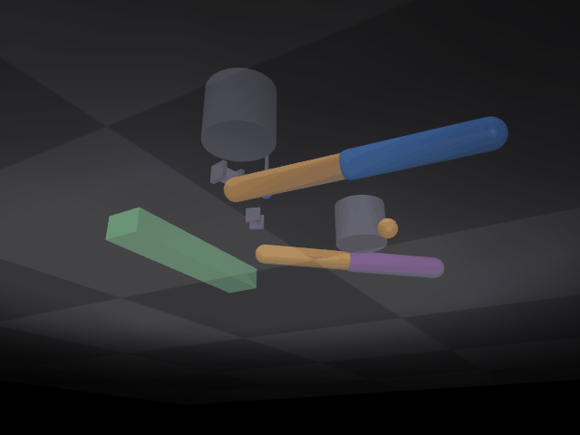

# mujoco_arm_dual

基于 **MuJoCo** 的双机械臂协同搬运仿真。

在 MuJoCo 3D 场景中：两台二连杆机械臂对称布置（带垂直升降关节与夹爪），
协同完成一次「抓取 → 抬升 → 平移 → 放下」，把一块长木板从 A 区搬到 B 区。
两臂末端各画一条黄色轨迹线，直观展示协同搬运路径。

## 场景

```
         A 区（起点）                    B 区（终点）
   🟦🟧┃                            🟦🟧┃
   ────╋━━━ 绿色长木板 ━━━╋────    ────╋━━━ 绿色长木板 ━━━╋────
        ┃🟪🟧                             ┃🟪🟧
   臂1（蓝橙） 臂2（紫橙）             臂1（蓝橙） 臂2（紫橙）
```

- 连杆长度：`L1 = L2 = 0.25 m`，水平面内运动（Z = 0.15 m）+ 垂直升降关节；
- 木板：`0.40 × 0.08 × 0.05 m` 绿色长方体，free joint；
- 任务：A 区 `(0.35, 0.30)` → B 区 `(0.35, -0.15)`，两臂同步夹持两端搬运；
- 全程 4.6 秒（110 帧 @ 24 fps）。

## 演示效果



> 双机械臂同步下降 → 夹取木板两端 → 抬升 → 协同平移 → 在 B 区放下，
> 两条黄色轨迹线记录两臂末端路径。

## 算法栈

| 模块 | 文件 | 作用 |
|---|---|---|
| 逆运动学 | `mujoco_arm_dual_single.py` | 解析 2 连杆 IK（`ik2`），实时解算两臂 (q1, q2) |
| 关节控制 | `mujoco_arm_dual_single.py` | 水平关节 PD 位置控制（KP=100, KD=25），升降/夹爪直接位置过渡 |
| 吸附判定 | `mujoco_arm_dual_single.py` | 两臂夹爪均降到木板中心高度（<6mm）且都闭合后吸附 |
| 木板位姿 | `mujoco_arm_dual_single.py` | 两夹爪中点 + 两点连线朝向角（yaw） |
| 相机标定 | `mujoco_arm_dual_single.py` | DLT 标定（10 目标点 → 红 tip 像素 → 3×4 投影矩阵） |
| 轨迹绘制 | `mujoco_arm_dual_single.py` | 两臂末端透视投影到像素，逐帧叠加黄色轨迹线 |
| 验证 | `verify_dual.py` | IK 数值精度互查（误差 0.0000mm）+ glfw 实时渲染 |

## 运行环境

- Ubuntu 20.04 / Windows 11
- Python 3.8+
- 依赖：`mujoco`、`pillow`、`numpy`；无显卡环境需 `libosmesa6-dev`（osmesa 软渲染）

## 快速开始

```bash
# 1. 安装依赖
pip3 install --user mujoco pillow numpy
sudo apt install -y libosmesa6-dev        # 无显卡虚拟机需要

# 2. 运行（生成 demo_dual.gif，110 帧 / 4.6 秒）
MUJOCO_GL=osmesa python3 mujoco_arm_dual_single.py

# 3. 查看效果图
xdg-open demo_dual.gif

# 4. 可选验证：IK 数值精度 / 实时渲染
MUJOCO_GL=osmesa python3 verify_dual.py ik
MUJOCO_GL=glfw   python3 verify_dual.py gui
```

详细说明见 [docs/mujoco_arm_dual.md](docs/mujoco_arm_dual.md)。
