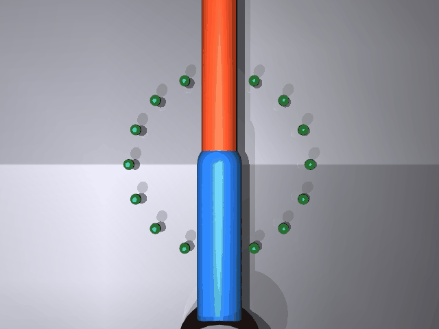

# mujoco_arm_ik

基于 **MuJoCo** 的二连杆机械臂逆运动学（IK）画圆轨迹仿真。

在 MuJoCo 3D 场景中：一个两连杆平面机械臂的末端沿半径为 0.15 m 的圆形轨迹匀速运动，
程序用**解析 2 连杆逆运动学**实时解算两个关节角，PD 位置控制驱动关节，
末端走过的路径以黄色轨迹线画出，与地面上的 16 个绿色参考圆点对照。

## 场景

```
  俯视图（相机正上方）
        ● ● ● ● ●         ← 绿色参考圆点（半径 0.15 m，圆心 (0.3, 0)）
       ●           ●
      ●    🟦🟧     ●       ← 蓝色第一段杆 + 橙色第二段杆（末端红色小球）
      ●     🟨      ●       ← 黄色轨迹线：末端画出的正圆
       ●           ●
        ● ● ● ● ●
```

- 连杆长度：`L1 = L2 = 0.30 m`（水平面内运动，Z = 0.05 m）；
- 轨迹：圆心 `(0.30, 0)`、半径 `0.15 m`，6 秒一圈，循环 8 秒；
- 目标圆完全位于机械臂工作空间内（半径 0.15 ≤ L1 + L2 = 0.60 m）。

## 演示效果



> 录制于 VMware Ubuntu 20.04 虚拟机（MuJoCo 离屏渲染，osmesa 软渲染）：
> 机械臂末端沿圆形轨迹运动，黄色轨迹线逐渐画出一个完整正圆，与绿色参考圆重合。

## 算法栈

| 模块 | 文件 | 作用 |
|---|---|---|
| 逆运动学 | `mujoco_arm_ik.py` | 解析 2 连杆 IK（`ik2`），实时解算 (q1, q2) |
| 关节控制 | `mujoco_arm_ik.py` | 关节 PD 位置控制（KP=30, KD=8） |
| 模型定义 | `arm_2link.xml` | 两连杆机械臂、地面、16 个绿色参考圆点 |
| 轨迹绘制 | `mujoco_arm_ik.py` | 末端目标点透视投影到像素，逐帧画出黄色轨迹 |
| 验证 | `verify_ik.py` | IK 数值精度互查（误差 0.0000mm）+ glfw 实时渲染 |

## 运行环境

- Ubuntu 20.04 / Windows 11
- Python 3.8+
- 依赖：`mujoco`、`pillow`、`numpy`；无显卡环境需 `libosmesa6-dev`（osmesa 软渲染）

## 快速开始

```bash
# 1. 安装依赖
pip3 install --user mujoco pillow numpy
sudo apt install -y libosmesa6-dev        # 无显卡虚拟机需要

# 2. 运行（生成 demo.gif，192 帧 / 8 秒）
MUJOCO_GL=osmesa python3 mujoco_arm_ik.py

# 3. 查看效果图
xdg-open demo.gif

# 4. 可选验证：IK 数值精度 / 实时渲染
MUJOCO_GL=osmesa python3 verify_ik.py ik
MUJOCO_GL=glfw   python3 verify_ik.py gui
```

详细说明见 [docs/mujoco_arm_ik.md](docs/mujoco_arm_ik.md)。
