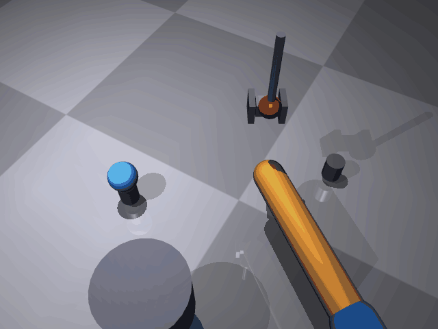

# mujoco_arm_pick

基于 **MuJoCo** 的机械臂抓取搬运（Pick & Place）仿真。

在 MuJoCo 3D 场景中：一个两连杆平面机械臂的末端带**垂直升降关节 + 夹爪**，
自动完成「移动到球上方 → 下降 → 夹取 → 抬升 → 移动到目标点 → 下降 → 释放」
的全流程，把蓝色小球从 A 点托盘搬运到 B 点托盘，
末端走过的路径以黄色轨迹线画出。

## 场景

```
  侧视图（示意）
                          A 点托盘柱           B 点托盘柱
                             ╭──╮                ╭──╮
                             │ ● │  ← 蓝色小球    │   │
      🟦🟧 机械臂两段杆        │   │                │ ● │  ← 球被放到 B
      (水平面 Z=0.15)         ╰───╯                ╰───╯
      ├── 垂直升降关节 + 夹爪 ──┤
      夹爪下降 → 夹起球 → 抬升 → 移到 B → 下降 → 张开释放
```

- 连杆长度：`L1 = L2 = 0.30 m`（水平面内运动，Z = 0.15 m）；
- 任务：球从 `A(0.18, 0.20, 0.08)` 夹起，运到 `B(0.45, -0.15, 0.08)` 放下；
- 末端带垂直升降关节（lift）+ 旋转夹爪（grip），夹爪逻辑吸附小球（无物理接触）。

## 演示效果



> 录制于 VMware Ubuntu 20.04 虚拟机（MuJoCo 离屏渲染，osmesa 软渲染）：
> 机械臂移动到 A 点上方 → 下降 → 夹爪闭合把球夹起 → 抬升 → 移动到 B 点 →
> 下降 → 张开夹爪把球放到 B 点托盘上，全程黄色轨迹线跟随末端。

## 算法栈

| 模块 | 文件 | 作用 |
|---|---|---|
| 逆运动学 | `mujoco_arm_pick.py` | 解析 2 连杆 IK（`ik2`），解算水平目标 (q1, q2) |
| 关节控制 | `mujoco_arm_pick.py` | 水平 PD（KP=100, KD=25）+ 升降 PD（KP=200, KD=20） |
| 任务调度 | `mujoco_arm_pick.py` | 9 段时间轴：下降/夹取/抬升/移动/放下/收回 |
| 抓取逻辑 | `mujoco_arm_pick.py` | 逻辑吸附：夹爪中心降到球心高度附近时锁定球位置 |
| 模型定义 | `arm_gripper.xml` | 两连杆臂 + 升降关节 + 夹爪 + 球 + A/B 托盘柱 |
| 轨迹绘制 | `mujoco_arm_pick.py` | DLT 相机标定把末端 3D 位置投影到像素，逐帧画黄色轨迹 |

## 运行环境

- Ubuntu 20.04 / Windows 11
- Python 3.8+
- 依赖：`mujoco`、`pillow`、`numpy`；无显卡环境需 `libosmesa6-dev`（osmesa 软渲染）

## 快速开始

```bash
# 1. 安装依赖
pip3 install --user mujoco pillow numpy
sudo apt install -y libosmesa6-dev        # 无显卡虚拟机需要

# 2. 运行（生成 demo_pick.gif，201 帧 / 8.4 秒）
MUJOCO_GL=osmesa python3 mujoco_arm_pick.py

# 3. 查看效果图
xdg-open demo_pick.gif
```

## 验证

脚本运行结束会打印小球最终位置，并与目标点 B 做断言（无头环境 / CI 可直接判读，无需看 GIF）：

```
小球最终位置：x=0.4500 y=-0.1500 z=0.0800 m
目标点 B：(0.45, -0.15, 0.08) m，偏差 0.0000 m（阈值 0.0200 m）
搬运判定：PASS（小球已放到目标点 B）
```

偏差超过 `0.02 m` 时断言失败、脚本以非 0 退出码退出，说明搬运没有真正到位。

## 效果图体积

`demo_pick.gif` 由 201 帧 640×480 逐帧渲染合成，本地实测约 **15.5 MB**，超过仓库单文件 10 MB 的限制。
仓库内 [docs/mujoco_arm_pick_demo.gif](docs/mujoco_arm_pick_demo.gif)（8.1 MB）是压缩后提交的版本。

> **生成的文件仅本地查看，不要直接提交。** 如需更新仓库里的演示图，请先降低 `FPS` / 分辨率，或二次压缩到 10 MB 以内再提交；脚本结束时也会打印生成体积并在超限时给出提示。

详细说明见 [docs/mujoco_arm_pick.md](docs/mujoco_arm_pick.md)。
