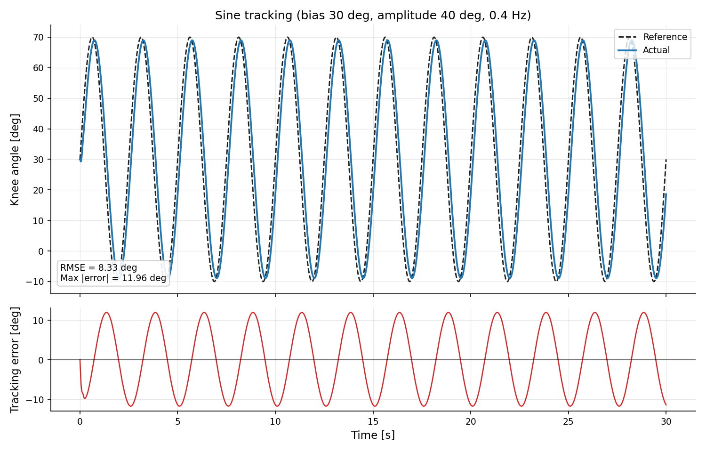
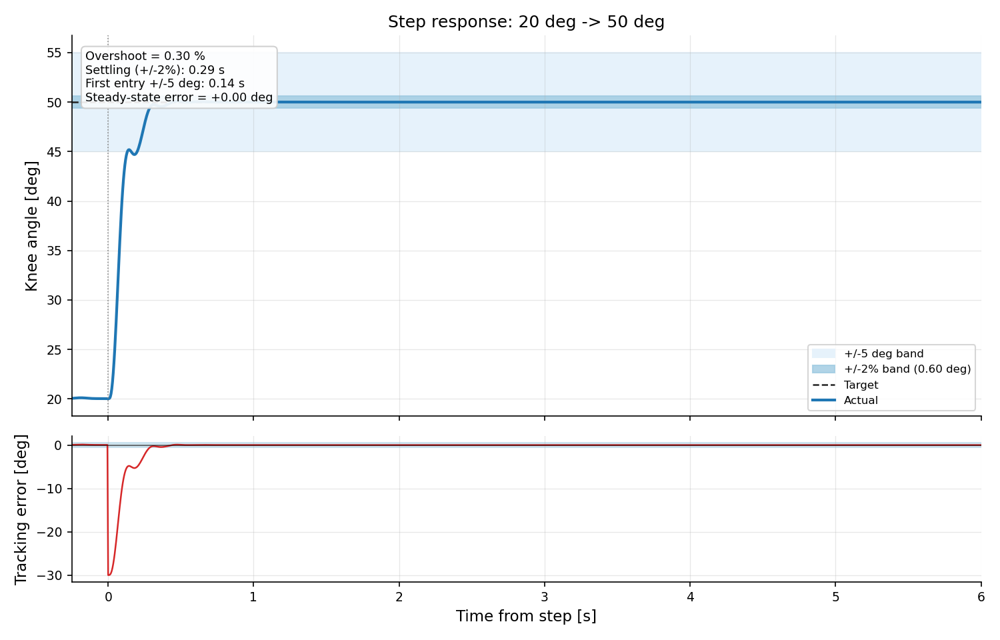

# 实验 4｜膝关节肌肉骨骼仿真与轨迹跟踪

单自由度膝关节 + 两条拮抗肌（Hill 型激活动力学）的纯 Python 仿真，比较
PD 跟踪与"PD + 重力矩前馈"两种控制，量化**肌肉激活滞后**与**重力下垂**
各自贡献了多少跟踪误差。

对应课程页面：
<https://openhutb.github.io/ros2/musculoskeletal/knee_tracking/>

## 1. 模型

```
I·θ̈ = τ_muscle − m g l·sin θ − b·θ̇
τ_muscle = (a_flex − a_ext) · F_max · r
ȧ = (u − a) / τ_act      (u > a)
ȧ = (u − a) / τ_deact    (u ≤ a)
```

| 参数 | 值 |
| --- | --- |
| 转动惯量 I | 0.06 kg·m² |
| 阻尼 b | 0.5 N·m·s/rad |
| 重力矩幅值 mgl | 4.5 N·m |
| 单肌最大力 F_max | 500 N |
| 力臂 r | 0.035 m（单肌最大力矩 17.5 N·m） |
| τ_act / τ_deact | 0.02 s / 0.05 s |
| 关节限位 | −15° … 90° |

θ = 0 时小腿竖直、重力矩为 0；θ > 0 为屈曲。屈曲时重力要把小腿拉回竖直，
所以不加重力前馈会看到稳态下垂。

## 2. 控制器

```
τ = kp·e − kd·θ̇ − g_ff·τ_g(θ),    e = θ_des − θ
```

- `g_ff = 0`：纯 PD。PD 必须靠一个**持续存在的误差**去平衡重力矩，
  平衡点满足 `kp·e_ss = τ_g`，即 `e_ss ≈ τ_g / kp`。
- `g_ff = 1`：完全前馈，重力矩被直接抵消，PD 只负责跟踪误差。

`τ ≥ 0` 时全部给屈肌、`τ < 0` 时全部给伸肌（`|τ| / 17.5` 归一化，两条肌肉
不同时激活）。另有上限 90° / 下限 −15° 的限位保护与非法输入保护。

## 3. 结果：同一组增益（kp = 30, kd = 3）下的对照

| 指标 | 无前馈 `g_ff = 0` | 有前馈 `g_ff = 1` |
| --- | --- | --- |
| 正弦跟踪 RMSE | 8.61° | **8.33°** |
| 正弦最大绝对误差 | 14.92° | **11.96°** |
| 阶跃稳态误差 | **−5.97°**（下垂） | **+0.0000°** |
| 阶跃调节时间（±2%） | 未进入 | **0.29 s** |
| 阶跃末段均值 | 44.03°（目标 50°） | **50.00°** |






### 两个结论

1. **稳态下垂完全由重力矩解释。** θ = 50° 时 τ_g ≈ −3.45 N·m，
   理论下垂 `3.45 / 30 = 0.115 rad = 6.6°`；实测 −5.97°，量级一致。
   打开前馈后稳态误差降到 1e−4 度量级。
2. **正弦段剩下的 8° 残差不是增益不够，而是肌肉激活滞后。**
   0.4 Hz 正弦、80° 峰峰值要求关节速度约 100°/s；τ_deact = 0.05 s 意味着
   放松指令要 50 ms 才跟上，相位滞后直接变成跟踪误差。把 kp 从 30 加到 80
   只能把 RMSE 从 8.6° 压到 7.4°，而且开始出现力矩饱和——这条路收益很低。

## 4. 怎么跑

```bash
cd knee_tracking
python main.py              # 完整仿真：CSV + 2 张 PNG + GIF + metrics.txt
python main.py --no-render  # 不生成 GIF
python main.py --quick      # 缩短时长，用于冒烟测试
python -m pytest -q         # 91 个单元测试
```

输出在 `results/`：

| 文件 | 内容 |
| --- | --- |
| `tracking.csv` | 逐时刻参考/实际角度、误差、屈伸肌激活、力矩 |
| `metrics.txt` | 正弦/阶跃指标 + 重力前馈对照表 + 数值健康检查 |
| `tracking_eval.png` | 正弦跟踪曲线与误差 |
| `tracking_step.png` | 阶跃响应与 ±5° 带 |
| `tracking.gif` | 膝关节运动动画 |

## 5. 文件结构

```
knee_tracking/
├── main.py                 # 入口：两组仿真 -> 出图 -> 指标
├── config/params.yaml      # 全部参数（含 gravity_feedforward）
├── src/
│   ├── config.py           # 最小 YAML 解析 + 强类型校验
│   ├── model.py            # 拮抗肌 + 刚体动力学（RK4）
│   ├── controller.py       # PD + 重力前馈 + 限位保护
│   ├── trajectory.py       # 正弦 / 阶跃参考
│   ├── simulation.py       # 闭环仿真循环
│   ├── metrics.py          # RMSE、超调、调节时间、稳态误差
│   └── plotting.py         # PNG / GIF
└── tests/                  # 91 个用例
```

## 6. 已知限制

- 两条肌肉各自独立激活，没有共同收缩（co-contraction）与肌间耦合；
- 力-长度因子默认关闭（`force_length_strength = 0`），力矩臂恒定；
- 关节是单自由度，不含膝关节的滚动-滑动与髌骨；
- 没有把肌腱弹性串进来——那部分单独放在实验 3（`msk_tendon_basics`）。
