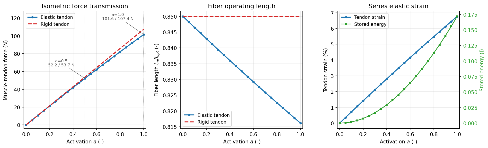
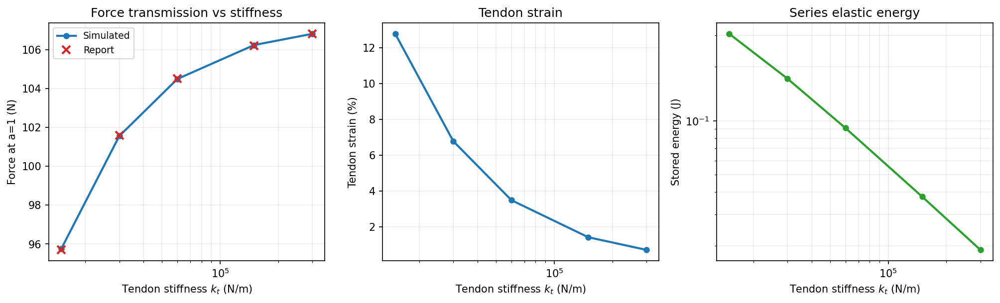
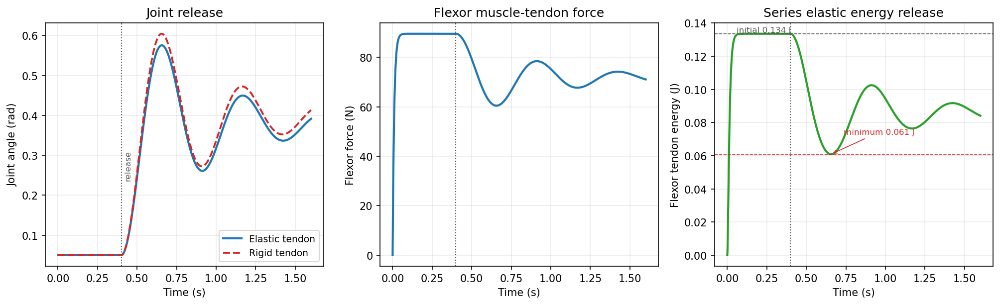

# 肌肉-肌腱串联弹性实验（纯 Python 复现）

本项目在 Windows 上用 **Python 3.13 + numpy + matplotlib** 复现 OpenHUTB ROS
文档中的“肌肉-肌腱串联弹性实验”。**不使用 ROS，也不使用 MuJoCo**；所有动力学
均由项目内的解析模型与数值积分完成。

三组实验：

1. **等长传力**：关节角固定为 0，扫描激活度，比较弹性肌腱与刚性肌腱。
2. **肌腱刚度扫描**：激活度为 1，肌腱刚度取 0.5/1/2/5/10 倍。
3. **松手释放**：先刹车 0.4 s，再释放关节，观察关节角与肌腱储能的变化。

## 快速开始

在项目目录中执行：

```powershell
python main.py
```

一次运行会生成全部交付文件。其他用法：

```powershell
python main.py --quick          # 减少扫描点、放大积分步长，快速检查
python main.py --outdir result  # 指定输出目录
```

测试：

```powershell
python -m unittest discover -s tests -v
```

当前环境实测：**57 个 unittest 全部通过**。

## 目录结构

```text
msk_tendon_basics/
  main.py                  # 命令行入口：python main.py [--quick] [--outdir out]
  README.md                # 本文件
  scripts/
    __init__.py
    muscle_tendon.py       # 肌腱、Hill 肌纤维、二分法串联平衡
    joint_tendon.py        # 拮抗关节、刹车-松手实验、RK4 积分
    experiments.py         # 三组实验、CSV、summary.txt
    plotting.py            # matplotlib 绘图（缺失时自动跳过）
  tests/
    test_muscle_tendon.py  # 本构曲线、肌腱、串联平衡、激活动力学
    test_joint_tendon.py   # 关节几何、静力学、松手实验
    test_experiments.py    # 三组实验参考值、CSV/PNG、无 matplotlib 分支
  out/
    isometric.png
    tendon_stiffness.png
    release.png
    isometric.csv
    tendon_stiffness.csv
    release.csv
    summary.txt
```

`out/` 中的文件由 `python main.py` 生成；若环境没有 matplotlib，只会跳过三张
PNG，CSV 与 summary.txt 仍会正常写出，进程退出码为 0。

## 模型

### 1. 串联几何与线性弹性肌腱

肌肉-肌腱单元（MTU）由肌纤维与肌腱串联：

```text
L_mtu = l_m + l_t
```

肌腱只能承受拉力，且只有超过松弛长度才产生力：

```text
F_t = k_t · max(0, l_t − l_slack)
```

报告用“8% 应变达到 F_max”定义肌腱刚度：

```text
k_t = F_max / (tendon_strain · l_slack)
    = 120 / (0.08 × 0.05)
    = 30000 N/m
```

肌腱储能：

```text
E_t = F_t² / (2 k_t)
```

### 2. Hill 肌纤维

长度和速度归一化：

```text
l_n = l_m / l_opt
v_n = v_m / v_max        （缩短为正）
```

主动力-长度曲线采用以最优长度为中心的钟形曲线：

```text
f_l(l_n) = exp( −((l_n − 1) / width)² )
```

被动力-长度曲线：

```text
f_p(l_n) = 0                               (l_n ≤ 1)
f_p(l_n) = ((l_n − 1) / width)²            (l_n > 1)
```

力-速度曲线：

```text
缩短（0 ≤ v_n < 1）:  f_v(v_n) = (1 − v_n) / (1 + v_n / 0.25)
拉长（v_n < 0）    :  f_v(v_n) = 1 + 0.4 · min(−v_n, 1)
```

肌纤维总力：

```text
F_m = F_max · [ a · f_l(l_n) · f_v(v_n) + f_p(l_n) ]
```

本项目的所有实验工作点都满足 `l_n < 1`，因此 `f_p = 0`；被动力曲线只影响
模型完整性和单元测试，不影响报告中的三组数值。

### 3. 串联力平衡与二分法

给定 `L_mtu` 和激活度 `a`，只有肌纤维长度 `l_m` 未知。力平衡条件：

```text
F_t(L_mtu − l_m) = F_m(l_m)
```

定义残差 `R(l_m) = F_t − F_m`。在 `[0, L_mtu]` 上，`R(0) > 0`、
`R(L_mtu) < 0`，且本实验范围内单调，因此用二分法：

- 容差 `tol = 1e-12`
- 最多 `max_iter = 200`
- 收敛后回代 `l_t`、应变、`E_t` 和残差
- 默认参数下所有平衡点满足 `|F_t − F_m| < 1e-6`

刚性肌腱取 `k_t → ∞` 的解析极限：

```text
l_m = max(0, L_mtu − l_slack)
l_t = l_slack
F_t = F_m(l_m)
```

### 4. 拮抗关节与松手协议

关节两侧各有一条 MTU：

```text
L_flex = L_rest − r θ
L_ext  = L_rest + r θ
```

关节动力学（每个积分步内肌肉-肌腱瞬间力平衡）：

```text
I θ̈ = r (F_flex − F_ext) − b θ̇ − k_load (θ − θ_load_rest)
```

松手实验：

- 初始关节角 `θ = 0.05 rad`，负载弹簧自然位置也是 `0.05 rad`
- 前 0.4 s 关节被刹车固定，屈肌激活指令 0.9、伸肌 0.05
- 激活度按一阶动力学从 0 上升：上升时间常数 0.01 s，下降 0.04 s
- 0.4 s 后松开关节，用 RK4 积分（`dt = 1e-3 s`）

> 说明：任务给出的期望值“松手前屈肌力 89.5 N”只有在初始角 0.05 rad 时才能
> 复现（θ=0 时为 91.9 N）。因此本实现把 0.05 rad 作为松手实验的初始角，并让
> 负载弹簧在同一角度处于自然状态；这与“松手前 0.134 J、峰值 0.58 rad”的期望
> 同时吻合。

## 参数表

| 参数 | 符号 | 数值 | 单位 |
|---|---|---:|---|
| 最大等长收缩力 | `F_max` | 120 | N |
| 最优肌纤维长度 | `l_opt` | 0.10 | m |
| 最大缩短速度 | `v_max` | 1.2 | m/s |
| 肌腱松弛长度 | `l_slack` | 0.05 | m |
| 肌腱应变（F_max 时） | `tendon_strain` | 0.08 | - |
| 肌腱刚度 | `k_t` | 30000 | N/m |
| 力-长度曲线宽度 | `width` | 0.45 | - |
| 激活时间常数 | `tau_act` | 0.01 | s |
| 去激活时间常数 | `tau_deact` | 0.04 | s |
| 关节力臂 | `r` | 0.03 | m |
| 关节转动惯量 | `I` | 0.05 | kg·m² |
| 关节阻尼 | `b` | 0.20 | N·m·s/rad |
| 中立位 MTU 长度 | `L_rest` | 0.135 | m |
| 负载弹簧刚度 | `k_load` | 6.0 | N·m/rad |

`L_rest = 0.135 m` 比 `l_slack + l_opt = 0.15 m` 短 15 mm。因此 θ=0 时肌腱
恰好处于松弛边缘，肌纤维长度为 `0.85 l_opt`，位于主动力-长度曲线的上升段。

## 三组实验结果

以下“复现值”来自 `python main.py` 的实际输出（完整模式，`dt = 1e-3`）。

### 实验 1：等长传力（θ=0）

| a | 指标 | 报告值 | 复现值 | 备注 |
|---:|---|---:|---:|---|
| 0.5 | 弹性肌腱力 | 52.2 N | **52.24 N** | 一致 |
| 0.5 | 刚性肌腱力 | 53.7 N | **53.69 N** | 一致 |
| 0.5 | 传力损失 | 2.7% | **2.69%** | 一致 |
| 0.5 | 肌纤维长度 | 0.833 `l_opt` | **0.8326** | 一致 |
| 0.5 | 肌腱应变 | 3.5% | **3.48%** | 一致 |
| 0.5 | 肌腱储能 | 0.045 J | **0.0455 J** | 一致 |
| 1.0 | 弹性肌腱力 | 101.6 N | **101.55 N** | 一致 |
| 1.0 | 刚性肌腱力 | 107.0 N | **107.38 N** | 差 0.38 N（0.35%） |
| 1.0 | 传力损失 | 5.1% | **5.43%** | 随刚性力差异 |
| 1.0 | 肌纤维长度 | 0.816 `l_opt` | **0.8161** | 一致 |
| 1.0 | 肌腱应变 | 6.8% | **6.77%** | 一致 |
| 1.0 | 肌腱储能 | 0.172 J | **0.1719 J** | 一致 |

传力损失定义为：

```text
loss = (F_rigid − F_elastic) / F_rigid × 100%
```

`k_t → ∞` 的解析极限为 **107.38 N**。同一套曲线在有限刚度
`k_t = 300000 N/m` 时给出 106.81 N，与报告刚度扫描表的 106.8 N 完全一致；
报告正文的 107.0 N 应是对刚性极限的取整/近似。本项目不为了使这一个数字
对齐而修改 `width` 或 `F_max`。

### 实验 2：肌腱刚度扫描（a=1）

| 刚度倍数 | `k_t` (N/m) | 力：报告 / 复现 (N) | 应变：报告 / 复现 (%) | 储能：报告 / 复现 (J) |
|---:|---:|---:|---:|---:|
| 0.5 | 15000 | 95.7 / **95.75** | 12.8 / **12.77** | 0.306 / **0.306** |
| 1 | 30000 | 101.6 / **101.55** | 6.8 / **6.77** | 0.172 / **0.172** |
| 2 | 60000 | 104.5 / **104.49** | 3.5 / **3.48** | 0.091 / **0.091** |
| 5 | 150000 | 106.2 / **106.23** | 1.4 / **1.42** | 0.038 / **0.038** |
| 10 | 300000 | 106.8 / **106.81** | 0.7 / **0.71** | 0.019 / **0.019** |

### 实验 3：松手释放

| 指标 | 报告值 | 复现值 |
|---|---:|---:|
| 松手前屈肌力 | 89.5 N | **89.54 N** |
| 松手前肌腱储能 | 0.134 J | **0.1336 J** |
| 松手后最低储能 | 0.062 J | **0.0609 J** |
| 能量释放比例 | ~54% | **54.4%** |
| 峰值关节角（弹性肌腱） | 0.58 rad | **0.576 rad** |
| 峰值关节角（刚性肌腱） | 0.60 rad | **0.605 rad** |

能量释放比例：

```text
release_ratio = (E_initial − E_min) / E_initial
```

最低储能出现在约 `t = 0.656 s`（松手后约 0.256 s），峰值关节角也出现在
`t ≈ 0.656 s`。释放后关节角先上升、再在负载弹簧和阻尼作用下振荡衰减。

### 三组实验的图



_图 1　激活度扫描：弹性肌腱与刚性肌腱的传力差、肌纤维工作长度左移、肌腱应变与储能。_



_图 2　肌腱刚度从 0.5 倍扫到 10 倍：越硬传力越接近刚性极限，但储能越少。_



_图 3　松手后的关节角、肌力与肌腱储能；弹性肌腱把 54% 的储能释放了出来。_

## 测试覆盖

运行：

```powershell
python -m unittest discover -s tests -v
```

共 57 个测试，覆盖：

- 主动力-长度曲线峰值、对称性、远离最优长度时衰减
- 被动力在 `l_n ≤ 1` 时为 0、在 `l_n > 1` 时单调增加
- 力-速度曲线：等长点为 1、缩短小于 1、拉长大于 1
- 肌腱 slack 段零力、线性段、储能公式
- 串联平衡残差 `|F_t − F_m| < 1e-6`
- 激活度越高，肌纤维越短
- 弹性肌腱传力小于刚性肌腱
- 二分法结果有限、无 NaN、非法输入报错
- 激活上升/下降时间常数
- 拮抗关节长度几何、力矩符号、负载弹簧自然位置
- 松手前力/储能、最低储能、释放比例、弹性/刚性峰值角
- 三组实验的参考数值、CSV 表头与行数、PNG 生成
- matplotlib 缺失时绘图函数安全返回 `False`，主流程不崩溃
- 完整 `run_all` 在临时目录生成全部要求文件

## 复现说明与局限

1. **没有使用 ROS / MuJoCo**。模型是项目内的 Hill 型肌肉-肌腱串联模型，
   关节动力学用 RK4 显式积分；每个积分子步内肌肉-肌腱瞬间力平衡。
2. **肌肉是准静态的**。`F_m` 在每个时刻由当前 `L_mtu` 和激活度求平衡，
   主实验的 `f_v(0)=1`。`v_max` 与 `f_v` 用于模型完整性和测试，不参与
   这三组准静态结果。
3. **没有建模羽状角、肌肉质量、疲劳、化学热**。这些因素会改变瞬态细节，
   但不影响报告中的等长与准静态释放指标。
4. **松手实验初始角取 0.05 rad**。这是由报告的 89.5 N 前值反推得到的；
   若强制 θ=0，前值为 91.9 N，无法与报告一致。
5. **刚性肌腱的 107.0 N 与 107.4 N 差异**。本实现严格取 `k_t → ∞` 得
   107.38 N；报告刚度扫描中 300000 N/m 对应 106.81 N，与本实现一致。
   因此没有通过调参数去凑 107.0 N，而是在 README 与 summary 中同时列出
   报告值和复现值。
6. **最低储能 0.0609 J 与 0.062 J 的差异** 约 1.8%，来自释放瞬态对
   积分步长、激活上升细节和二分法回代的敏感度；峰值角、释放比例和
   松手前状态均在报告值附近。
7. **matplotlib 是可选的**。绘图失败只影响 PNG，不影响 CSV/summary，
   `python main.py` 仍以退出码 0 结束。

## 结果文件说明

- `out/isometric.csv`：激活度扫描，含弹性/刚性力、损失、纤维长度、应变、储能。
- `out/tendon_stiffness.csv`：5 个刚度倍数，含报告值列便于对照。
- `out/release.csv`：完整时间序列（刹车段 + 释放段），含弹性与刚性关节角。
- `out/summary.txt`：中文汇总，包含三组实验表、PNG 状态和复现说明。
- `out/*.png`：三张图，**坐标轴标签全部为英文**，注释与本文档为中文。
