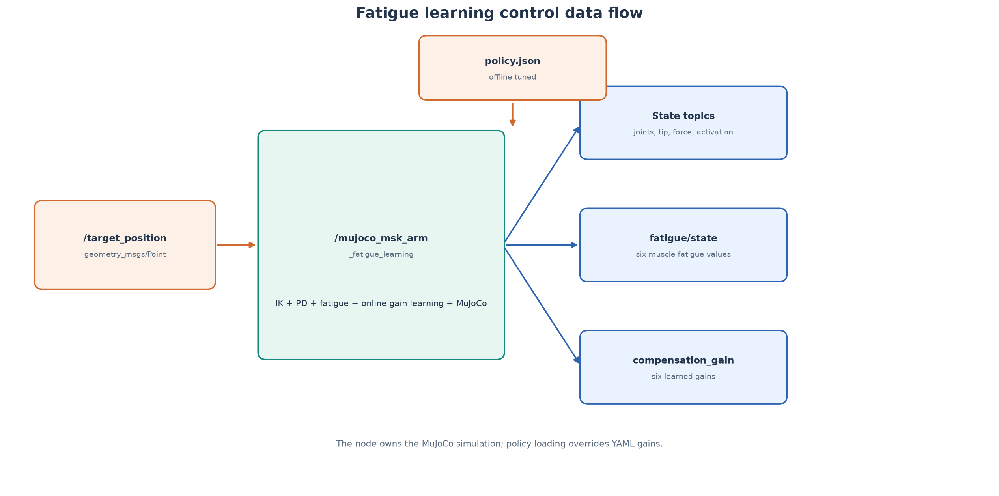
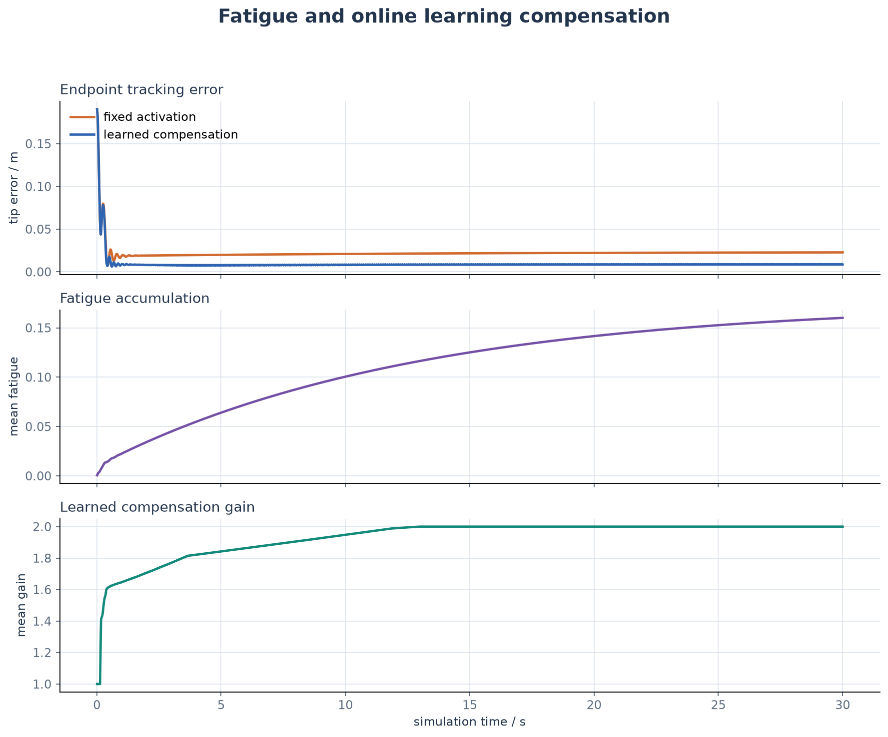

# MuJoCo 肌肉骨骼手臂疲劳与学习控制

本模块在双关节肌肉骨骼手臂上加入六肌肉疲劳动力学和在线增益学习。
疲劳会降低有效激活和输出力；学习器根据持续关节误差提高有用肌肉的补偿
增益，使手臂在 1 kg 负载下保持更小的末端误差。



## 模型

每条肌肉的疲劳状态 `f_m` 由一阶动力学更新：

```text
df_m/dt = a_m (1 - f_m) / T_fatigue
          - (1 - a_m) f_m / T_recovery
```

疲劳后的强度保留率为：

```text
retention_m = 1 - strength_loss_m * f_m
```

在线学习器按照关节误差和当前激活更新每条肌肉的补偿增益：

```text
gain_m += learning_rate * ||joint_error|| * activation_m * dt
gain_m = clip(gain_m, 1, maximum_gain)
```

最终发送给 MuJoCo 的激活为：

```text
effective_activation = base_activation * retention * gain
```

所有疲劳时间常数、恢复时间常数、强度损失和学习参数均位于
`config/simulation.yaml`。

## ROS 2 接口

| 话题 | 类型 | 方向 | 内容 |
| --- | --- | --- | --- |
| `/target_position` | `geometry_msgs/msg/Point` | 订阅 | `x-z` 平面目标 |
| `/joint_states` | `sensor_msgs/msg/JointState` | 发布 | 肩、肘状态 |
| `/end_effector_position` | `geometry_msgs/msg/Point` | 发布 | 末端位置 |
| `/muscle_activations` | `std_msgs/msg/Float64MultiArray` | 发布 | 疲劳和学习补偿后的实际激活 |
| `/muscle_forces` | `std_msgs/msg/Float64MultiArray` | 发布 | 六维肌肉力 |
| `/fatigue/state` | `std_msgs/msg/Float64MultiArray` | 发布 | 六维疲劳状态 |
| `/fatigue/compensation_gain` | `std_msgs/msg/Float64MultiArray` | 发布 | 六维学习增益 |
| `/fatigue/tracking_error` | `std_msgs/msg/Float32` | 发布 | 关节目标误差范数 |

## 构建与运行

```bash
source /opt/ros/humble/setup.bash

colcon build \
  --packages-select \
    mujoco_musculoskeletal_arm_reach \
    mujoco_msk_arm_fatigue_learning \
  --symlink-install

source install/setup.bash
ros2 launch mujoco_msk_arm_fatigue_learning main.launch.py
```

检查输出：

```bash
ros2 node list
ros2 topic hz /fatigue/tracking_error
ros2 topic echo /fatigue/state --once
ros2 topic echo /fatigue/compensation_gain --once
rqt_graph
```

## 训练与推理

训练脚本搜索学习率、增益衰减和最大增益，并生成策略 JSON：

```bash
python3 scripts/train_learning_policy.py \
  --duration-s 12 \
  --output ~/.ros/mujoco_msk_arm_fatigue_learning/policy.json
```

把 `policy_file` 设置为该 JSON 路径后，节点会优先使用离线策略参数；文件不
存在时记录 warning 并回退到 YAML。由于当前默认策略本身是在线自适应算法，
没有策略 JSON 也可以运行。

## 实验

```bash
python3 scripts/evaluate_fatigue_learning.py
```



1 kg 负载、30 s 仿真：

- 固定激活的尾段末端误差约 `0.0227 m`；
- 学习补偿约 `0.0088 m`；
- 30 s 时平均疲劳约 `0.160`；
- 学习平均增益接近上限 `2.0`。

## 测试

```bash
python3 -m pytest test -q

colcon test --packages-select mujoco_msk_arm_fatigue_learning
colcon test-result --verbose
```

测试覆盖疲劳积累与恢复、强度衰减、学习增益、策略文件、ROS 话题、
疲劳输出和学习禁用模式。

## 当前边界

- 疲劳时间常数是加速演示参数，不代表特定受试者或真实肌肉标定；
- 学习器是在线增益学习，不是深度神经网络策略；
- 当前只在 MuJoCo 闭环中验证，尚未在 ROS 2 Humble 实机运行并截图。
