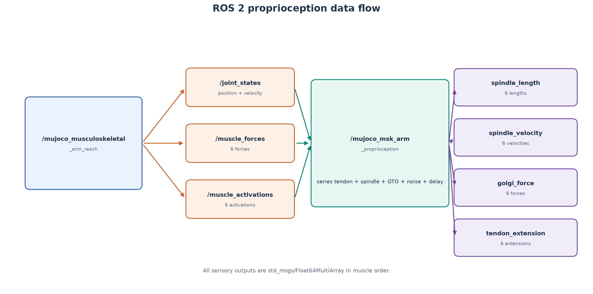
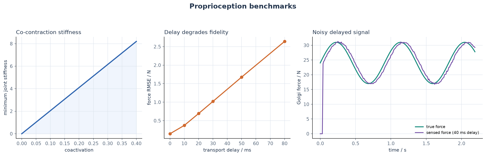

# MuJoCo 肌肉骨骼手臂本体感觉

本模块在已合并的双关节肌肉臂仿真上增加本体感觉层。它读取肩肘状态和
六条肌肉的激活与力，计算串联弹性肌腱伸长、肌梭长度/速度和高尔基腱器官
力，并支持可配置噪声与传输延迟。



## 模型

串联弹性肌腱采用线性集总模型：

```text
tendon_extension = muscle_force / tendon_stiffness
fiber_length = musculotendon_length - tendon_extension
```

肌梭输出肌纤维长度和滤波后的长度变化率；高尔基腱器官输出肌肉力。
六条肌肉按固定顺序排列：

```text
shoulder_flexor
shoulder_extensor
elbow_flexor
elbow_extensor
biarticular_flexor
biarticular_extensor
```

## ROS 2 接口

| 话题 | 类型 | 方向 | 内容 |
| --- | --- | --- | --- |
| `/joint_states` | `sensor_msgs/msg/JointState` | 订阅 | 肩、肘位置和速度 |
| `/muscle_forces` | `std_msgs/msg/Float64MultiArray` | 订阅 | 六维肌肉力 |
| `/muscle_activations` | `std_msgs/msg/Float64MultiArray` | 订阅 | 六维肌肉激活 |
| `/proprioception/spindle_length` | `std_msgs/msg/Float64MultiArray` | 发布 | 六维肌纤维长度，单位 m |
| `/proprioception/spindle_velocity` | `std_msgs/msg/Float64MultiArray` | 发布 | 六维长度变化率，单位 m/s |
| `/proprioception/golgi_force` | `std_msgs/msg/Float64MultiArray` | 发布 | 六维肌肉力，单位 N |
| `/proprioception/tendon_extension` | `std_msgs/msg/Float64MultiArray` | 发布 | 六维肌腱伸长，单位 m |

本节点在 100 Hz 定时器中发布传感器输出，不创建 service、action 或 TF。

## 构建与运行

需要同时构建双关节手臂包和本体感觉包：

```bash
source /opt/ros/humble/setup.bash

colcon build \
  --packages-select \
    mujoco_musculoskeletal_arm_reach \
    mujoco_msk_arm_proprioception \
  --symlink-install

source install/setup.bash
ros2 launch mujoco_msk_arm_proprioception main.launch.py
```

检查接口：

```bash
ros2 node list
ros2 topic list -t
ros2 topic hz /proprioception/spindle_length
ros2 topic echo /proprioception/golgi_force --once
rqt_graph
```

参数位于 `config/simulation.yaml`：采样率、延迟、四类噪声标准差和随机种子。

## 实验

重新生成架构图和基准图：

```bash
python3 scripts/evaluate_proprioception.py
```



当前结果：

- 共激活从 `0.02` 提高到 `0.40` 时，最小关节刚度约从
  `0.41` 提高到 `8.20`；
- 80 ms 传输延迟使示例 Golgi 力估计 RMSE 增至约 `2.64 N`。

## 测试

```bash
python3 -m pytest test -q

colcon test --packages-select mujoco_msk_arm_proprioception
colcon test-result --verbose
```

测试覆盖肌腱伸长、肌梭长度/速度、GTO 力、共收缩刚度、噪声可复现性、
延迟缓冲、ROS 话题接口和输入校验。

## 当前边界

本模块使用集总串联弹性肌腱模型处理传感估计，不改变已合并手臂的
MuJoCo 刚体动力学。噪声和延迟目前用于传感器评估，尚未接入反馈控制闭环。
