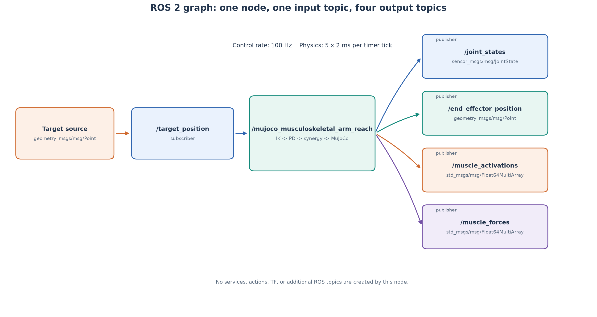
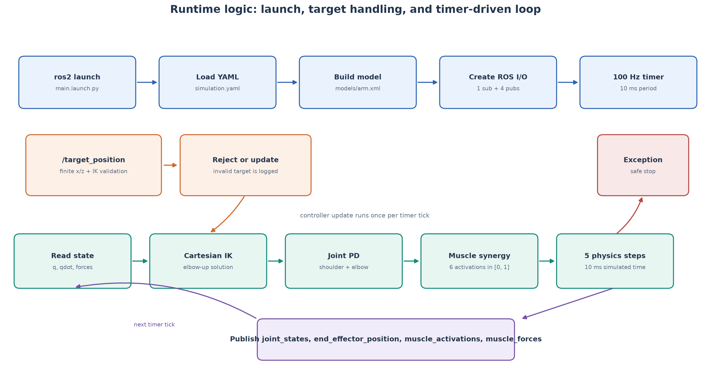
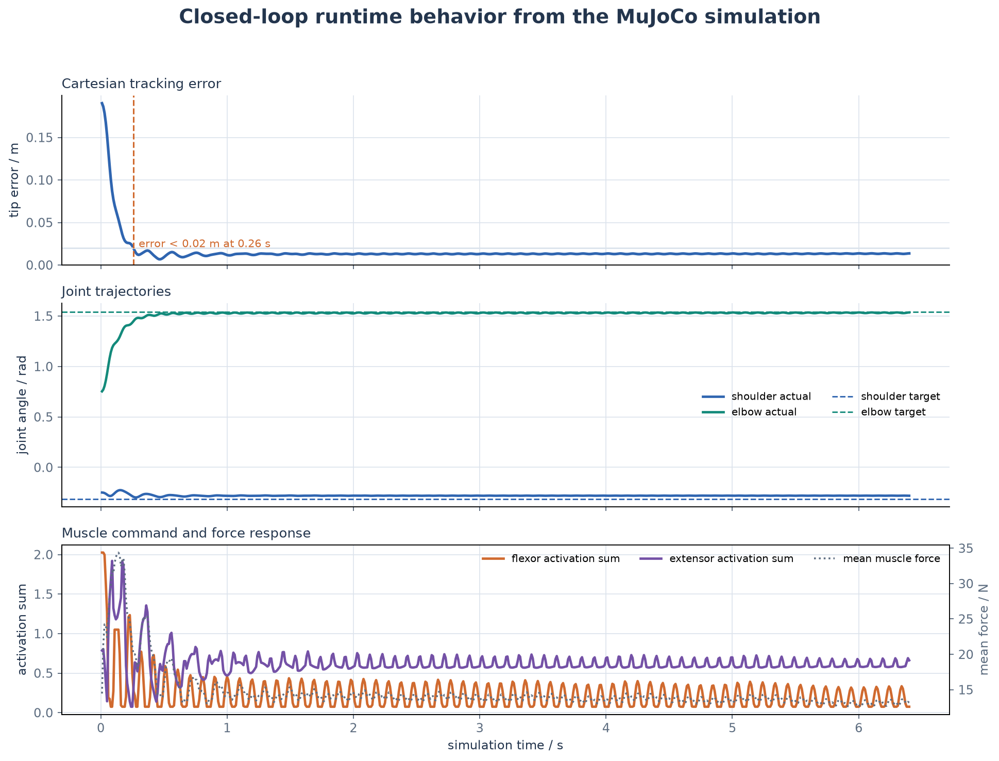

# MuJoCo 双关节肌肉骨骼手臂

本模块建立肩、肘两自由度 MuJoCo 手臂，由 6 条 Hill 型肌肉驱动：

- 肩屈肌 / 肩伸肌
- 肘屈肌 / 肘伸肌
- 双关节屈肌 / 双关节伸肌

双关节肌同时跨越肩、肘，是它与现有单关节 Hill 模块和灵巧手模块的主要区别。

## 模型

- 上臂长度 `0.30 m`，前臂长度 `0.28 m`
- 肩关节范围 `[-1.25, 1.45] rad`
- 肘关节范围 `[-0.10, 2.30] rad`
- MuJoCo muscle actuator，控制量为 `[0, 1]`
- 固定腱通过肩、肘关节系数定义肌肉力臂

## 控制

控制器先对平面目标做两连杆逆运动学，再生成肩、肘 PD 力矩，并将力矩映射为 6 条肌肉的协同激活：

```text
目标点 (x, z)
  → 两连杆逆运动学
  → 肩/肘目标角
  → PD 力矩
  → 肩、肘、双关节肌肉激活
  → MuJoCo Hill 肌肉动力学
```





## 构建

```bash
python3 -m pip install --user \
  -r src/musculoskeletal/mujoco_musculoskeletal_arm_reach/requirements.txt

colcon build \
  --packages-select mujoco_musculoskeletal_arm_reach \
  --symlink-install

source install/setup.bash
ros2 launch mujoco_musculoskeletal_arm_reach main.launch.py
```

## 话题

| 话题 | 类型 | 方向 |
| --- | --- | --- |
| `/target_position` | `geometry_msgs/Point` | 输入 |
| `/joint_states` | `sensor_msgs/JointState` | 输出 |
| `/end_effector_position` | `geometry_msgs/Point` | 输出 |
| `/muscle_activations` | `std_msgs/Float64MultiArray` | 输出 |
| `/muscle_forces` | `std_msgs/Float64MultiArray` | 输出 |

节点只创建上述 1 个订阅和 4 个发布接口，不创建 service、action 或 TF。
目标坐标相对于肩关节，使用手臂平面的 `x-z` 坐标。100 Hz 控制回调每次推进
5 个 2 ms MuJoCo 物理步。

修改目标：

```bash
ros2 topic pub --once /target_position geometry_msgs/msg/Point \
  "{x: 0.30, y: 0.0, z: -0.10}"
```

观察：

```bash
ros2 node info /mujoco_musculoskeletal_arm_reach
ros2 topic list -t
ros2 topic hz /joint_states
rqt_graph
ros2 topic echo /end_effector_position
ros2 topic echo /joint_states
ros2 topic echo /muscle_activations
ros2 topic echo /muscle_forces
```

闭环运行记录：



默认目标 `(0.38, -0.17) m` 下，末端误差约 `0.26 s` 进入 `0.02 m`，
3.2 s 时最终误差约 `0.014 m`。

## 测试

```bash
python3 -m pytest \
  src/musculoskeletal/mujoco_musculoskeletal_arm_reach/test -q

colcon test --packages-select mujoco_musculoskeletal_arm_reach
colcon test-result --verbose
```

测试覆盖正/逆运动学、不可达目标、六维激活范围、MuJoCo 模型结构、模型加载和单步仿真。

重新生成 ROS 与运行图：

```bash
python3 scripts/generate_ros_diagrams.py
```

## 后续

Commit 1 只实现刚性 Hill 肌肉与多关节协同。后续 Commit 2 将加入串联弹性肌腱、肌梭和高尔基腱器官反馈。
