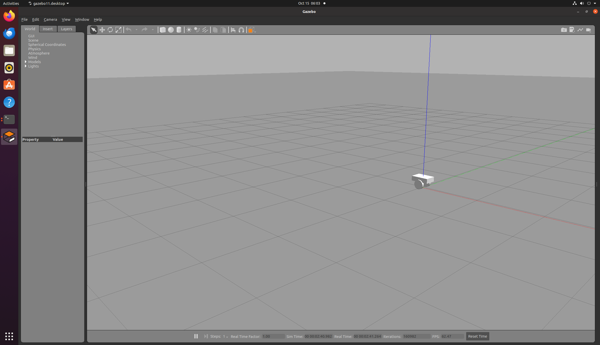
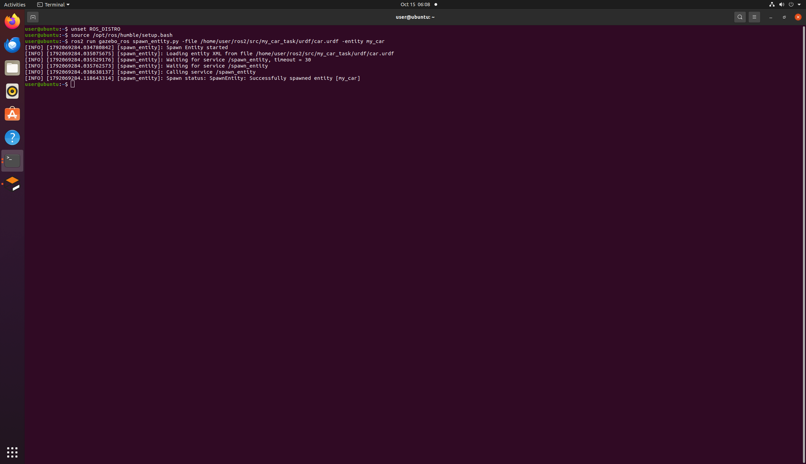

# ROS2 差速小车仿真模型
## 项目简介
搭建两轮差速小车URDF模型，可在Gazebo仿真环境成功加载。

## 运行说明
```bash
# 启动Gazebo
gazebo --verbose -s libgazebo_ros_init.so -s libgazebo_ros_factory.so
# 新开终端加载模型
ros2 run gazebo_ros spawn_entity.py -file urdf/car.urdf -entity my_car

## 运行结果
模型加载成功截图：


