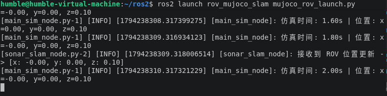

# MuJoCo 水下机器人：ROS2 仿真与建图初步验证

## 一、项目介绍

本实验在 Ubuntu 和 ROS 2 环境下，利用 MuJoCo 物理引擎搭建水下机器人（ROV）的虚拟仿真环境。通过 Python 脚本加载水下机器人 MJCF 模型，使用 `mujoco.mj_step` 实现物理引擎的步进运算，并通过 `rclpy` 节点实时输出仿真时间与机器人基座位置。

## 二、运行环境

- 操作系统：Ubuntu 22.04 (虚拟机)
- ROS 版本：ROS 2 Humble Hawksbill
- 编程语言：Python
- 物理引擎：MuJoCo
- 深度学习框架：PyTorch / Stable-Baselines3 (按需)
- 依赖功能包：mujoco (python), rclpy, geometry_msgs
- 渲染依赖：libosmesa6-dev (针对虚拟机无显卡环境的软件渲染)

## 三、项目结构

```text
src/rov_mujoco_slam/
├── launch/
│   └── mujoco_rov_launch.py     # 启动 MuJoCo 仿真与 ROS 2 节点
├── config/
│   └── mujoco_params.yaml       # 仿真与 SLAM 参数配置
├── scripts/
│   ├── main_sim_node.py         # 仿真与物理步进节点(入口)
│   └── sonar_slam_node.py       # 声呐建图与避障节点
├── models/
│   └── rov_underwater.xml       # 水下机器人 MJCF 模型文件
├── package.xml                  # ROS 2 包清单
├── CMakeLists.txt               # 编译文件
└── README.md                    # 运行说明
```

## 四、核心算法与源码解析

1. 物理引擎加载：代码通过 mujoco.MjModel.from_xml_path 加载水下机器人 MJCF 文件，初始化物理模型和数据结构 MjData。
2. 闭环仿真流程：main_sim_node.py 节点启动后，通过 ROS 2 定时器以 100Hz 的频率调用 mujoco.mj_step(model, data) 推进水下物理仿真（包含水阻、浮力等计算），有效避免阻塞主线程。
3. 状态数据输出：在循环中，通过 rclpy.get_logger().info 限制日志频率，实时打印仿真时间 data.time 和机器人基座位置 data.qpos[0:3]（x, y, z 坐标），验证仿真环境连通性。

## 五、运行步骤

1. 安装系统依赖与 MuJoCo：

```bash
# 安装虚拟机软件渲染库
sudo apt update
sudo apt install -y libosmesa6-dev

# 安装 MuJoCo python 库
python3 -m pip install mujoco
```

2. 确认水下机器人的 MJCF 模型文件：

本项目已在 models/ 目录下自带 rov_underwater.xml 模型文件（基于 MuJoCo 内置几何体构建，无需额外下载外部资产文件）。

3. 编译工作空间并刷新环境（确保当前位于工作空间根目录）：

```bash
cd ~/ros2
colcon build --packages-select rov_mujoco_slam
source install/setup.bash
```

4. 启动 ROS 2 仿真与建图节点：

(注：如果在虚拟机运行且没有独立显卡，必须设置以下环境变量以强制使用软件渲染，防止报 glGetError 错误。)

```bash
export MUJOCO_GL=osmesa
export PYOPENGL_PLATFORM=osmesa
ros2 launch rov_mujoco_slam mujoco_rov_launch.py
```

运行成功后，终端将持续打印仿真时间和机器人基座位置。

## 六、运行效果



## 七、实验总结

本次实验成功在 ROS 2 框架下配置了 MuJoCo 物理引擎环境，加载了水下机器人 MJCF 模型，实现了基于 Python 节点的物理仿真步进。

实验证明了 ROS 2 节点能够与 MuJoCo 物理引擎进行有效的数据交互，通过终端能够实时输出机器人的仿真时间与基座位置，验证了物理仿真回路的连通性。该实验为后续接入水下声呐 SLAM、占据栅格建图与自主避障导航奠定了坚实的工程基础，达到了阶段性实验目的。