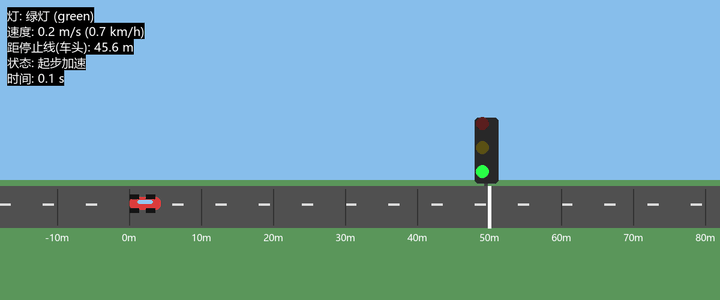

# traffic_light_stop

基于**规则决策 + 平方根减速度曲线**的红绿灯启停（Traffic Light Stop）仿真。

在 Pygame 内置的道路场景中：车辆沿道路直线行驶，前方路口有红绿灯与停止线。
按一下空格后车辆自主运行——**绿灯巡航通过，红灯/黄灯自动减速并停在停止线前，
变绿后自动起步通过路口**。

## 场景

```
        红绿灯(杆在停止线上方)
           ●  ●  ●          ← 当前灯色点亮
  ───────║───────────────
         │停止线│
   ───────║───────────────     路面
     🚗(起点)  →  行驶方向
```

- 起点：`x = 0 m`，静止起步；
- 停止线：`x = 50 m`，车头必须在停止线前停住（安全余量 1 m）；
- 巡航速度：`10 m/s`（36 km/h），最大减速度 `3 m/s²`；
- 灯周期：绿 4 s → 黄 1 s → 红 9 s → 绿 12 s，循环。

## 演示效果



> 自动生成的仿真动图（无头录制）：车辆绿灯起步 → 黄灯/红灯自动减速 →
> 车头停在停止线前 0.9 m → 变绿后自动起步通过路口。

## 算法栈

| 模块 | 文件 | 作用 |
|---|---|---|
| 车辆模型 | `vehicle_model.py` | 一维运动学：位置/速度/加速度积分 |
| 红绿灯 | `traffic_light.py` | 相位序列状态机（红/黄/绿循环） |
| 停车控制 | `stop_controller.py` | 平方根减速度曲线 + 全力刹车兜底 |
| 可视化 | `traffic_light_sim.py` | Pygame 仿真（无 ROS 也能跑），支持无头录制动图 |
| ROS 入口 | `main.py` | 节点发布 `/cmd_vel`，订阅 `/traffic_light` |

## 运行环境

- Windows 11 / Ubuntu 20.04
- Python 3.8+
- 依赖：`pygame`（纯演示）；ROS Noetic + geometry_msgs + std_msgs（roslaunch 版）

## 快速开始

### 1. 纯 Pygame 演示（Windows 双击即可）

```bash
pip install pygame
cd scripts
python traffic_light_sim.py
```

按 **空格** 开始运行，**R** 重置，**ESC** 退出。

无头录制演示动图（需 pillow）：

```bash
python traffic_light_sim.py --record demo.gif --duration 25
```

### 2. ROS Noetic 版

```bash
# 把本目录拷到 catkin_ws/src/traffic_light_stop
cd ~/catkin_ws
catkin_make
source devel/setup.bash
roslaunch traffic_light_stop main.launch
```

节点发布 `/cmd_vel`（geometry_msgs/Twist），可在另一个终端
`rostopic echo /cmd_vel` 查看；也可发布 `/traffic_light`
（std_msgs/String: red/green/yellow）覆盖内部模拟灯色。

## 验证

```bash
cd scripts
python headless_test.py
```

无界面跑完一个完整灯周期，检查：红灯期间不越线、停稳位置在停止线前、
绿灯后通过停止线、全程不超速。
