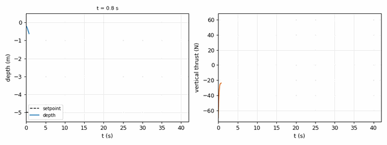
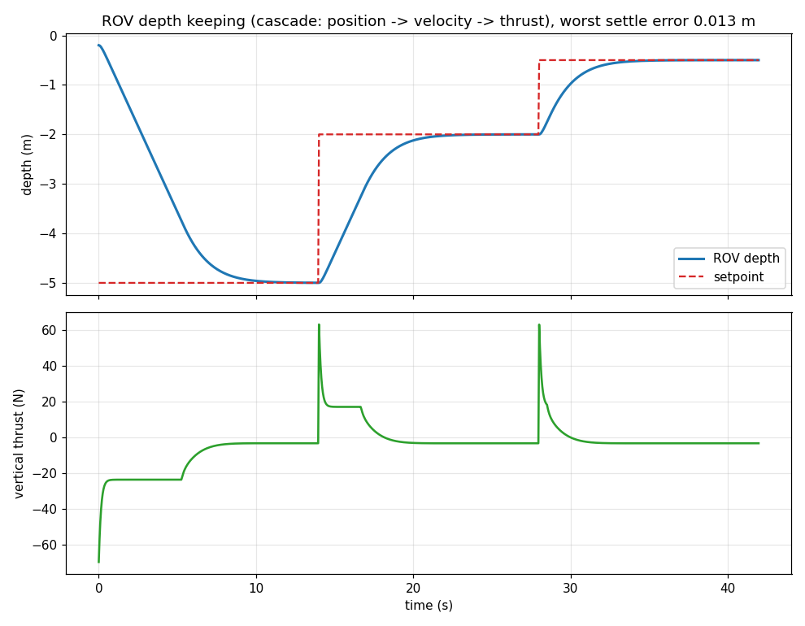
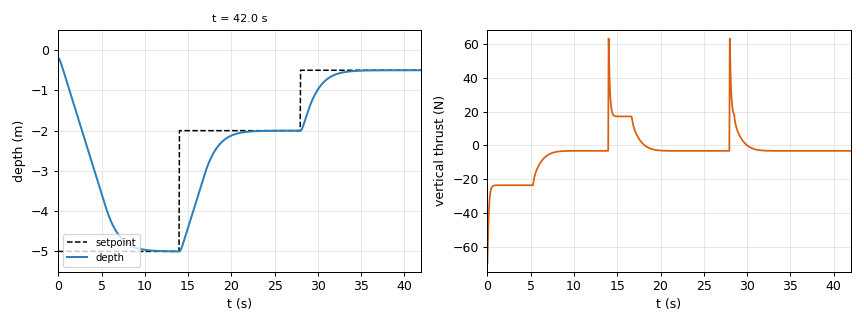

# mujoco_rov_depth_control — 水下 ROV 定深控制实验

## 1. 概述

用 **MuJoCo** 物理引擎搭一个近中性浮力的 ROV 刚体模型（含线性/二次水阻尼、垂向推进器），
实现串级定深控制器：依次定深 −5 m → −2 m → −0.5 m，每段量化稳态误差与超调。
水下机器人（潜水器）方向的控制链路由此完整跑通，且不依赖任何外部世界包。

## 2. 与已有示例的区别

| 对比项 | 官方/常见示例 | 本模块 |
|---|---|---|
| 物理 | 直接在引擎里"推箱子" | 显式建模净浮力 + 线性/二次阻尼（MuJoCo 本身不含浮力与流体阻力） |
| 控制 | 单环 PD 打满推力 | 串级：位置误差 → 期望垂速（限速）→ 期望加速度 → 推力限幅 |
| 验收 | 只看曲线"像不像" | 三段定深逐段算稳态误差，输出 PASS/FAIL |
| 依赖 | HoloOcean 需数 GB 世界包 | 纯 MuJoCo（OpenHUTB 自带 `mujoco/` 引擎），零下载 |

## 3. 环境要求

- Windows / Linux 均可；Python 3.10
- `mujoco`（实测 3.17.0；3.1x 均可）、`numpy`、`matplotlib`、`PyYAML`
- 不需要 CARLA 服务端，不需要 GPU

> 说明：HoloOcean 路线需要另外下载数 GB 的世界包和独立渲染器，本机没有对应资源；
> OpenHUTB 的水下方向本身就是基于 MuJoCo 插件，因此这里用 MuJoCo 复现控制链路。

## 4. 安装

```bat
python -m pip install mujoco numpy matplotlib pyyaml
```

## 5. 运行

```bat
cd src\water\mujoco_rov_depth_control
python main.py            :: 或 main.bat / bash main.sh
```

## 6. 预期输出

```text
[rov] 任务: [[-5.0, 14.0], [-2.0, 14.0], [-0.5, 14.0]]（每段 (深度, 保持秒数)）
[rov] 机体质量 16.60 kg（hull 15.00 + fin 1.60），净浮力 3.26 N，控制频率 20 Hz
[rov] t=0.0s 切换到目标深度 -5.00 m（保持 14.0 s）
[rov] t=14.0s 切换到目标深度 -2.00 m（保持 14.0 s）
[rov] t=28.0s 切换到目标深度 -0.50 m（保持 14.0 s）
[rov] 定深 0：目标 -5.00 m，稳态平均误差 0.013 m，最大 0.042 m
[rov] 定深 1：目标 -2.00 m，稳态平均误差 0.002 m，最大 0.005 m
[rov] 定深 2：目标 -0.50 m，稳态平均误差 0.000 m，最大 0.001 m
[rov] 最差稳态误差 0.013 m（阈值 0.050 m）
[rov] 结论：PASS（三段定深均收敛）
```

## 7. 输出文件

| 文件 | 内容 |
|---|---|
| `docs/result.png` | 深度跟踪曲线（含设定值）+ 垂向推力曲线 |
| `docs/depth_log.csv` | 20 Hz 逐点：`t / setpoint / depth / error / thrust / vz` |
| `docs/summary.md` | 质量、净浮力、控制律参数、各段稳态误差 |

## 8. 目录结构

```text
mujoco_rov_depth_control/
├── main.py                  # 便捷入口（等价于 ros2 run mujoco_rov_depth_control mujoco_rov_depth_control）
├── main.sh / main.bat       # 一键运行脚本（自动挑解释器）
├── package.xml              # ament_python 包描述（含执行依赖）
├── setup.py / setup.cfg     # 安装脚本与 console_scripts 入口
├── mujoco_rov_depth_control/
│   ├── __init__.py
│   └── app.py               # 全部实现（感知 / 决策 / 控制 / 取证）
├── launch/
│   └── main.launch.py       # ROS2 launch（Node 调 console_scripts）
├── config/
│   └── params.yaml          # 全部可调参数
├── resource/
│   └── mujoco_rov_depth_control           
├── test/
│   └── test_mujoco_rov_depth_control.py   # 纯逻辑单元测试（不需要仿真器）
├── tools/
│   └── summarize_csv.py     # 从 depth_log.csv 重算摘要（不重跑仿真）
├── requirements.txt         # pip 依赖（numpy / matplotlib / PyYAML / mujoco）
├── LICENSE                  # MIT（与 package.xml 一致）
├── docs/                    # 运行证据（曲线图 / CSV / 关键帧 / summary.md）
└── README.md
```

## 9. 已知限制

1. **浮力与阻尼是显式建模的**，不是引擎自带：`xfrc_applied` 里补浮力 + 阻尼，
   同时 MuJoCo 自己会施加重力，所以补浮力时不能再减一次重量（这是本次调试的主要坑）。
2. 单自由度（垂向）控制，没有做横滚/俯仰姿态控制。
3. 模型是简化刚体，不与 OpenHUTB 的 UE4 场景做视觉联调。

## 运行效果（截图 / 动图）







> 动图由本次实际运行产生的帧合成（GIF < 5 MB，PNG < 3 MB）。

## 运行证据文件

`docs/depth_log.csv`（840 行 / 20 Hz 逐点记录）、`docs/result.png`（深度与推力曲线）、
`docs/summary.md`（各段稳态误差与判定）是**实际运行的证据文件**，保留以便评审不重跑仿真也能核对数字；
如需干净源码包，可删除 `docs/` 后重新运行生成。

> 注意：这三个文件是 **tracked**（随仓库提交），重新运行 `python main.py` 会**覆盖**它们，
> 从而在 `git status` 里显示修改。如果只是复算数字，用 `python tools/summarize_csv.py --csv docs/depth_log.csv`
> 即可，不必重跑仿真。

## 许可证

MIT，见同目录 `LICENSE`（与 `package.xml` 声明一致）。
