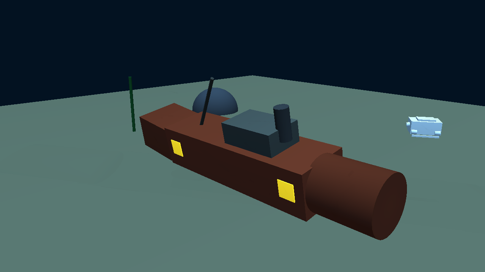
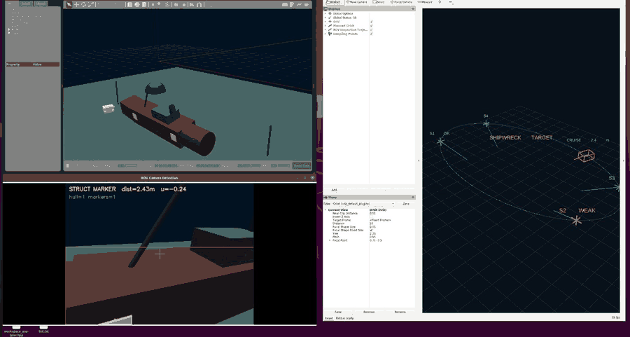
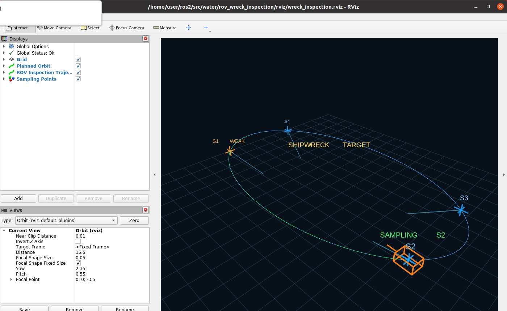

# rov_wreck_inspection

水下 ROV 视觉引导的沉船结构巡检采样仿真（ROS 2 Humble + Gazebo classic 11）。

ROV 沿沉船外侧椭圆航线环绕巡检，机头持续朝向船体；视觉节点用 HSV 颜色分割识别船体侧面的
黄色结构标记板，按单目针孔模型估算距离，并把标记板的像平面偏移量反馈给控制节点修正机头偏航。
到达预设采样点时 ROV 停止运动并悬停，视觉确认标记板位于画面中心且距离在 1.5～6.0 m 内后记为
采样完成；超时未确认则降级记录。RViz 中绘制规划航线、实际轨迹、采样点位与 ROV 本体轮廓。

## 运行环境

- Ubuntu 22.04 + ROS 2 Humble
- Gazebo classic 11.13（`gazebo_ros`、`gazebo_ros_pkgs`）
- Python 3.10，依赖 `rclpy`、`gazebo_msgs`、`opencv-python`、`numpy`、`PyYAML`
- 显卡受限或使用 VMware 虚拟机时，RViz 用软件渲染启动：
  `LIBGL_ALWAYS_SOFTWARE=1 rviz2`

## 编译

```bash
cd ~/ros2
source /opt/ros/humble/setup.bash
colcon build --packages-select rov_wreck_inspection
source install/setup.bash
```

## 运行

```bash
ros2 launch rov_wreck_inspection main.launch.py
```

可选参数：`gui:=false` 关闭 Gazebo 客户端（只保留服务端渲染与 ROS 话题），`rviz:=false` 关闭 RViz。

```bash
# 无 Gazebo 图形界面，仅 RViz 可视化
ros2 launch rov_wreck_inspection main.launch.py gui:=false
```

启动时序：世界加载 → 10 s 后生成 ROV → 14 s 后启动视觉节点与控制节点 → 16 s 后启动 RViz。
世界文件较大，`spawn_entity.py` 已把服务等待超时放宽到 60 s。

## 场景与模型

| 文件 | 说明 |
| --- | --- |
| `world/wreck_inspection.world` | 水下场景：沉船（船体 6.4 × 1.8 × 1.45 m、船首圆柱、甲板室、烟囱、桅杆）、海床、雾、4 块自发光黄色结构标记板、场景相机 `scene_camera` |
| `urdf/rov.urdf` | ROV 机体 0.78 × 0.56 × 0.36 m，前视相机 640×480、水平视场角 1.22 rad |
| `config/inspection.yaml` | 椭圆航线、速度、悬停时间、采样点参数角 |
| `rviz/wreck_inspection.rviz` | RViz 显示配置 |

## 节点与话题

| 节点 | 功能 |
| --- | --- |
| `hull_detector.py` | 订阅 `/rov/camera/image_raw`，HSV 分割船体与黄色标记板，发布检测结果与叠加图 |
| `inspection_controller.py` | 椭圆航线运动学控制、视觉偏航修正、定点采样状态机、轨迹与 MarkerArray 发布 |

| 话题 | 类型 | 说明 |
| --- | --- | --- |
| `/rov/camera/image_raw` | `sensor_msgs/Image` | ROV 前视相机原始图像 |
| `/rov/camera/image_detected` | `sensor_msgs/Image` | 检测叠加图（船体与标记板轮廓） |
| `/rov/hull_detection` | `std_msgs/Float32MultiArray` | 10 元素：`[hull_valid, hull_u, hull_v, hull_ratio, marker_valid, marker_u, marker_v, marker_dist, marker_w, marker_count]` |
| `/inspection/planned_path` | `nav_msgs/Path` | 规划椭圆航线（180 段） |
| `/inspection/trajectory` | `nav_msgs/Path` | 实际巡检轨迹 |
| `/inspection/sample_points` | `visualization_msgs/MarkerArray` | 采样点十字标记、观测视线、文字标签、ROV 轮廓 |
| `/inspection/status` | `std_msgs/String` | 巡检状态与进度 |
| `/inspection/sample_event` | `std_msgs/String` | 每个采样点完成事件 |
| `/rov/odom` | `nav_msgs/Odometry` | ROV 位姿 |
| `/scene/camera/image_raw` | `sensor_msgs/Image` | 第三人称场景相机（用于录制水下效果图） |

TF：`odom → base_link`（控制节点发布），`base_link → camera_link`（`robot_state_publisher`）。

## 关键参数

| 参数 | 默认值 | 说明 |
| --- | --- | --- |
| `wreck_center` | `[0.0, 0.0]` | 沉船中心 |
| `orbit_a` / `orbit_b` | `6.6` / `3.6` | 椭圆半轴（米） |
| `orbit_z` | `-3.6` | 巡检高度（米） |
| `speed` | `0.45` | 环航线速度（米/秒） |
| `hold_time` | `3.5` | 采样点悬停时间（秒） |
| `confirm_time` | `0.6` | 视觉确认所需的连续识别时间（秒） |
| `marker_size` | `0.55` | 标记板边长，用于单目测距 |
| `camera_hfov` | `1.22` | 相机水平视场角（弧度） |
| `sample_points` | S1～S4 | 采样点椭圆参数角，由标记板径向反算 |

单目测距：`f = (w/2) / tan(hfov/2)`，`d = f * W / w`（`W` 为标记板实际边长，
`w = max(bw, bh)` 为检测框长边像素数），并对测距结果做低通滤波。斜视时取长边会使 `w` 偏大、
估计距离偏小，因此结果只作为单目估计值，不是几何真值。

## 实跑结果

同一轮 4 个采样点的**单目估计距离**（不是几何真值）：S1 2.21 m、S2 2.21 m、S3 2.24 m、S4 2.26 m。
S1 的几何真值约 3.0 m（相机前移约 0.4 m 后），估计值系统性偏小约 30%。
`/inspection/status` 输出示例：

```
CRUISE  36.3% | marker dist=2.44m u=+0.01
SAMPLE  41.1% | marker dist=2.24m u=-0.09
```

其中 2.44 m 也是单目估计值，对应几何距离约 2.79 m（偏差约 12%）。偏差量随斜视角度变化，
不是采样噪声，而是 `max(bw, bh)` 取长边与针孔近似在大倾角下的系统误差。



场景相机为 Gazebo 真实渲染输出（锈红色船体、4 块黄色标记板、ROV 本体）。



Gazebo、相机识别窗口与 RViz 同时运行的实际屏幕录制（94 帧，约 28 秒）。



RViz 中蓝色为规划椭圆航线，绿色为实际巡检轨迹，十字标记为 4 个采样点（绿色=视觉确认，
橙色=视觉确认超时降级，蓝色=待检），橙色线框为 ROV 本体与机头指向。

## 已知限制

- ROV 采用运动学位姿控制（`/gazebo/set_entity_state`），未建模推进器与水动力；不是动力学仿真。
- 视觉仅识别单目相机中的黄色标记板，依赖颜色分割与光照，未使用声呐、SLAM 或深度学习。
- 测距为针孔模型近似：斜视时 `max(bw, bh)` 会取到较长边，导致估计距离系统性偏小，
  文档中的距离均为单目估计值而非几何真值。
- 在软件渲染（llvmpipe）下 RViz 对 `SPHERE`/`CUBE` 等网格型 Marker 会触发 Ogre 包围盒断言，
  因此采样点与 ROV 均以 `LINE_LIST` 绘制；`MarkerArray` 与 `Path` 的时间戳置零以避免坐标系
  时间外推问题。
